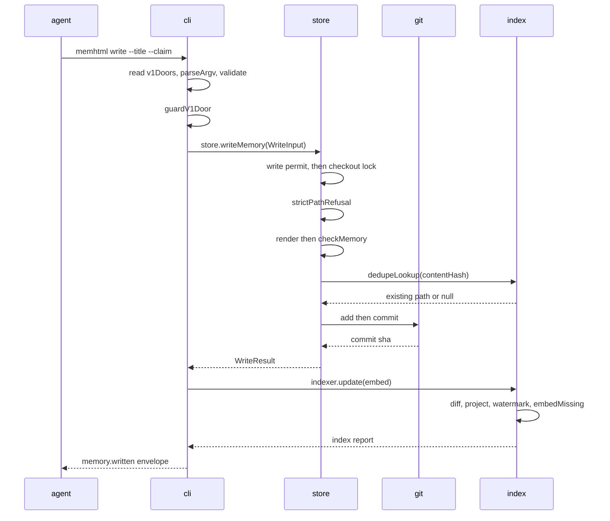
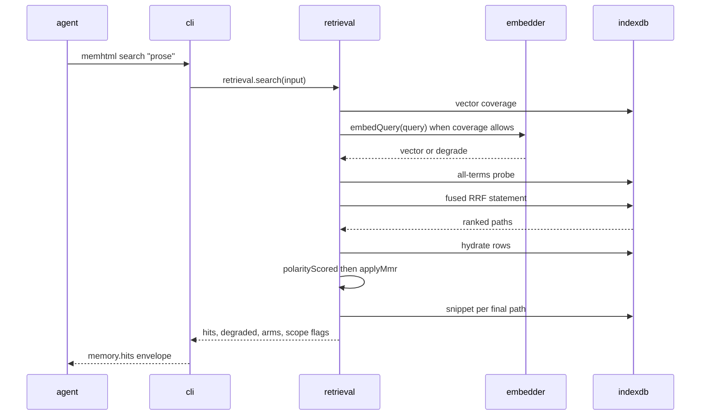
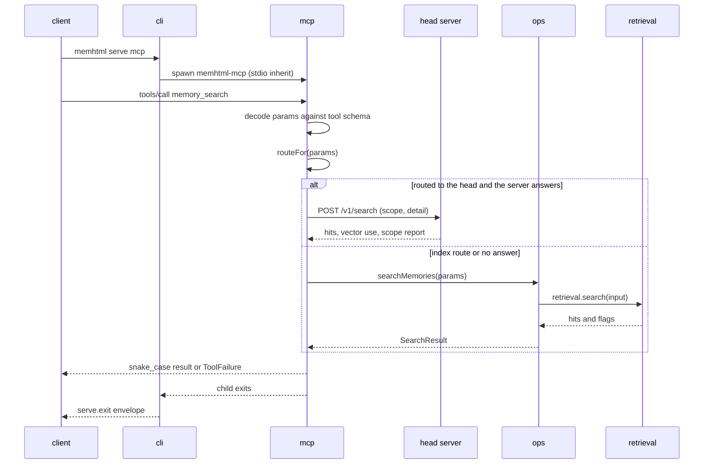
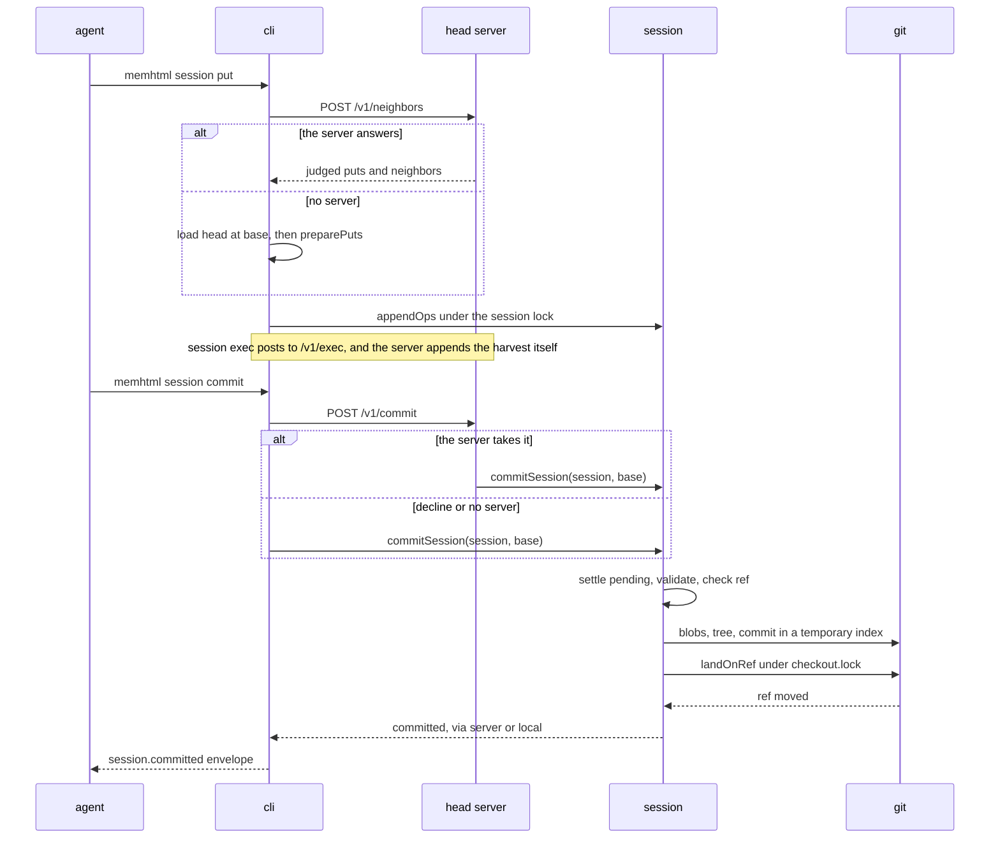
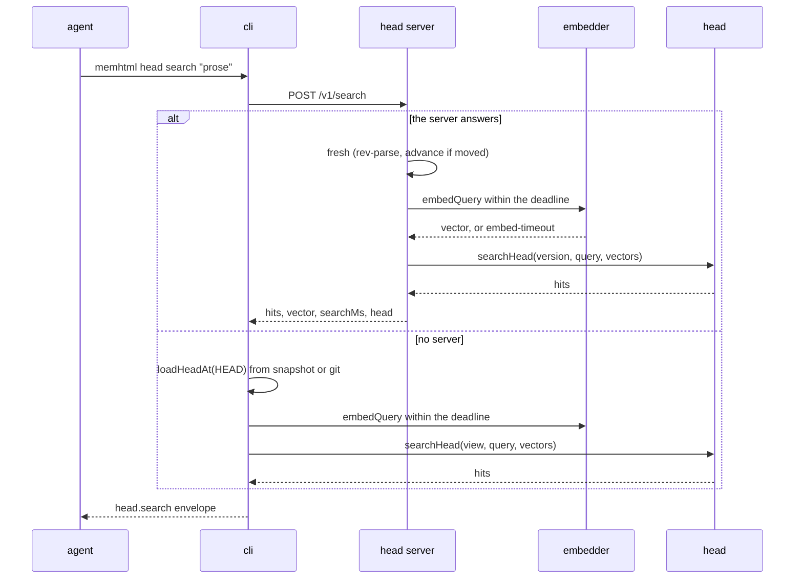

# memhtml-public · Data flow

Describes the source at 0.16.0 (2026-10-18). Citations are `path:line` into that tree.

This repository is the software that manages a separate memory tree, the `memhtml root`, located by `$MEMHTML_ROOT` (`AGENTS.md:688`). No memory lives in this repository.

Every flow below acts on whichever root the process resolves. `--repo` wins over `MEMHTML_ROOT`, so the same binary serves many roots without the caller changing its environment (`apps/cli/src/api-layer.ts:96-109`).

Each flow starts at an external event. Every process here is a CLI invocation of the `memhtml` binary, a tool call arriving on the MCP server's stdio transport, or a request on the head server's Unix socket (`apps/cli/src/bin.ts:5`, `apps/mcp/src/bin.ts:15`, `apps/cli/src/head-protocol.ts:7-10`). The repository has no TCP listener and no queue consumer.

The five flows below are the v1 write, the v1 ranked read, the MCP tool call that reaches either read, the v2 write through a session, and the v2 search on the head. Participant labels follow `architecture/module-map.md`: `cli`, `store`, `index`, `mcp`, `head`, `session`, plus `head server` for the `memhtml head serve` process.

## Flow 1: Write one memory

An agent runs `memhtml write --title … --claim … --type semantic`. The process checks the store's `v1Doors` mode, validates the line, renders the file, and stops with an error if the format check finds a violation. It then checks for a duplicate before anything touches disk, commits under the checkout lock, and brings the index up to the new commit.

1. The binary calls `run(process.argv.slice(2))`, and the returned envelope is the only thing written to stdout `apps/cli/src/bin.ts:5`.
2. The process exits from the write's callback rather than straight after the write, so a slow pipe reader still receives the whole envelope (issue #117) `apps/cli/src/bin.ts:7-22`.
3. `run` parses argv into a command, positionals, and a map of repeatable flag arrays `apps/cli/src/run.ts:1691`. `parseArgv` matches compound command names, reads `-h` as `--help`, and turns `--no-<flag>` into `false` `apps/cli/src/run.ts:187-264`.
4. Help and the bare manifest answer before validation, so neither needs a repo `apps/cli/src/run.ts:1699-1705`.
5. For a record-creating door, `run` reads the store's `v1Doors` mode from `memhtml.config.json` before it validates, whenever it knows the root without a layer. A file that doesn't decode refuses the write at exit 1 `apps/cli/src/run.ts:1707-1723`.
6. `validate` returns a failure that becomes exit 2 before any service is built `apps/cli/src/run.ts:1725-1726`.
7. The checks run in order: flags against this command's own spec, stray boolean values, surplus arguments, the session-bound door, missing arguments, required flags, the claim-or-markup exclusive rule, and every closed vocabulary `apps/cli/src/run.ts:1403-1525`. Under `MEMHTML_SESSION` with the default `closed-in-session` mode, `write` answers `ERR_SESSION_BOUND` here `apps/cli/src/run.ts:1003-1016`. The claim-or-markup rule lives in `claimOrArticle` `apps/cli/src/run.ts:1090-1115`.
8. When `MEMHTML_REFUSE_ENV_ROOT` is set and no `--repo` was given, `envRootRefusal` answers `ERR_REPO_REQUIRED` at exit 2, so nothing is opened `apps/cli/src/run.ts:1944-1945`, `apps/cli/src/run.ts:1295-1308`.
9. `run` provides `layerApp(--repo)`, the one production composition, then the tracer, and routes every log to stderr `apps/cli/src/run.ts:2414-2446`, `apps/cli/src/api-layer.ts:409-419`.
10. Building the layer opens `$MEMHTML_ROOT/.memhtml/index.db` with `state.db` attached on the same connection `apps/cli/src/api-layer.ts:119-129`.
11. The `write` dispatch arm runs `guardV1Door`, then calls `ops.writeMemory` with the decoded flags and names the response type `memory.written` `apps/cli/src/run.ts:364-386`. The guard reads the policy again at the layer's root, which covers the case `run` couldn't read before validating `apps/cli/src/store-config.ts:120-133`.
12. `writeMemory` decodes the parameters into the store's `WriteInput` and calls `store.writeMemory` `apps/cli/src/operations.ts:349-358`.
13. `toWriteInput` decodes the type through the operator vocabulary, which admits `arc` on the CLI write doors while the MCP schemas refuse it (issue #88). It also decodes a task's status and due date before any file is rendered `apps/cli/src/operations.ts:292-341`.
14. The store takes its one in-process write permit and then the cross-process checkout lock `.memhtml/checkout.lock`, so a second process or a session commit on the same checkout waits its turn, up to 15 s `packages/store/src/store.ts:1442-1474`, `packages/contracts/src/checkout-lock.ts:47-54`.
15. The first gate is `strictPathRefusal`, which refuses an unusable explicit path when the caller asked for strict placement `packages/store/src/store.ts:763`, `packages/store/src/store.ts:746-759`.
16. The format check follows. `renderChecked` renders the article and rejects it with `InvalidMemory` on any `checkMemory` violation, before the file is written, staged, or committed `packages/store/src/store.ts:766`, `packages/store/src/store.ts:715-722`.
17. The duplicate check follows the format check. The store hashes the rendered bytes and asks the injected `dedupeLookup`, and an existing active path is returned with `deduped: true` and no commit `packages/store/src/store.ts:767-783`.
18. The lookup is the index recorder's `activePathForHash`, one query for a live, non-archived, non-task row with that content hash `apps/cli/src/api-layer.ts:196`, `packages/index/src/traces-persist.ts:196-203`.
19. The store picks a free path, then writes the file, stages it with `git add`, and makes one commit with provenance trailers, all under a journal that compensates a failure `packages/store/src/store.ts:785-812`. `Git.commit` takes the checkout lock too, and the lock is reentrant within one fiber, so the nested take runs at once `packages/store/src/git.ts:517-536`, `packages/contracts/src/checkout-lock.ts:88-97`.
20. Back in the operation, only a created file triggers `reindex`, because a dedupe changed nothing `apps/cli/src/operations.ts:355`.
21. `reindex` calls `indexer.update({ embed: true })` over the whole commit rather than a list of paths, because a rename is only expressible as a diff and the watermark is what makes freshness answerable `apps/cli/src/operations.ts:253-276`.
22. `update` falls through to a full reprojection when no watermark row exists, and refuses with `IndexStale` when a rebuild died before writing one `packages/index/src/indexer.ts:808-846`.
23. Otherwise `update` diffs the watermark against HEAD, adds uncommitted working-tree changes, and reads every changed blob in two subprocesses `packages/index/src/indexer.ts:854-887`.
24. It applies the projection writes, records the new watermark, and embeds the chunks this pass projected `packages/index/src/indexer.ts:994-1002`.
25. `embedMissing` returns 0 when no document embedder is bound. It embeds in slices, and a failed slice stops the pass while keeping every vector already written, so an embedder outage never fails the write `packages/index/src/indexer.ts:542-610`.
26. The operation records a `wrote` session link when the call carries a session id. A failed link is logged and never costs the caller the memory `apps/cli/src/operations.ts:356`, `apps/cli/src/operations.ts:206-223`.
27. The result becomes a `memory.written` envelope. A typed failure becomes a failure envelope through `failureFor` at exit 1, and a closed door raised inside the layer exits 2 `apps/cli/src/run.ts:2414-2422`, `apps/cli/src/errors.ts:277-279`, `apps/cli/src/envelope.ts:176-180`.

## Flow 2: Ranked retrieval

An agent runs `memhtml search "<prose>"`. This command reads the SQLite index. The process reads vector coverage and embeds the query when coverage and a credential allow it. It then sanitizes the query, folds up to four reciprocal-rank-fusion arms into one SQL statement, hydrates the fused pool, demotes negation-flipped twins, and reorders the pool with MMR for diversity. One more statement fetches the winning snippet per final path.

1. The `search` dispatch arm calls `ops.searchMemories` with the query, the limit, and the shared retrieval scope, then names the response type `memory.hits` `apps/cli/src/run.ts:428-436`. The scope is one helper, so `search` and `recall` can't diverge `apps/cli/src/run.ts:302-313`.
2. `searchMemories` delegates to the retrieval service and records no access bump, so a ranked hit doesn't feed back into salience `apps/cli/src/operations.ts:987-1003`.
3. The retrieval service is built over the query embedder and the configured vector coverage floor `apps/cli/src/api-layer.ts:320-336`.
4. `search` defaults the limit to 10 and asks fusion for three times that many candidates, the pool MMR later chooses from `packages/index/src/retrieval.ts:47`, `packages/index/src/retrieval.ts:53`, `packages/index/src/retrieval.ts:506-516`.
5. `gatedQueryVector` reads vector coverage first. Below the floor (default 0.95) the query is never embedded and the vector arm is dropped on purpose (issue #141) `packages/index/src/retrieval.ts:308-320`, `packages/index/src/vector-coverage.ts:43`.
6. `queryVector` returns `undefined` when no embedder is bound. It also catches an embedder failure, logs it, and returns `undefined`, which becomes `degraded: true` on the response rather than an error `packages/index/src/retrieval.ts:266-280`.
7. `fuse` never MATCHes the caller's prose. `ftsQueryForms` reduces the query to letter and digit runs, keeps a balanced double-quoted span as one phrase, and yields an all-terms form and an any-of form `packages/index/src/fts-query.ts:99-124`.
8. `fuse` binds the all-terms form when some file in scope holds every term, and the any-of form otherwise (issue #143). The probe is one `LIMIT 1` statement, skipped when the two forms are equal `packages/index/src/retrieval.ts:283-296`, `packages/index/src/retrieval.ts:354-358`.
9. `fuse` assembles the RRF statement over the arms that can fire and runs one query for the fused paths `packages/index/src/retrieval.ts:359-375`. The registry holds four arms, lexical, vector, recency, and salience, and an arm leaves the fold when it lacks a query vector, the state plane, or query terms `packages/index/src/retrieval-sql.ts:268-295`.
10. `hydrate` reads the fused paths' rows, entity names, entity references, superseding edge, and first chunk vector in one statement `packages/index/src/retrieval.ts:404-429`.
11. `polarityScored` gives each candidate a score from its fused rank and demotes a negation-flipped twin of a better-agreeing candidate `packages/index/src/retrieval.ts:530-533`, `packages/index/src/polarity.ts:78-82`.
12. `applyMmr` reorders the pool down to the caller's limit with lambda 0.5 `packages/index/src/retrieval.ts:539`, `packages/domain/src/mmr.ts:36-40`, `packages/domain/src/ranking.ts:18`.
13. `snippets` runs over the final paths only, picking each file's chunk nearest the query vector, or its opening chunk when there's none `packages/index/src/retrieval.ts:441-461`, `packages/index/src/retrieval.ts:545-548`.
14. When a named scope left nothing, `scopeEmpty` is true and the same scope is re-run over archived rows to report `archivedMatches` and `archived` (issue #130) `packages/index/src/retrieval.ts:549-558`, `packages/index/src/retrieval.ts:474-498`.
15. The hits go back with `degraded`, `vectorCoverage`, `arms`, `entityScope`, `scopeEmpty`, `archivedMatches`, and `archived` `packages/index/src/retrieval.ts:560-597`.

## Flow 3: MCP tool call

An MCP client runs `memhtml serve mcp`, which spawns the `memhtml-mcp` server as a child process holding the client's own descriptors. A `tools/call` for `memory_search` then asks the head server first and reaches the same operation that `memhtml search` calls when the head gives no answer.

1. `run` handles `serve mcp` before building the app layer, so the supervisor doesn't open the database the child exists to serve `apps/cli/src/run.ts:1947-1979`.
2. The environment-root refusal still runs first, and for `serve mcp` an injected layer doesn't count as naming the root `apps/cli/src/run.ts:1302`, `apps/cli/src/run.ts:1944-1945`.
3. `serveMcp` resolves the server entry point from `MEMHTML_MCP_BIN` or the two shipped layouts `apps/cli/src/serve.ts:56-80`.
4. It spawns the entry point with `stdio: "inherit"` and `MEMHTML_ROOT` set to the resolved root, so the client talks to the child directly and a `--repo` override reaches it `apps/cli/src/serve.ts:82-90`.
5. Interrupting the supervisor kills the child, and the `serve.exit` envelope is written only after the child exits `apps/cli/src/serve.ts:95-110`, `apps/cli/src/run.ts:1969`.
6. The child launches `layerServer()` over the Node stdio transport for the process's lifetime `apps/mcp/src/bin.ts:15`.
7. `layerServer` merges the 15-tool toolkit and the 2 resources over `layerApp(repoOverride)`, the CLI's own composition. It pins protocol `v2025_06_18` and routes every log to stderr, so stdout stays the NDJSON-RPC stream `apps/mcp/src/server.ts:40-63`, `apps/mcp/src/tools.ts:1059-1075`, `apps/mcp/src/resources.ts:323`.
8. The call's arguments are decoded against the tool's own parameter schema, snake_case on the wire `apps/mcp/src/tools.ts:553-583`.
9. A `tools/call` lands on the handler table that `MemhtmlToolkit.toLayer` type-checks against the toolkit's own parameter and success schemas `apps/mcp/src/handlers.ts:361-365`.
10. The `memory_search` handler renames the wire parameters and decodes `facets` with the same parser the CLI uses `apps/mcp/src/handlers.ts:588-603`.
11. It asks the head server through `searchOnHead`, and on a `null` answer calls the same `searchMemories` the CLI arm calls `apps/mcp/src/handlers.ts:604-612`.
12. `routeFor` sends the call to the index when `MEMHTML_MCP_HEAD` is `off`, when it sets `include_archived` or `as_of`, when the query holds a double-quoted phrase, or when it has no term the head's BM25 indexes `apps/cli/src/head-retrieval.ts:64-80`.
13. Otherwise the handler posts one scoped, detailed search to `/v1/search` and waits at most 2 s for the answer `apps/cli/src/head-retrieval.ts:93-118`, `apps/cli/src/head-retrieval.ts:37-42`. Flow 5 shows what the server does with it.
14. A head answer is reshaped into v1's `SearchResult`. Its arms read `fts`, `vector` when the vector arm ran, and `recency`, and there's no salience arm and no MMR on this path `apps/cli/src/head-retrieval.ts:120-165`.
15. With no head answer, retrieval runs the flow 2 chain: coverage gate, query vector, fused RRF statement, hydrate, polarity, MMR, snippets `packages/index/src/retrieval.ts:506-598`.
16. The handler renames the result fields back to snake_case for the wire `apps/mcp/src/handlers.ts:613-636`.
17. Every handler's failures pass through `handled`, which maps them with `toToolFailure` `apps/mcp/src/handlers.ts:82-83`.
18. `toToolFailure` composes the stable code, the reason, and suggestions into the single prose error channel MCP offers. An already composed `ToolFailure` passes through unchanged `apps/mcp/src/failure.ts:207-224`.
19. The failure must be a `ToolFailure` that each tool declares, because `McpServer` rewrites an `AiError` or an undeclared failure to a generic internal-error sentence `apps/mcp/src/handlers.ts:70-77`, `apps/mcp/src/tools.ts:47-56`.

## Flow 4: Write through a session

An agent writes into a session with `memhtml session put` or `memhtml session exec`, then lands the whole log as one commit with `memhtml session commit`. Each of the three steps asks the head server first and runs locally when no server takes the request. Every append takes the session's lock, and every commit runs `commitSession`. See `docs/design.md` §17 and §22.

The session commands resolve the root themselves and never build `layerApp`, because none of them reads `index.db` `apps/cli/src/run.ts:1223-1229`, `apps/cli/src/v2.ts:122-128`. A session is a base sha, a ref, and an op log in `.memhtml/sessions/<id>.json` `packages/session/src/session.ts:13-17`, `packages/session/src/session.ts:38-53`. `session start --id <id>` writes that log at the ref's tip `apps/cli/src/v2.ts:399-424`. Under `MEMHTML_SESSION`, `session put` and `session exec` start the session on first use instead `apps/cli/src/v2.ts:438-482`.

`session put` appends rendered writes and entity edits.

1. `run` reads the op stream (the JSONL `apply` takes, plus `label` and `unlabel` lines) before anything opens, so a bad line is exit 2 with nothing appended `apps/cli/src/run.ts:2126-2134`.
2. `sessionPut` resumes the session and posts its base sha, its ops, and the new lines to `/v1/neighbors`, unless `--no-server` is set or the session is on a curate ref `apps/cli/src/v2.ts:647-685`.
3. The server reads the policy, builds the version at the session's base from the version it holds, and runs `preparePuts` over it with the vector cache it holds `apps/cli/src/head-server.ts:1423-1440`, `apps/cli/src/head-server.ts:995-999`.
4. With no answer, the CLI reads the policy, loads the head at the base from a snapshot or git, and runs the same `preparePuts` over the vector cache file `apps/cli/src/v2.ts:688-706`.
5. `preparePuts` overlays the session's ops on the base, renders each write the way the store would, judges the whole log against the base with `validateOps`, and ranks each put's nearest records with `searchHead` when nothing blocks `apps/cli/src/v2.ts:529-611`.
6. A blocking violation fails the call with `InvalidMemory` and appends nothing. Otherwise `appendOps` writes the log under the session's lock, refusing when another writer changed it meanwhile `apps/cli/src/v2.ts:707-715`, `packages/session/src/session.ts:321-335`.

`session exec` runs a script and appends what it wrote.

1. `run` reads the script from `--script`, `--file`, or stdin, and refuses a blank one or one past the server's request cap, for both paths `apps/cli/src/run.ts:2081-2125`.
2. `sessionExec` posts it to `/v1/exec` with an answer timeout that covers the server's queue waits and the script's own deadline `apps/cli/src/v2.ts:1016-1024`, `apps/cli/src/v2.ts:977-978`.
3. The server reads the policy, resumes the session, builds its base from the held tip or an ancestor, and runs `execOverHead` in a sandbox worker `apps/cli/src/head-server.ts:1084-1134`.
4. With no server, a refusal, or a decline, the CLI runs the same `execOverHead` in process. A request the server took and never answered fails naming `session status`, because the server may have appended the harvest `apps/cli/src/v2.ts:1050-1055`.
5. `execOverHead` overlays the log on the base, runs the script in the just-bash sandbox, judges the log plus the harvest, and appends the harvest only on exit 0 with no blocking violation `apps/cli/src/v2.ts:870-917`.

`session commit` lands the log as one commit.

1. `sessionCommit` reads the policy before it asks the server, so a malformed `memhtml.config.json` fails with `ERR_STORE_CONFIG` on either path `apps/cli/src/v2.ts:1325-1327`.
2. It posts `{ id, message, dropRefused }` to `/v1/commit` and waits for the answer up to `MEMHTML_COMMIT_DEADLINE_MS`, 60000 by default `apps/cli/src/v2.ts:1329-1337`, `apps/cli/src/head-protocol.ts:373-376`.
3. The server runs one commit or rebase at a time and declines `busy` after a 20 s wait `apps/cli/src/head-server.ts:1232-1241`, `apps/cli/src/head-protocol.ts:384`. It reads the policy per request, declines a session on another ref or one whose log doesn't read, builds the version at the session's base, and runs `commitOverHead` `apps/cli/src/head-server.ts:1243-1290`.
4. A served answer comes back with `via: "server"` `apps/cli/src/v2.ts:1338-1347`.
5. A decline, a 4xx, or no server sends the commit to the local path. A 5xx or a lost answer fails with `ERR_STORAGE` and isn't retried locally, because the ref may already have moved `apps/cli/src/v2.ts:1245-1283`, `apps/cli/src/v2.ts:1349-1351`.
6. Locally, the CLI resumes the session, loads the head at its base, and runs the same `commitOverHead` `apps/cli/src/v2.ts:1353-1362`.
7. `commitOverHead` calls `commitSession`, repeats it with the refused ops dropped under `--drop-refused`, and writes the new commit's snapshot on `committed` `apps/cli/src/v2.ts:1091-1202`.
8. `commitSession` holds the session's lock and refuses a log that changed since it was read `packages/session/src/commit.ts:451-458`.
9. It settles a `pending` commit an earlier call left, answering `committed` with `recovered: true` when that commit landed `packages/session/src/commit.ts:465-491`.
10. It validates the ops, answers `refused` on any violation, and answers `rebase-needed` when the ref moved past the base `packages/session/src/commit.ts:493-508`.
11. It marks frame-key contradictions, builds the blobs and the tree in a temporary index under the OS temp directory, and writes the commit object `packages/session/src/commit.ts:510-534`, `packages/session/src/commit.ts:223-247`.
12. It saves `pending` before it touches anything shared `packages/session/src/commit.ts:536-537`.
13. `landOnRef` takes the checkout lock, checks that the ref still names the base, moves the checkout when `HEAD` is the ref, and compare-and-swaps the ref. A lost swap rolls the checkout back `packages/session/src/commit.ts:539-567`, `packages/session/src/commit.ts:284-333`.
14. The log is saved on the new commit with zero ops, and the commit's `Memhtml-Session` trailer records the session id `packages/session/src/commit.ts:569-580`, `packages/session/src/commit.ts:62-80`.
15. On the server path, the server moves the version it holds to the new commit and writes its snapshot before it answers `apps/cli/src/head-server.ts:1198-1230`.

## Flow 5: Search on the head

An agent runs `memhtml head search "<prose>"`. The CLI asks the head server, which answers over the version it holds at its ref's tip. When no server answers, the CLI loads the head itself and runs the same `searchHead`. Either way the ranking is a BM25 lexical arm plus, when a vector cache and an embedder exist, a vector arm, fused by RRF with recency only as an exact-tie break. See `docs/design.md` §16 and §22.

1. `head search` is one of the four v2 commands that bind an embedder, and it builds no app layer `apps/cli/src/run.ts:1231-1241`, `apps/cli/src/run.ts:2271-2278`.
2. `headSearch` posts the query and limit to `/v1/search`, plus `embedDeadlineMs` when `MEMHTML_EMBED_DEADLINE_MS` is set `apps/cli/src/v2.ts:1668-1681`, `apps/cli/src/run.ts:2161-2167`. `--no-server` skips the ask.
3. `askHead` dials `.memhtml/head.sock` and answers `null` for every way of not getting an answer, so a server can make a call faster and never makes it fail `apps/cli/src/head-client.ts:10-25`, `apps/cli/src/head-client.ts:221-229`.
4. The server decodes the body with excess properties refused and calls `fresh`, which reads the ref and advances the held version when the ref moved `apps/cli/src/head-server.ts:1363-1368`, `apps/cli/src/head-server.ts:958-969`.
5. `vectorsForQuery` embeds the query against the held vector cache within the deadline, 450 ms by default. Past it the search answers on the lexical arm with `embed-timeout` `apps/cli/src/head-server.ts:1369-1377`, `apps/cli/src/head-vectors.ts:206-266`, `apps/cli/src/head-protocol.ts:123`.
6. `searchHead` runs over the version, with the request's scope as a predicate when the request named one `apps/cli/src/head-server.ts:1378-1385`, `packages/head/src/search.ts:211-234`.
7. The server answers with the hits, the vector arm's report, the search time, and the head it searched `apps/cli/src/head-server.ts:1406-1414`.
8. The CLI returns the answer with `head.source` set to `server` `apps/cli/src/v2.ts:1682-1692`, `apps/cli/src/v2.ts:201-210`.
9. With no answer, the CLI loads the head at `HEAD` from its snapshot, an ancestor's snapshot advanced, or git, then runs `vectorsForQuery` over the cache file and the same `searchHead` `apps/cli/src/v2.ts:1694-1707`, `apps/cli/src/head-cache.ts:164-211`.

## See also

Counts are the distinct existing non-docs source paths cited in inline backticks on both pages, measured against the tree at cf76951.

- [memhtml-public · Processes](../behavior/processes.md): 36 shared source citations
- [memhtml-public · Impact analysis](../insights/impact-analysis.md): 32 shared source citations
- [memhtml-public · CLI](../reference/cli.md): 31 shared source citations
- [memhtml-public · Module map](../architecture/module-map.md): 29 shared source citations
- [memhtml-public · Sequences](../diagrams/behavioral/sequences.md): 28 shared source citations
- [memhtml-public · Contract map](../insights/contract-map.md): 27 shared source citations
- [memhtml-public · Debugging guide](../insights/debugging-guide.md): 24 shared source citations
- [memhtml-public · RPC tools](../reference/rpc-tools.md): 24 shared source citations
- [memhtml-public · Business logic](../insights/business-logic.md): 23 shared source citations
- [memhtml-public · Tech debt](../insights/tech-debt.md): 22 shared source citations
- [memhtml-public · Dependency graph](../diagrams/structural/dependency-graph.md): 17 shared source citations
- [memhtml-public · System overview](../architecture/system-overview.md): 15 shared source citations
- [memhtml-public · Components](../diagrams/architecture/components.md): 14 shared source citations
- [memhtml-public · Public API](../reference/public-api.md): 13 shared source citations
- [memhtml-public · State machines](../behavior/state-machines.md): 11 shared source citations
