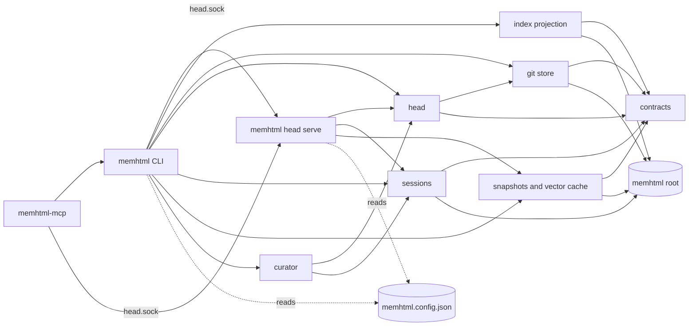

# memhtml-public · System overview

Describes the source at 0.16.0 (2026-10-18). Citations are `path:line` into that tree. A package's file count is its `.ts` files under `src/`, and its LOC is the `wc -l` line count of those files summed, measured in that tree.

## What this repository is

This repository holds the software that manages an agent's long-term memory. It stores no memory of its own. The memory lives in a separate directory called the memhtml root, which is its own git repository. The environment variable `MEMHTML_ROOT` tells every command which root to act on, and it defaults to `~/memhtml` (`apps/cli/src/config.ts:108-112`, `apps/cli/src/config.ts:277-280`, `AGENTS.md:675`). One installed binary serves many roots.

Inside a root, one fact is one semantic HTML5 file, and the root's git tree is the system of record. `.memhtml/index.db` is a SQLite projection of that tree, so it can be deleted and rebuilt without loss (`packages/store/src/layout.ts:24-25`, `packages/index/src/indexer.ts:19`).

A second database, `.memhtml/state.db`, holds the access plane, which git can't reproduce. It exports to a committed sidecar at `.memhtml/state/access.jsonl`, so a fresh clone plus `memhtml state import` plus `memhtml index rebuild` yields the whole system (`packages/store/src/layout.ts:27-31`, `packages/store/src/layout.ts:76-79`).

The v2 parts keep their own state under `.memhtml/` too. A session's log is `.memhtml/sessions/<id>.json`, each commit can have an Arrow snapshot under `.memhtml/snapshots/`, the vector cache lives under `.memhtml/vectors/`, and `.memhtml/head.sock` exists only while a head server runs (`packages/store/src/layout.ts:50-60`, `packages/store/src/layout.ts:79-82`). All four are gitignored, and git still holds every record.

The root also carries one tracked file that isn't a record, the store policy `memhtml.config.json` (`packages/contracts/src/store-config.ts:5-21`). It sets the write bar, the `v1Doors` mode, and the curator's writer buckets and placement quota. A process reads it from the working tree each time a decision needs it, so an edit applies on the next call with no restart. A file that doesn't decode fails the call with `ERR_STORE_CONFIG` (`apps/cli/src/store-config.ts:27-43`). See `docs/design.md` §19 for the write bar and the policy.

The primary caller is a coding agent. The workspace declares two binaries, `memhtml` (`apps/cli/package.json:21-23`) and `memhtml-mcp` (`apps/mcp/package.json:20-22`).

Every CLI call writes one JSON envelope carrying `apiVersion`, a `type` discriminator drawn from the append-only `RESPONSE_TYPES` list, and `data` (`apps/cli/src/envelope.ts:92-96`, `apps/cli/src/envelope.ts:8-12`). There are two exceptions. `memhtml help` on a terminal writes Markdown, and a successful `memhtml hook` writes the host's hook protocol (`apps/cli/src/envelope.ts:51-54`). Two commands run until they're stopped and write their envelope then. `memhtml serve mcp` writes `serve.exit` after its child exits, and `memhtml head serve` writes `head.served` after a signal stops it (`apps/cli/src/run.ts:1946-1955`, `apps/cli/src/run.ts:2269-2282`).

Failures carry a stable `code` from the append-only `ERROR_CODES` list plus `suggestions`, so an agent branches on the code instead of the prose (`apps/cli/src/envelope.ts:98-110`). Exit codes are fixed at 0 for success, 2 for usage, and 1 for runtime (`apps/cli/src/envelope.ts:165-168`).

`memhtml manifest` returns the whole command surface without building the app layer, so it answers on a machine with no root, no database, and no credentials (`apps/cli/src/run.ts:1714-1729`). At 0.16.0 it lists 57 commands, the 53 response types they answer, 25 error codes, and 25 environment variables (`buildManifest` at `apps/cli/src/commands.ts:1995-2023`). `--dense` drops nulls and indentation to save context tokens (`apps/cli/src/envelope.ts:218-235`).

`AGENTS.md` is generated from the same `COMMANDS` array that drives argument parsing, so the doc stays in step with the binary (`apps/cli/src/agents-doc.ts:11-16`).

The MCP server exposes 15 tools and 2 resources over stdio (`apps/mcp/src/tools.ts:1041-1057`, `apps/mcp/src/resources.ts:323`, `apps/mcp/src/server.ts:40-63`). Curation is deliberately absent from it, because a curation run produces a branch a human is expected to read (`apps/mcp/src/index.ts:4-5`). `memory_search` and `memory_recall` ask the head server first and fall back to the SQLite index. The three tools that create a record obey the store's `v1Doors` mode (`apps/mcp/src/handlers.ts:322-328`, `apps/mcp/src/handlers.ts:573-581`).

## How the pieces fit

The repository is a pnpm workspace over `apps/*`, `packages/*`, and `tests-integration` (`pnpm-workspace.yaml:1-4`). That's fourteen libraries, three apps, and one integration harness. The apps are `apps/cli`, `apps/mcp`, and `apps/docs`. `apps/docs` is the documentation site, and this page leaves it out. TypeScript project references keep the layering strict (`apps/cli/tsconfig.json:10-53`).

`@memhtml/contracts` sits at the bottom with schemas, closed vocabularies, error types, path algebra, the store policy schema, and the checkout lock's constants. It depends on nothing but `effect` (`packages/contracts/package.json:60-62`, 10 files, 1376 LOC).

`@memhtml/telemetry` also depends only on `effect`. It's the opt-in OTLP trace exporter, switched on by `OTEL_EXPORTER_OTLP_ENDPOINT` (`packages/telemetry/src/index.ts:4-5`, 1 file, 129 LOC).

`@memhtml/domain` adds pure ranking and retention math on top of the contracts (`packages/domain/package.json:5`, 12 files, 1836 LOC). `@memhtml/html` parses, serializes, and hashes the memory file format (`packages/html/package.json:5`, 13 files, 2704 LOC).

`@memhtml/store` is the git-backed file store behind the v1 write doors, and every change it makes is one commit (`packages/store/src/index.ts:2-3`, 7 files, 2943 LOC). `@memhtml/index` owns the SQLite projection and its four-arm retrieval (`packages/index/package.json:5`, 19 files, 5296 LOC). `@memhtml/traces` reads Claude Code transcripts, `@memhtml/llm` reaches Bedrock, `@memhtml/integrations` wires a coding agent to a store, and `@memhtml/eval` owns the refusable discrimination gate.

Four libraries carry v2, which treats the corpus as a value (`docs/design.md` §15). `@memhtml/head` holds the parsed corpus as one immutable version per commit in `effect` structures, with its indexes, `searchHead`, and the head gate (`packages/head/src/index.ts:1-6`, 9 files, 1473 LOC). `@memhtml/session` holds a session's overlay log and the commit path that lands it on a ref through a temporary git index (`packages/session/src/index.ts:1-4`, 10 files, 2440 LOC). `@memhtml/snapshot` writes and reads the Arrow snapshot of a commit and the vector cache (`packages/snapshot/src/index.ts:1`, 5 files, 981 LOC). `@memhtml/curator` holds the bounded model-driven curator loop, its charters and budget, and the deterministic collapse planner (`packages/curator/src/index.ts:1-6`, 17 files, 3307 LOC).

`@memhtml/cli` is the one composition root. It depends on every library (`apps/cli/package.json:38-59`, 44 files, 22561 LOC), and `@memhtml/mcp` depends on the CLI and reuses its operations (`apps/mcp/package.json:44`, 7 files, 2674 LOC). The v1 commands run over `layerApp` (`apps/cli/src/api-layer.ts:402-419`), the Effect layer that opens `index.db` through `layerDatabase` (`apps/cli/src/api-layer.ts:111-129`). The `session`, `head`, and `curate` commands resolve the root themselves and never build that layer, because none of them reads `index.db` (`apps/cli/src/v2.ts:122-128`, `apps/cli/src/run.ts:1209-1215`).

`memhtml head serve` is a long-running process that holds the head loaded at its ref's tip and follows the ref (`apps/cli/src/head-server.ts:96-117`). It answers JSON over HTTP on the Unix socket `.memhtml/head.sock`, or a named pipe on win32, on seven routes (`apps/cli/src/head-protocol.ts:7-29`). `head status`, `head search`, `session put`, `session exec`, `session commit`, and `session rebase` ask the server first. When no server answers, they load the head locally, from a snapshot when one exists and from git otherwise (`apps/cli/src/v2.ts:130-141`). See `docs/design.md` §22 for the server's lifecycle and protocol.

## Module map

The diagram shows the main dependency edges and the two callers of the head server's socket. A dotted edge is a runtime read rather than an import.

`memhtml head serve` is a command of `@memhtml/cli` (`apps/cli/src/head-server.ts:1626-1655`), drawn apart because it runs as its own process. The two `head.sock` edges are the CLI's client (`askHeadFor` at `apps/cli/src/head-client.ts:147-219`) and the MCP server's head-first search and recall (`apps/cli/src/head-retrieval.ts:19-33`). The policy file sits at the root, and the CLI, the head server, and the MCP server's record tools each read it per decision (`apps/cli/src/store-config.ts:27-36`).

## Stack

| Layer         | Technology                                                                                       | Source                                                                        |
| ------------- | ------------------------------------------------------------------------------------------------ | ----------------------------------------------------------------------------- |
| Language      | TypeScript 7.0.2 (`apps/docs` pins 6.0.3)                                                        | `package.json:38`, `apps/docs/package.json:51`                                |
| Runtime       | Node.js >= 24, pinned to 24                                                                      | `package.json:7-9`, `mise.toml:37`                                            |
| Framework     | Effect 4.0.3, one catalog set of four packages                                                   | `pnpm-workspace.yaml:92-96`                                                   |
| Storage       | `node:sqlite` `DatabaseSync` over 12 SQL migrations plus 2 state-plane migrations                | `packages/index/src/database.ts:4`, `packages/index/src/schema-const.ts:9-16` |
| Storage       | git as the system of record for the root                                                         | `packages/index/src/indexer.ts:19`                                            |
| Snapshots     | apache-arrow 21.2.0, one Arrow IPC file per commit and one vector cache per model                | `packages/snapshot/package.json:27`, `packages/snapshot/src/snapshot.ts:2`    |
| Locks         | proper-lockfile 4.1.2 for the checkout lock and the session lock                                 | `packages/store/package.json:40`, `packages/session/package.json:30`          |
| Atomic writes | write-file-atomic 8.0.0 for session logs, snapshots, and vector caches                           | `packages/session/package.json:31`, `packages/snapshot/package.json:29`       |
| HTML parsing  | parse5 8.0.1                                                                                     | `packages/html/package.json:36`                                               |
| Embeddings    | AWS Bedrock SDK 3.1150.0, `cohere.embed-v4:0` at 1024 dims                                       | `packages/llm/package.json:33`, `packages/llm/src/constants.ts:7-8`           |
| Curator model | AI SDK `ai` 7.0.138 with `@ai-sdk/amazon-bedrock` 5.0.114 and `@ai-sdk/openai-compatible` 3.0.68 | `packages/curator/package.json:28-38`                                         |
| Collapse plan | graphology 0.26.0, graphology-communities-louvain 2.0.2, graphology-metrics 2.4.2                | `packages/curator/package.json:40-42`                                         |
| Sandbox       | just-bash 3.4.2 for `exec` and `session exec`                                                    | `apps/cli/package.json:56`                                                    |
| Head server   | `@effect/platform-node` 4.0.3, HTTP over the store's Unix socket                                 | `pnpm-workspace.yaml:94`, `apps/cli/src/head-client.ts:30-33`                 |
| Tracing       | Effect's own `OtlpTracer`, opt-in                                                                | `packages/telemetry/src/index.ts:14-18`                                       |
| Build tooling | turbo 2.11.7, pnpm 11.21.0, biome 2.5.15, tsdown 0.23.1                                          | `package.json:6`, `package.json:33-38`                                        |
| Test tooling  | vitest 5.0.4, `@effect/vitest`, fast-check 4.10.2                                                | `apps/cli/package.json:60-67`, `pnpm-workspace.yaml:96-97`                    |
| Docs site     | astro ^7.3.8, `@astrojs/starlight` ^0.42.6                                                       | `apps/docs/package.json:20`, `apps/docs/package.json:25`                      |

## See also

Counts are the distinct existing non-docs source paths cited in inline backticks on both pages, measured against the tree at cf76951.

- [memhtml-public · Module map](../architecture/module-map.md): 36 shared source citations
- [memhtml-public · Dependency graph](../diagrams/structural/dependency-graph.md): 32 shared source citations
- [memhtml-public · Contract map](../insights/contract-map.md): 24 shared source citations
- [memhtml-public · Impact analysis](../insights/impact-analysis.md): 23 shared source citations
- [memhtml-public · CLI](../reference/cli.md): 22 shared source citations
- [memhtml-public · Tech debt](../insights/tech-debt.md): 22 shared source citations
- [memhtml-public · Debugging guide](../insights/debugging-guide.md): 21 shared source citations
- [memhtml-public · Processes](../behavior/processes.md): 19 shared source citations
- [memhtml-public · Business logic](../insights/business-logic.md): 17 shared source citations
- [memhtml-public · RPC tools](../reference/rpc-tools.md): 16 shared source citations
- [memhtml-public · Data flow](../architecture/data-flow.md): 15 shared source citations
- [memhtml-public · Public API](../reference/public-api.md): 15 shared source citations
- [memhtml-public · Sequences](../diagrams/behavioral/sequences.md): 10 shared source citations
- [memhtml-public · Components](../diagrams/architecture/components.md): 9 shared source citations
- [memhtml-public · State machines](../behavior/state-machines.md): 6 shared source citations
