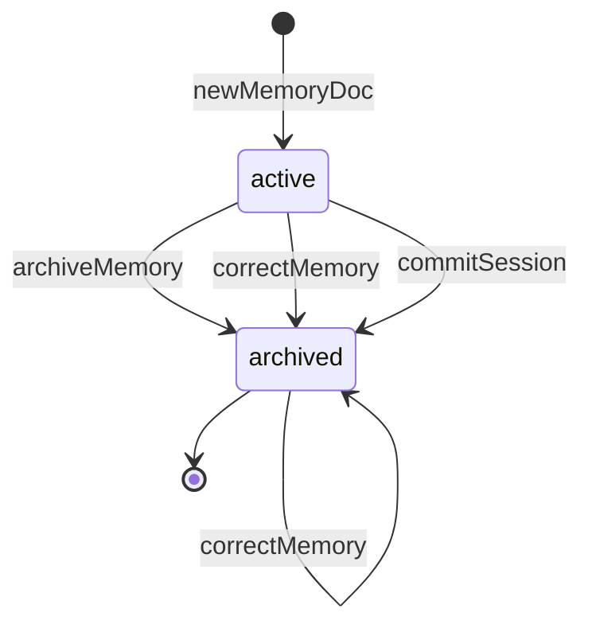
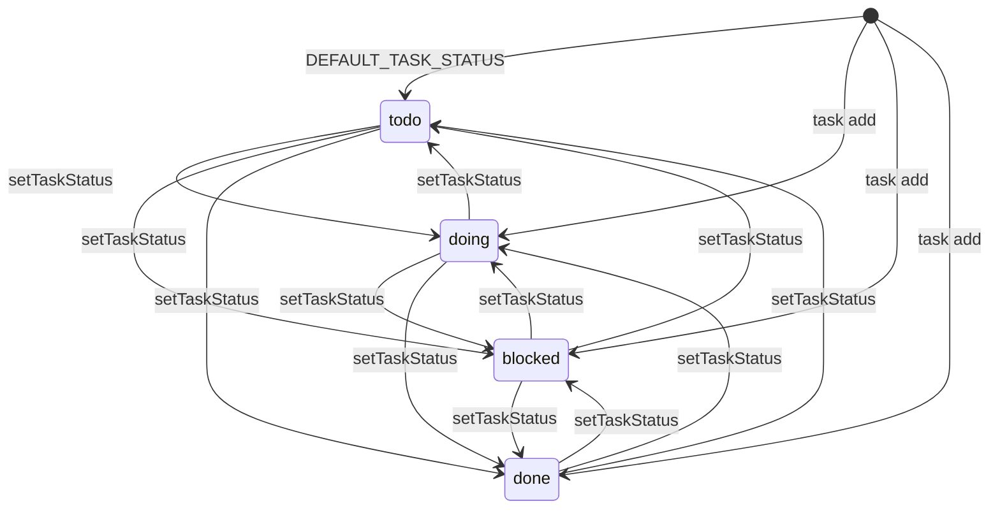
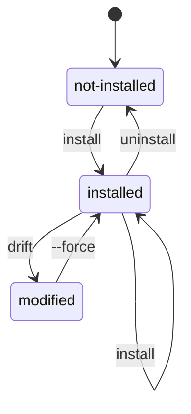
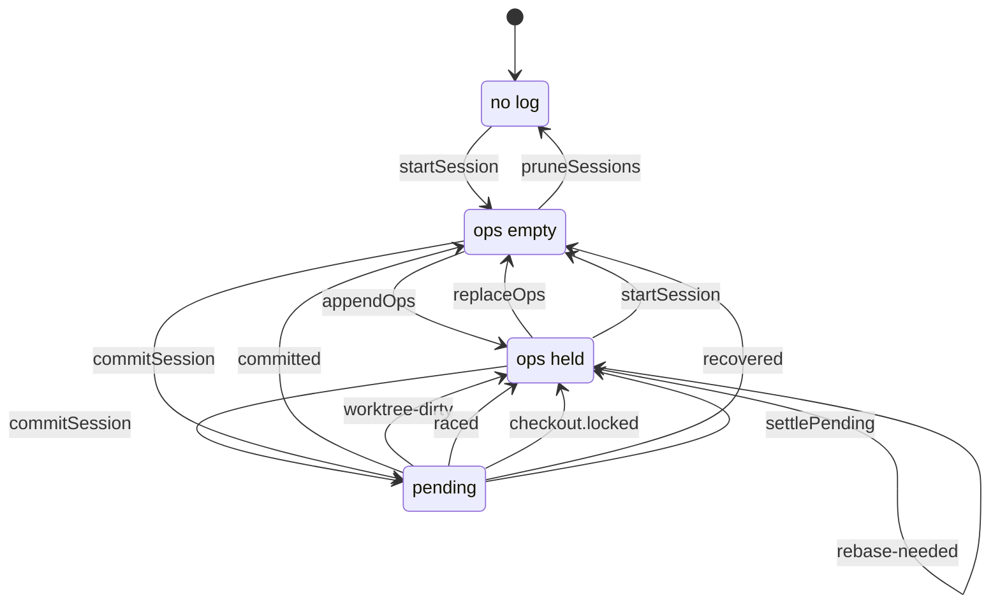
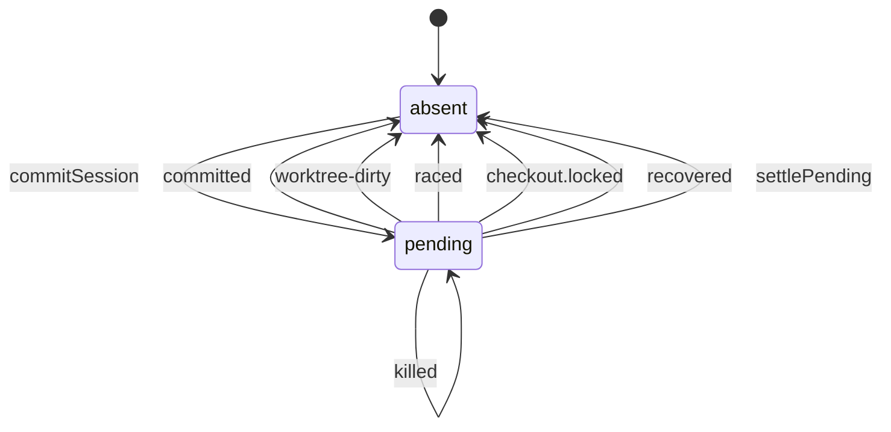
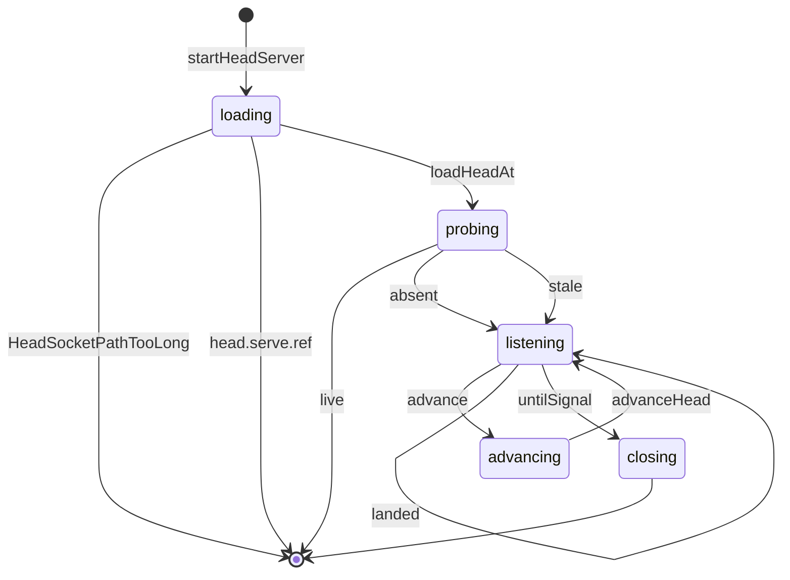
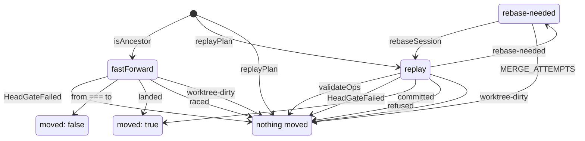

# memhtml-public · State machines

Describes the source at 0.16.0 (2026-10-18). Citations are `path:line` into that tree.

Seven state machines drive the durable state an agent can observe. Three of them come from v1. `MemoryStatus` and `TaskStatus` live on memory files in the `memhtml root`, the directory `$MEMHTML_ROOT` points at, and are stamped as `<meta>` values in the file's own HTML. `InstallState` is derived from a receipt file per host and scope, and tracks one host integration. Four more come from v2. The session log and its `pending` commit live in one file per session under `.memhtml/sessions/` in the root. The head server lifecycle is one long-running process per store. The `curate merge` landing decides how a curate branch reaches its target.

**Removed in 0.16.** The `sleep_runs` status machine and the sleep cycle's detected-task mint and closures went away with `@memhtml/sleep`. Curation runs on a `curate/` branch through the curation door instead (see `docs/design.md` §23). Migration `0006_sleep.sql` still creates the `sleep_runs` table, and nothing writes it (`packages/index/migrations/0006_sleep.sql:6-16`). Detected tasks a store already holds are ordinary tasks, and `memhtml task list --detected` still finds them by their `det-` path (`apps/cli/src/operations.ts:2194-2197`). The [migration guide](https://memhtml.github.io/learn/operations/migrate-to-0-16/) covers the upgrade.

Every transition label below appears verbatim in the cited source, and so does every v1 state name. No type names the states of the four v2 machines, so each of those sections says what its state names stand for. A state drawn reaching `[*]` is one that source never moves to a different state. Where a diagram leaves out an edge that source allows, the prose beside it names the edge.

## MemoryStatus

`MemoryStatus` has two states and moves in one direction. Every archive, correction, and publish path switches on it. Each transition moves the file under `archive/`, because the archive path itself records the state. So `git log --follow` reads through the move, and `diff -M` reports it as a rename (`packages/contracts/src/types.ts:58-70`).

The path is also what the index trusts. `projectFile` sets `archived` when the path's PARA bucket is `archive`, and it ignores `memhtml-status`, so a file whose head says `active` while it sits under `archive/` is indexed as archived (`packages/index/src/project.ts:133-151`). The head reads the path the same way. `recordFrom` sets a record's `archived` from `isArchivedPath`, and the overlay's `archive` op marks the moved record archived (`packages/head/src/record.ts:30-31`, `packages/head/src/record.ts:60`, `packages/head/src/overlay.ts:39-44`).

An agent doesn't choose `active` through a v1 door or a `session put` write line. `newMemoryDoc` hardcodes it on every fresh memory document (`packages/html/src/template.ts:152-160`), and its one caller is `renderTemplate` (`packages/html/src/template.ts:204-210`). Three call sites in package and app source render a new file through `renderTemplate`. The store's `renderFor` is one, and `renderChecked` runs it for every write and every correction (`packages/store/src/store.ts:657`, `packages/store/src/store.ts:676-683`). `preparePuts` renders each `session put` write line (`apps/cli/src/v2.ts:546-550`). The curator's scripted `--model fake` renders the canonical record it writes for a collapse briefing (`fakeCanonicalHtml`, `packages/curator/src/fake-model.ts:238-246`).

Two v2 writers hand a commit a whole file instead. `session exec` turns a new file a script writes into a `put` of the script's bytes, unless the file pairs as an archive twin or a move destination (`harvestOps`, `apps/cli/src/session-exec.ts:328-379`), and a `put` the curator's model proposes carries the whole memory file in `html` (`ProposedOp`, `packages/curator/src/tools.ts:100-105`). `validateOps` judges such a file's format, and the parser accepts either status value, so the file's writer authors its `memhtml-status` (`packages/session/src/validate.ts:264-272`, `packages/html/src/parse.ts:99-114`).

Three functions an agent can reach move a file to `archived`. Each one stamps `memhtml-status` as `archived` and stamps `memhtml-archived` on the moved file, and the two v1 functions stamp `memhtml-updated` too.

- `archiveMemory` is a plain eviction, and the store commits it (`packages/store/src/store.ts:1146-1172`). An agent reaches it through the `memory_archive` MCP tool and the `memhtml archive` command (`MemoryArchive`, `apps/mcp/src/tools.ts:877-890`, `archive`, `apps/cli/src/commands.ts:516-522`). `setTaskStatus` also calls `store.archiveMemory` for a task's `done` (`apps/cli/src/operations.ts:2049`).
- `correctMemory` archives the target a correction supersedes through `stageArchive`, in the same commit as the new file (`packages/store/src/store.ts:1114-1134`). An agent reaches it through `memory_correct` and `memhtml correct`, two record-creating doors that the store's `v1Doors` policy can close (`apps/mcp/src/handlers.ts:655-668`, `apps/cli/src/run.ts:448-462`).
- `commitSession` applies each `archive` op in a session's log, inside the session's own commit (`packages/session/src/commit.ts:399-450`). Its `stage` fold removes the source and writes the destination through `archiveBody`, which splices the two stamps into the head with `setMeta`, so the article bytes and the content hash don't change (`packages/session/src/commit.ts:90-95`, `packages/session/src/commit.ts:121-129`). `validateOps` takes an archive only from a record that's active in the head or put earlier in the batch, and only to `archive/<YYYY>/<original path>`. A destination that an earlier archive of the same path already holds is overwritten, and the older copy's bytes stay in git history (`packages/session/src/validate.ts:291-309`). Archive ops come from three writers. `session exec` pairs a file the script moved to its `archive/<YYYY>/` twin into one (`apps/cli/src/session-exec.ts:398-454`), the curator's model proposes them in `curate run` (`toOverlayOps`, `packages/curator/src/tools.ts:164-196`), and `curate collapse` archives the members of an archive cluster or a fold (`apps/cli/src/curate-collapse.ts:445-458`, `apps/cli/src/curate-collapse.ts:549-556`). The curator commits on a `curate/` branch, so its moves reach `main` only through `curate merge` (`apps/cli/src/v2.ts:1607-1619`).

`StoreShape` also carries `supersedeMemories`, which archives the loser of each winner and loser pair in one commit. No source outside the store's own tests calls it, so the diagram leaves it out (`packages/store/src/store.ts:291-293`, `packages/store/src/store.ts:1174-1261`).

A `move` op never changes the status. `stage` writes the source's bytes unchanged at the new live path, and `validateOps` refuses a destination under `archive/` (`packages/session/src/commit.ts:160-169`, `packages/session/src/validate.ts:414-417`). `withRepoints` completes a batch of moves with the `unlink` and `link` pairs that repoint each live edge to the old path. It leaves alone a holder the batch archives, whose archived copy keeps the edge as history (`packages/session/src/moves.ts:3-20`).

`archived` is terminal for the status. No source file writes `active` onto an existing memory. The two non-test writes of that literal are the creation default (`newMemoryDoc`, `packages/html/src/template.ts:152-159`) and the eval package's generated fixture corpus (`packages/eval/src/fixture.ts:64`). The parse-side validator rejects any third value (`packages/html/src/parse.ts:99-114`). A v2 `put` can still replace an archived file's bytes. `validateOps` refuses a put over an active path, and its duplicate check reads only active records, so a put at an archived record's path lands with whatever `memhtml-status` the writer's file carries (`packages/session/src/validate.ts:169-179`, `packages/session/src/validate.ts:273-279`). The path still says archived, and both the index and the head trust the path.

The file can still move again through a v1 door. Neither `archiveMemory` nor `correctMemory` refuses a path that's already under `archive/`. `archivePathFor` prefixes `archive/<YYYY>/` to whatever path it's given, and `originalPathFor` strips exactly one prefix, so a twice-archived path unwraps one layer (`packages/contracts/src/paths.ts:209-229`, `packages/contracts/tests/paths.test.ts:112-117`). So `archiveMemory` or `correctMemory` on an archived file moves it to a nested archive path, and the status stays `archived`. A session's `archive` op refuses that source, because `validateOps` takes an archive only from an active record (`packages/session/src/validate.ts:291-298`). An archived memory is still readable at its archive path, because `readMemory` resolves any path in the tree without consulting status (`packages/store/src/store.ts:1037-1043`).

Both v1 functions read every path they'll move through `readRaw` before they stage anything, so a missing path fails with the tree byte-identical (`correctMemory`, `packages/store/src/store.ts:1045-1059`, `archiveMemory`, `packages/store/src/store.ts:1146-1153`). The move, the stamps, and the commit then run under a journal. A failure or an interruption, including a caller that drops an MCP call, puts every touched path back, and the compensation runs uninterruptibly (`makeJournal`, `compensated`, `packages/store/src/store.ts:490-577`). A compensation that can't finish is logged, and the call still fails with the original error. The dirty tree it leaves shows up in `memhtml status` as `dirtyPaths` and in `memhtml doctor` as `dirty` (`packages/store/src/store.ts:560-563`, `apps/cli/src/operations.ts:2533-2537`, `apps/cli/src/doctor.ts:576`). A session commit needs no journal. `validateOps` refuses before anything is written, the new tree is built in a temporary index, and `landOnRef` moves the checkout and the ref as one uninterruptible section under the checkout lock, rolling the checkout back when the compare-and-swap loses (`landOnRef`, `packages/session/src/commit.ts:267-333`).

`StoreShape.exclusive` runs each store write as the store's one writer (`packages/store/src/store.ts:229-238`). It takes `oneWriterAtATime`, an in-process permit, and then the checkout lock, the directory `.memhtml/checkout.lock` that every writer of the shared git index holds (`packages/store/src/store.ts:1397-1439`, `packages/store/src/checkout-lock.ts:14-19`). So two processes sharing a root take turns, and so do a store write and a session commit in any process. A writer that can't take the lock within 15 s fails with `StorageFailure` `checkout.locked` before it stages anything, and a lock a killed holder left goes stale after 10 s and is reclaimed (`packages/contracts/src/checkout-lock.ts:37-63`). `Git.commit` takes the same lock again, reentrantly, so a caller that stages through `store.git` without `exclusive` is still excluded at the commit (`packages/store/src/git.ts:98-105`, `packages/store/src/git.ts:403-422`). A git process outside memhtml takes no checkout lock, so git's own index lock can still refuse a store write, and the journal then puts the tree back. Once the store has committed, the CLI and MCP doors run `reindex`, and a failure there fails the call although the move is already in git (`archiveMemory`, `apps/cli/src/operations.ts:1112-1120`). The index then describes the earlier commit until the next successful `update` (`reindex`, `apps/cli/src/operations.ts:248-271`).

Defined at: `packages/contracts/src/types.ts:69`

## TaskStatus

`TaskStatus` has four states. It's a second axis, carried in `memhtml-task-status` and separate from `MemoryStatus`. `MemoryStatus` stays `active | archived` for every memory type, including `task` (`packages/contracts/src/types.ts:72-85`). The vocabulary is closed in three places. They're `TASK_STATUSES`, the parser's refusal of any other value, and a SQL `CHECK` on `files.task_status` (`TASK_STATUSES`, `packages/contracts/src/types.ts:82`, `taskViolations`, `packages/html/src/parse.ts:226-246`, `packages/index/migrations/0008_tasks.sql:70-72`).

A task enters at `todo` by default. `DEFAULT_TASK_STATUS` is `"todo"`, and `newMemoryDoc` applies it only when the memory type is `task`, leaving the meta absent on every other type (`packages/html/src/template.ts:71-78`, `packages/html/src/template.ts:172-179`). So a task written through `memhtml write` or `memory_write` opens at `todo`, because neither carries a status. The tool's `writeFields` has no status field, and the `write` arm calls `writeMemory` without one (`apps/mcp/src/tools.ts:305-338`, `apps/cli/src/run.ts:364-386`).

A caller may name another opening state. `memhtml task add --status` takes any of the four. So does the `status` field of a `memhtml apply` line, and so does a `session put` write line, which `session put` decodes exactly as `apply` does (`apps/cli/src/commands.ts:647-653`, `SCALAR_FIELDS`, `apps/cli/src/apply.ts:37-51`, `apps/cli/src/apply.ts:333-339`). `decodeTaskStatus` narrows each one before any file is rendered (`toWriteInput`, `apps/cli/src/operations.ts:299-308`). A raw `put` from `session exec` or the curator carries whatever `memhtml-task-status` its file names, and the format check holds a task to the four values (`packages/session/src/validate.ts:264-272`). A task opened as `done` stays at its live path, because only `setTaskStatus` pairs `done` with the archive move.

`setTaskStatus` is the one transition function an agent can call (`apps/cli/src/operations.ts:1976-2059`). An agent reaches it through `memhtml task status`, and no MCP tool moves a task's status (`apps/cli/src/run.ts:572-580`). It applies no from-state guard. `decodeTaskStatus` narrows the target status against the closed vocabulary (`apps/cli/src/operations.ts:149-157`), and two more cases stop it early. A non-task memory type is rejected with `InvalidMemory` (`apps/cli/src/operations.ts:1985-1992`). A no-op, where the file already carries the requested status, writes nothing, commits nothing, and reports `unchanged` (`apps/cli/src/operations.ts:1994-2007`). Because there's no from-state guard, every one of the 12 ordered pairs of distinct states is a legal transition, all through the same event.

On success, `setTaskStatus` never leaves `done` at rest, and reaching it drives the other machine. `setTaskStatus` branches on `status !== "done"` (`apps/cli/src/operations.ts:2020`) and otherwise calls `store.archiveMemory` (`apps/cli/src/operations.ts:2049`), so finishing a task stamps `done` and moves the file under `archive/<YYYY>/` in one commit. The design comment gives the reason for reusing the archive move instead of adding a state. A fifth `memhtml-status` value would change the meaning of every archive, correction, and publish path that switches on `active | archived` (`setTaskStatus`, `apps/cli/src/operations.ts:1966-1976`, `TaskStatus`, `packages/contracts/src/types.ts:76-84`).

`setTaskStatus` writes the file and commits outside the store's journal, through `attemptIo` and `store.git` directly. For `todo`, `doing`, and `blocked`, it runs the write, the `git add`, and the commit inside `store.exclusive`, so it holds the checkout lock across all three (`apps/cli/src/operations.ts:2014-2029`). A lock that doesn't come free within 15 s fails the command before anything is written. A failed `git add` or commit, such as git's own index lock held by another git process, leaves the stamped bytes in the working tree with nothing committed, and nothing puts them back. `memhtml status` and `memhtml doctor` report that path until someone clears it (`apps/cli/src/operations.ts:2533-2537`, `apps/cli/src/doctor.ts:576`). When the `git add` went through, the stamp stays staged, and the next store write's commit carries it, because `Git.commit` commits the whole shared index (`packages/store/src/git.ts:98-105`). A session commit that writes that path while `HEAD` is the session's ref answers `worktree-dirty` (`packages/session/src/commit.ts:49-57`, `packages/session/src/commit.ts:308-311`).

For `done`, the stamp reaches disk before any lock is taken, and `store.archiveMemory` takes the lock after it (`apps/cli/src/operations.ts:2040-2049`, `packages/store/src/store.ts:1433`). The archive's `journal.note` records the bytes it reads, which already carry the stamp (`archiveMemory`, `packages/store/src/store.ts:1146-1160`). A failed archive therefore puts the file back at its live path with `done` written to disk and uncommitted, and a lock wait that runs out leaves the same state. On every path, a `reindex` failure after the commit fails the command with the commit in place.

The diagram draws no `--> [*]` because source never stops a task moving. `setTaskStatus` reads the file through `store.readMemory`, which resolves any path in the tree (`packages/store/src/store.ts:1037-1043`, `apps/cli/src/operations.ts:1985`), so a `done` task at its archive path can be moved back to `todo`, `doing`, or `blocked`. That reverse move restamps `memhtml-task-status` without moving the file back out of `archive/`, so the two axes disagree afterward. An agent reading the working set with `memhtml task list` won't see the row, because that query filters `f.archived = 0` unless `--include-archived` is passed (`listTasks`, `apps/cli/src/operations.ts:2148-2155`), and `projectFile` sets `archived` from the path (`packages/index/src/project.ts:136-151`). Moving that task to `done` again archives it a second time, under a nested archive path.

Three other paths leave the axes apart. `memhtml archive` and `memory_archive` on a task move it under `archive/` with its task status unchanged, because `archiveMemory` hands `stageArchive` only the three archive metas (`packages/store/src/store.ts:1161-1165`). A correction of a task archives the old file the same way, with its task status unchanged. It also writes a new task file that opens at `todo` whatever the target carried, because `correctMemory` passes no task status to the template (`apps/cli/src/operations.ts:1062-1083`). A session's `archive` op stamps only `memhtml-status` and `memhtml-archived`, so a task that a session or the curator archives keeps its task status too (`packages/session/src/commit.ts:90-95`).

A session never moves an existing task's status. `validateOps` refuses a put over an active path, and the content hash covers only the article's text, so a put that restamps a task answers `duplicate` at any path (`packages/session/src/validate.ts:273-279`, `apps/cli/src/session-exec.ts:236-245`). `session exec` rejects a head edit that changes any meta other than an entity (`apps/cli/src/session-exec.ts:246-278`), and a `move` carries the bytes unchanged (`packages/session/src/commit.ts:160-169`).

The session-start hook counts only `todo` and `doing` as open, so a `blocked` task is left out of the tasks it injects (`OPEN_TASK_STATUSES`, `apps/cli/src/hook.ts:92-96`, `openTasks`, `apps/cli/src/hook.ts:255-259`).

Defined at: `packages/contracts/src/types.ts:84`

## InstallState

`InstallState` has three states and describes one host's wiring at one scope (`packages/integrations/src/types.ts:128-129`). It isn't a stored field. Every reader derives it from the receipt file, which records what an install wrote and the SHA-256 of each owned entry, and from re-hashing those entries on disk. Each reader opens the receipt through `inspectReceiptFile` (`packages/integrations/src/receipt.ts:1-13`). `memhtml integrations list` reports it per host and scope (`listIntegrations`, `packages/integrations/src/list.ts:65-81`, `integrationsList`, `apps/cli/src/integrations.ts:389`).

`rowFor` derives it in three steps (`packages/integrations/src/list.ts:32-63`). No receipt file is `not-installed`. A receipt that can't be read is `modified`, so an operator isn't told `not-installed` and invited to install over the only record of an earlier install (`packages/integrations/src/list.ts:8-10`). Otherwise `compareEntries` answers `installed` when every claimed entry hashes to its receipt value, and `modified` when any one doesn't, including an entry that's gone (`packages/integrations/src/receipt.ts:154-176`).

`install` plans every write and checks every refusal before it touches disk (`install`, `packages/integrations/src/install.ts:666-754`). From `not-installed` it writes the files and then the receipt. Run again over `installed`, it rewrites what changed. When the entries, the options, and the files already match, `changed` is false and it writes nothing, the receipt included, so `installedAt` doesn't move (`packages/integrations/src/install.ts:775-799`, `packages/integrations/src/install.ts:842-844`).

No memhtml code puts a host into `modified`. The state appears when someone edits or deletes an entry the receipt claims, and `compareEntries` reports the difference as drift on the next read. Over `modified`, `install` refuses with `IntegrationModified` and writes nothing. `--force` is the override. With it, `install` proceeds and keeps the prior bytes beside each drifted file as a timestamped backup (`packages/integrations/src/install.ts:683-700`, `packages/integrations/src/install.ts:846-868`, `backupPathFor`, `packages/integrations/src/install.ts:661`). The same refusal and the same override apply to an unreadable receipt, to an artifact already in place that no receipt claims, and to a hand-written Codex `[mcp_servers.memhtml]` table (`planInstall`, `packages/integrations/src/install.ts:454-469`, `packages/integrations/src/install.ts:702-754`).

`uninstall` removes exactly what the receipt claims, strips each claimed fragment from its file, and removes the receipt last (`packages/integrations/src/uninstall.ts:91-173`). It has no `--force`. Over `modified` it refuses the whole uninstall with `IntegrationModified`, because deleting a file somebody has made their own can't be undone (`packages/integrations/src/uninstall.ts:1-12`, `packages/integrations/src/uninstall.ts:127-140`). Over `not-installed` it succeeds and changes nothing, so it can be re-run (`packages/integrations/src/uninstall.ts:102-114`). It also refuses when a sibling host's receipt can't be read, since that receipt may claim a skill file the two hosts share (`claimedElsewhere`, `packages/integrations/src/uninstall.ts:64-89`). The report's `state` names the state the call found, so a removal that ran reports `installed` (`UninstallReport`, `packages/integrations/src/uninstall.ts:31-36`, `packages/integrations/src/uninstall.ts:175-179`).

Both verbs snapshot every file they'll touch before the first write. `install` writes the receipt last, and any throw restores every snapshot and removes every backup (`install`, `packages/integrations/src/install.ts:19-22`, `packages/integrations/src/install.ts:888-905`). So after a completed install, or a throw that was caught, the receipt on disk describes files that exist. `uninstall` restores its snapshots the same way (`packages/integrations/src/uninstall.ts:164-173`). Each restore step, a `restoreText` call, swallows its own failure so that the original error is the one reported, and a file whose restore failed stays as the failed step left it. A process killed mid-install runs no rollback. The receipt is still the earlier one, or absent, so a claimed file the killed run already rewrote reads as drift against that earlier receipt. A reinstall that retires an entry, such as `--hooks none`, removes that file inside the same write loop (`rm`, `packages/integrations/src/install.ts:869-873`). So a kill before the new receipt lands leaves the earlier receipt claiming a file that's gone, which also reads as `modified` (`writeReceipt`, `packages/integrations/src/install.ts:874-887`).

With several hosts, `integrations install` runs `install` for every host as a dry run first, so a refusal that's already visible at that point leaves no host wired. The dry run is only a preflight, and the hosts don't share one transaction. The real pass then runs `install` again for each host in turn, so drift or a conflicting artifact that appears after the preflight can make a later host refuse after earlier hosts have landed. That failure, like a disk failure during the real pass, is reported by `failureOf` with the hosts that did land (`integrationsInstall`, `apps/cli/src/integrations.ts:264-310`, `failureOf`, `apps/cli/src/integrations.ts:334-335`).

Defined at: `packages/integrations/src/types.ts:128`

## Session log

A session's durable state is one file, `.memhtml/sessions/<id>.json`. It holds the session's `id`, `baseSha`, `ref`, `ops`, and an optional `pending` commit, and decoding refuses any other field (`SessionState`, `packages/session/src/session.ts:124-132`). No type names the log's states, so the diagram names each one by what the file holds. The four are no log, a log whose `ops` is empty, a log that holds ops, and a log that carries `pending`. See `docs/design.md` §17.

Every write replaces the whole file atomically, under the session's lock `<id>.lock` (`writeState`, `packages/session/src/session.ts:194-206`). The lock never waits. A second writer of the same id fails at once with `session.locked`, and a lock with no refresh for `SESSION_LOCK_STALE_MS` (30 s) is reclaimed by the next writer of that id (`withSessionLock`, `packages/session/src/session.ts:161-188`). Every writer except `startSession` also re-reads the log under the lock and refuses with `session.moved` when its ops differ from the ones the caller read, so a stale caller changes nothing (`requireLogUnmoved`, `packages/session/src/session.ts:311-319`).

`startSession` checks that the base names a commit with `rev-parse` and writes a log with no ops (`packages/session/src/session.ts:230-264`). It refuses an id that already has a log with `session.exists`, unless `force` is set, and then it writes the empty log over whatever was there, a `pending` commit included (`packages/session/src/session.ts:248-253`). `session start --force`, the replay session of `curate merge`, and the cluster sessions of `curate collapse` start with `force` (`apps/cli/src/v2.ts:1666-1672`, `apps/cli/src/curate-collapse.ts:643-649`). Under `MEMHTML_SESSION`, `ensureSession` starts the log on first use and leaves an existing one alone (`apps/cli/src/v2.ts:442-469`).

`appendOps` adds ops at the end of the log. `replaceOps` is the one way ops leave a log short of a commit. Its one caller is `session commit --drop-refused`, which can leave the log empty (`packages/session/src/session.ts:325-375`, `apps/cli/src/v2.ts:965-982`). `rebaseSession` is pure. It moves `baseSha` and keeps every op, and `saveSession` writes the result (`packages/session/src/session.ts:337-356`). The base moves in only two ways, a rebase and a landed commit.

`commitSession` holds the session lock for its whole run, and its outcome decides where the log goes (`packages/session/src/commit.ts:427-582`). A `refused` outcome and a `rebase-needed` answered at step 2 write nothing, so the log keeps its ops and its base. Step 5 writes `pending` before anything shared moves, and from there each outcome clears it (`packages/session/src/commit.ts:536-571`). A log with no ops commits too. `commitSession` has no zero-op check, so a commit of an empty log lands a commit whose tree is its parent's.

| Outcome                              | The log afterward                                  | The ref                           | The checkout, when `HEAD` is the ref | Source                                   |
| ------------------------------------ | -------------------------------------------------- | --------------------------------- | ------------------------------------ | ---------------------------------------- |
| `refused`                            | unchanged                                          | unchanged                         | unchanged                            | `packages/session/src/commit.ts:493-500` |
| `rebase-needed` at step 2            | unchanged                                          | moved by another writer           | unchanged                            | `packages/session/src/commit.ts:502-508` |
| `committed`                          | base at the new commit, no ops, no `pending`       | moved by compare-and-swap         | moved with it                        | `packages/session/src/commit.ts:569-580` |
| `worktree-dirty`                     | `pending` cleared                                  | unchanged                         | unchanged                            | `packages/session/src/commit.ts:557-560` |
| `raced`, answered as `rebase-needed` | `pending` cleared                                  | moved by another writer           | rolled back when it moved            | `packages/session/src/commit.ts:561-567` |
| `checkout.locked`, an `ERR_STORAGE`  | `pending` cleared                                  | unchanged                         | unchanged                            | `packages/session/src/commit.ts:549-556` |
| `committed` with `recovered: true`   | base at the `pending` commit, no ops, no `pending` | already moved by the earlier call | as the earlier call left it          | `packages/session/src/commit.ts:466-488` |

`raced` is a `Landing` kind, and `commitSession` answers it as `rebase-needed` (`Landing`, `packages/session/src/commit.ts:250-265`). `CommitOutcome` has four kinds, `committed`, `rebase-needed`, `refused`, and `worktree-dirty`, and `recovered` is a field on `committed` (`packages/session/src/commit.ts:24-57`).

`pruneSessions` removes a log only when it holds zero ops, its last write is older than the cutoff, and no live writer holds its lock. A log that holds ops is kept and listed under `unlanded`, whatever its age (`packages/session/src/prune.ts:191-225`). So `pruneSessions` is the one transition back to no log.

Defined at: `packages/session/src/session.ts:38`

## Session pending commit

`pending` is the commit a `commitSession` built and was about to land when it last wrote the log (`packages/session/src/session.ts:46-52`). It's written before the ref moves and cleared after, so a process killed in between leaves a record, and the next commit of that session settles it (`packages/session/src/commit.ts:335-347`).

The `killed` edge is a process that died after step 5 and before step 7. The checkout and the ref can be anywhere between the two moves, because `landOnRef` runs its three steps uninterruptibly once it holds the checkout lock, and only a process that dies stops it partway (`packages/session/src/commit.ts:267-283`).

Step 0 of the next `commitSession` runs `settlePending` under the checkout lock (`packages/session/src/commit.ts:465-491`). It has three answers (`settlePending`, `packages/session/src/commit.ts:348-383`).

- A `pending` that names no object, because `git gc` pruned it, never landed. `pending` is cleared, and the commit goes on from step 1.
- A `pending` reachable from the ref landed. The log moves its base there with no ops, and the call answers `committed` with `recovered: true` and an empty `contradictions` list.
- A `pending` that isn't reachable never landed. When `HEAD` is the ref, `read-tree -m -u pending <tip>` undoes a checkout update that ran without its swap. That two-tree merge only changes paths where the shared index still holds `pending`'s version, so it's a no-op when the checkout never moved. `pending` is cleared, and the commit goes on from step 1 and builds the commit again.

`session status` and `session prune` both report `pending` (`apps/cli/src/v2.ts:1295-1296`, `packages/session/src/prune.ts:209-221`). `session prune` keeps a log that carries `pending` and holds ops under `unlanded`. Only an empty commit leaves `pending` on a log with zero ops, and prune removes that log like any other zero-op log.

The checkout lock that `landOnRef` and `settlePending` take is `.memhtml/checkout.lock`, shared with every v1 store write. A holder that dies leaves the lock for at most `CHECKOUT_LOCK_STALE_MS` (10 s), and a waiter's 15 s budget outlasts it (`packages/contracts/src/checkout-lock.ts:37-54`).

Defined at: `packages/session/src/session.ts:52`

## Head server lifecycle

`memhtml head serve` runs one process per store that holds the corpus version loaded and answers on the store's socket (see `docs/design.md` §22). No type names its states. The diagram names them by the words the server's own log lines use, `listening`, `advanced`, and `closing`, and by the three values of `SocketProbe`, `absent`, `stale`, and `live` (`apps/cli/src/head-server.ts:422`, `apps/cli/src/head-server.ts:1636-1641`, `apps/cli/src/head-server.ts:949-951`).

`startHeadServer` refuses a socket path past the platform's byte limit with `HeadSocketPathTooLong` before it loads anything (`refuseLongSocket`, `apps/cli/src/head-server.ts:474-491`, `apps/cli/src/head-server.ts:543-546`). It fails with `head.serve.ref` when the ref it follows doesn't resolve, and otherwise loads that ref's tip through `loadHeadAt` (`apps/cli/src/head-server.ts:587-603`).

The probe runs after the load (`apps/cli/src/head-server.ts:1479`). A socket that accepts a connection, or that neither accepts nor refuses within `CONNECT_TIMEOUT_MS` (100 ms), is `live`, and the second server stops with `HeadServerRunning`, which is `ERR_HEAD_SERVER_RUNNING`. A wedged server still owns its socket, which is why a silent one counts as live. `ECONNREFUSED` is `stale`, a socket a killed server left, and it's removed. A path that exists and isn't a socket fails with `head.serve.notSocket` (`probeSocket`, `apps/cli/src/head-server.ts:424-468`, `claimSocket`, `apps/cli/src/head-server.ts:497-519`). A failed bind is `head.serve.listen` (`apps/cli/src/head-server.ts:1515-1519`).

While it's `listening`, every answer that reads the version runs `fresh`, which reads the ref and enters `advancing` only when the ref moved (`apps/cli/src/head-server.ts:958-969`). `advance` holds one permit, so two advances never run at once. A request that waited behind another's advance reads the ref again inside the permit and answers from that result, so the held version never moves backward (`apps/cli/src/head-server.ts:934-956`). The poll runs the same `fresh` every `--poll-ms` between requests (`apps/cli/src/head-server.ts:1532-1548`). A ref that stops resolving keeps the server listening at its held version, with a warning (`apps/cli/src/head-server.ts:960-966`).

A commit the server ran moves the held version itself through `landed`. Under the advance permit it reads the ref again and moves the version only when the ref still names the new commit, so a commit never moves the version past a newer tip (`apps/cli/src/head-server.ts:1205-1230`).

The server also gates its writes. `/v1/commit` and `/v1/rebase` share one permit, and a request that waits past `COMMIT_QUEUE_WAIT_MS` (20 s) is declined `busy` (`apps/cli/src/head-server.ts:1232-1241`). `/v1/exec` runs one exec per session id at a time, waiting up to `EXEC_QUEUE_WAIT_MS` (30 s) before `busy`, and execs of different sessions run at once up to the pool's size (`apps/cli/src/head-server.ts:1054-1081`).

`untilSignal` waits for the first SIGTERM or SIGINT (`apps/cli/src/head-server.ts:1607-1620`). `closing` closes the server's scope, which stops the poll and the warmup, terminates the pool's workers, closes the listener with a 2 s grace, and removes the socket file last (`apps/cli/src/head-server.ts:1483-1489`, `apps/cli/src/head-server.ts:1640-1653`, `apps/cli/src/exec-pool.ts:134-137`). A server killed with no chance to run its finalizers leaves the socket file, which the next start reads as `stale`.

Defined at: `apps/cli/src/head-server.ts:535`

## Curate merge landing

`curate merge` lands a curate branch on its target, `main` unless `--into` names another (see `docs/design.md` §23). The order is refusals first, the gate second, and movement last, so every failure leaves the refs and the checkout as it found them (`apps/cli/src/v2.ts:1587-1623`). The states below are the two landing shapes in source, `fastForward` and `replay`, and the `moved` field of the report (`CurateMerged`, `apps/cli/src/v2.ts:1513-1532`).

The landing is a fast-forward when the target's tip is an ancestor of the curate ref's tip, and a replay otherwise (`apps/cli/src/v2.ts:1656`). Both refs must resolve first (`apps/cli/src/v2.ts:1640-1655`).

A replay's refusals come before the gate. `replayPlan` refuses two refs with no merge base, and a change on the branch that isn't a session operation, such as an article edited in place or a file deleted with no archive twin (`apps/cli/src/v2.ts:1551-1585`). The rebuilt ops then go into a fresh session `merge-<short sha>` on the target, completed with `withRepoints`, and `validateOps` judges them against the target's tip under the `curate` scope with no batch cap (`apps/cli/src/v2.ts:1663-1688`).

Both shapes pass the head gate before anything moves. `headGate` scores the same probes at the target's tip and at the curate ref's tip, and a failing report is `HeadGateFailed`, which is `ERR_DISCRIMINATION_FAILED`. `--skip-gate` logs a warning, skips the gate, and reports `gate.ran: false` (`apps/cli/src/v2.ts:1690-1699`, `headGate`, `apps/cli/src/head-gate.ts:93-109`).

A fast-forward whose two tips are equal answers `moved: false` with nothing written (`apps/cli/src/v2.ts:1716-1728`). Any other fast-forward runs `landOnRef` on the target under the checkout lock, with the target's tip as the expected value. `landed` answers `moved: true`. `worktree-dirty` fails with `DirtyTree`, and `raced` refuses, because another writer moved the target while the gate ran (`apps/cli/src/v2.ts:1730-1764`).

A replay lands through `commitSession` under the `curate` scope, up to `MERGE_ATTEMPTS` (8) times. `rebase-needed` loads the head at the new tip, rebases the session, saves it, and tries again, and an eighth `rebase-needed` refuses with nothing landed. `refused` and `worktree-dirty` stop the loop (`landReplay`, `apps/cli/src/v2.ts:1771-1852`). On `committed`, the curate ref moves to the landed commit by a compare-and-swap against its old tip. A lost swap only logs a warning, because the landing stands and the curator committed again meanwhile (`apps/cli/src/v2.ts:1800-1810`). After that, a second merge of the same ref finds it a descendant of the target and answers `moved: false`.

A replay that's refused after its session started leaves the `merge-<short sha>` log holding its ops, and `session prune` lists it under `unlanded`. The next merge of the same curate tip starts that session again with `force`, which replaces the log (`apps/cli/src/v2.ts:1666-1675`).

Defined at: `apps/cli/src/v2.ts:1624`

## See also

Counts are the distinct existing non-docs source paths cited in inline backticks on both pages, measured against the tree at cf76951.

- [memhtml-public · Impact analysis](../insights/impact-analysis.md): 36 shared source citations
- [memhtml-public · Contract map](../insights/contract-map.md): 33 shared source citations
- [memhtml-public · Processes](../behavior/processes.md): 31 shared source citations
- [memhtml-public · Business logic](../insights/business-logic.md): 28 shared source citations
- [memhtml-public · CLI](../reference/cli.md): 27 shared source citations
- [memhtml-public · Module map](../architecture/module-map.md): 27 shared source citations
- [memhtml-public · Dependency graph](../diagrams/structural/dependency-graph.md): 18 shared source citations
- [memhtml-public · Tech debt](../insights/tech-debt.md): 18 shared source citations
- [memhtml-public · Public API](../reference/public-api.md): 15 shared source citations
- [memhtml-public · Debugging guide](../insights/debugging-guide.md): 14 shared source citations
- [memhtml-public · Data flow](../architecture/data-flow.md): 11 shared source citations
- [memhtml-public · RPC tools](../reference/rpc-tools.md): 11 shared source citations
- [memhtml-public · Sequences](../diagrams/behavioral/sequences.md): 10 shared source citations
- [memhtml-public · Components](../diagrams/architecture/components.md): 8 shared source citations
- [memhtml-public · System overview](../architecture/system-overview.md): 6 shared source citations
