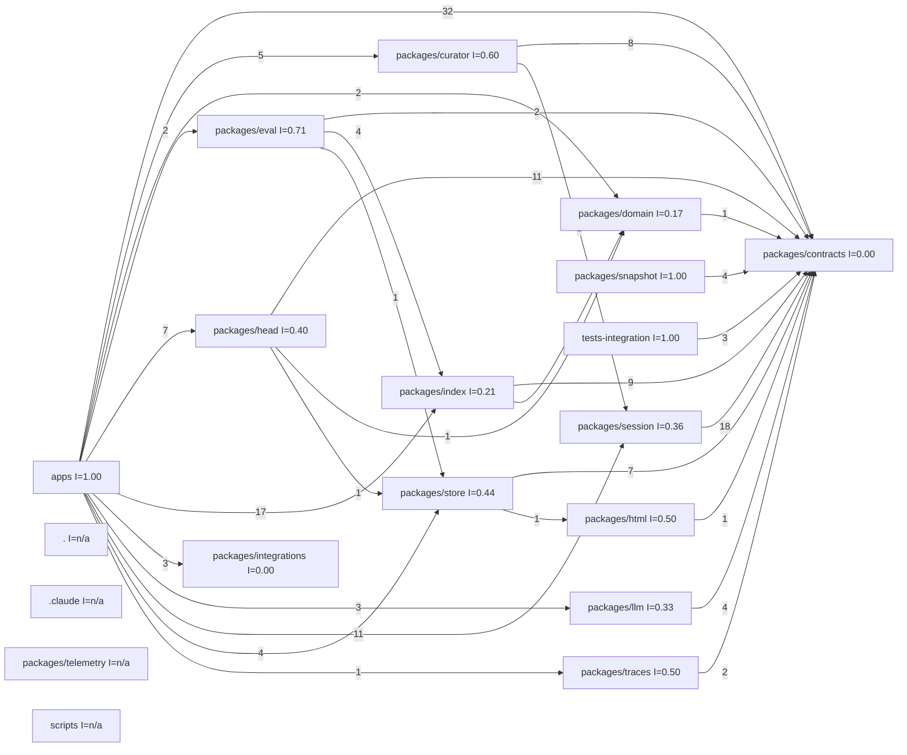

# memhtml · Architecture drift

> Generated from commit [`3406f7089918`](https://github.com/memhtml/memhtml/tree/3406f7089918528856905902284309cc11fc065d). Line citations refer to that commit.

The code follows the inward dependency direction the repository declares: the module graph has no cycles, every package edge points toward `packages/contracts`, and no import runs from a lower layer back up to `apps`. The declaration is prose in `CLAUDE.md:65-69` backed by TypeScript project references, since the repository has no import-linter, tach or dependency-cruiser config.

The module graph comes from codegraph's file dependencies, grouped by top-level directory (no import contract declares modules), and the analysis measured each module's afferent and efferent coupling, the cycles and the imports that break a declared rule. Reviewers confirmed none of the architecture drift candidates.

## Declared rules

The repository declares no machine-checked import contract: there is no import-linter, tach or dependency-cruiser config among the tracked files. What it does declare:

- `CLAUDE.md:65` says dependencies point inward, enforced by TypeScript project references, and `CLAUDE.md:68-69` gives the order `contracts ← domain, html ← store ← index (+domain, +llm) ← traces, eval ← apps/cli ← apps/mcp` and `contracts ← integrations ← apps/cli`.
- Each package's `tsconfig.json` `references` list is the build-time form of that rule. For example `packages/index/tsconfig.json:10-23` references `contracts`, `domain`, `html` and `llm`, and `packages/integrations/tsconfig.json:10-14` references only `contracts`.
- One direction is test-asserted: `packages/domain/tests/layering.test.ts:56-65` fails when any emitted `dist` module of `@memhtml/domain` imports anything other than `effect` or a relative path.

The diagram in `CLAUDE.md:68-69` leaves out `head`, `session`, `curator`, `snapshot` and `telemetry`. The code places them inside the same inward order: `packages/head/src/version.ts:4` imports `@memhtml/store`, `packages/curator/src/budget.ts:1` imports `@memhtml/session`, and `packages/curator/src/planner/similarity.ts:2` imports `@memhtml/head`.

## Module graph

The graph is the module import graph. Edge labels count file-pair imports. The map groups `apps/cli`, `apps/mcp` and `apps/docs` into one `apps` module, so the declared `apps/cli ← apps/mcp` step isn't visible at this level.

All 19 modules fit in the diagram, so it needs no legend table.

The map undercounts some package edges that the source shows. `packages/integrations/src/render/skill.ts:13` imports `@memhtml/contracts/guidance`, yet the map gives `packages/integrations` no outgoing edge. `packages/curator/src/planner/similarity.ts:2` imports `@memhtml/head` and `packages/index/src/indexer.ts:8` imports `@memhtml/html`, and neither edge is drawn. Every missing edge found still points inward, so none of them would add a cycle or break the declared order.

## Cycles

The module graph has no cycles.

## Instability

In the module graph, Ca counts what depends on a module, Ce what it depends on, and I is Ce / (Ca + Ce), so 0 is fully stable and 1 fully unstable. Modules with no edges have no defined I.

| Module                  | Ca | Ce | I    |
| ----------------------- | -- | -- | ---- |
| `packages/contracts`    | 78 | 0  | 0.00 |
| `packages/index`        | 11 | 3  | 0.21 |
| `packages/session`      | 7  | 4  | 0.36 |
| `packages/head`         | 6  | 4  | 0.40 |
| `packages/store`        | 5  | 4  | 0.44 |
| `packages/domain`       | 5  | 1  | 0.17 |
| `packages/eval`         | 2  | 5  | 0.71 |
| `packages/curator`      | 2  | 3  | 0.60 |
| `packages/llm`          | 2  | 1  | 0.33 |
| `packages/integrations` | 2  | 0  | 0.00 |
| `packages/traces`       | 1  | 1  | 0.50 |
| `packages/html`         | 1  | 1  | 0.50 |
| `apps`                  | 0  | 33 | 1.00 |
| `packages/snapshot`     | 0  | 2  | 1.00 |
| `tests-integration`     | 0  | 1  | 1.00 |
| `.`                     | 0  | 0  | n/a  |
| `.claude`               | 0  | 0  | n/a  |
| `packages/telemetry`    | 0  | 0  | n/a  |
| `scripts`               | 0  | 0  | n/a  |

No module that many others depend on is unstable: `packages/contracts` is fully stable and `packages/index` sits at 0.21, while, among modules with at least five dependents (Ca >= 5), the least stable are `packages/head` at 0.40 and `packages/store` at 0.44 (module import graph).

## See also

- [dependency graph](../diagrams/structural/dependency-graph.md): 4 shared source citations
- [REPORT](../REPORT.md): 2 shared source citations
- [module map](../architecture/module-map.md): 2 shared source citations
- [impact analysis](../insights/impact-analysis.md): 2 shared source citations
