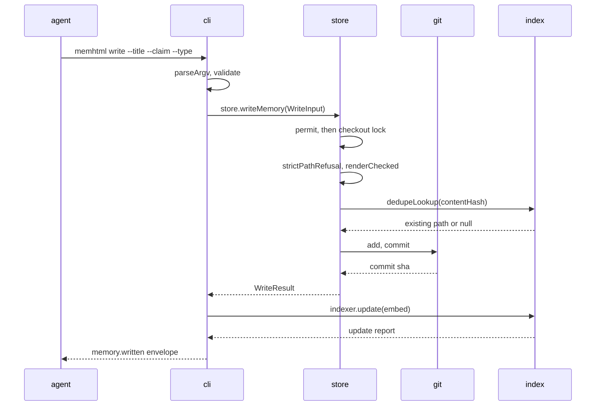
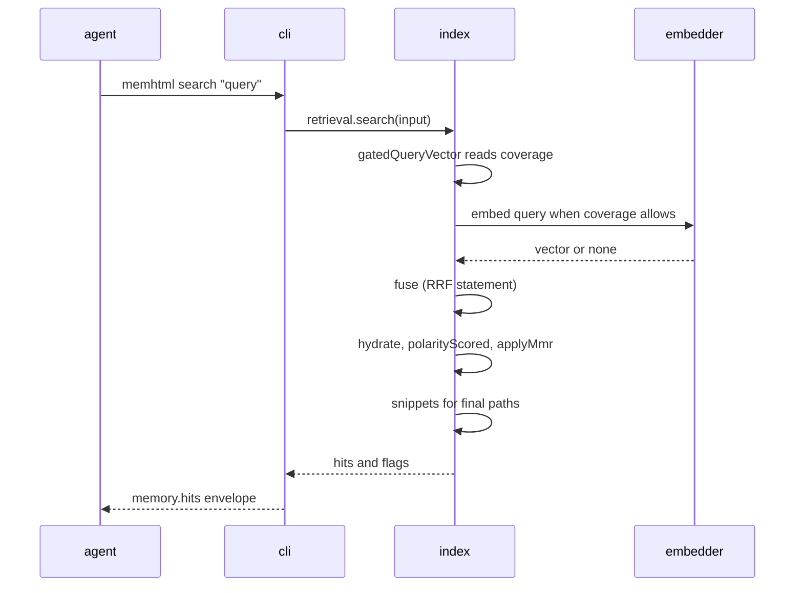
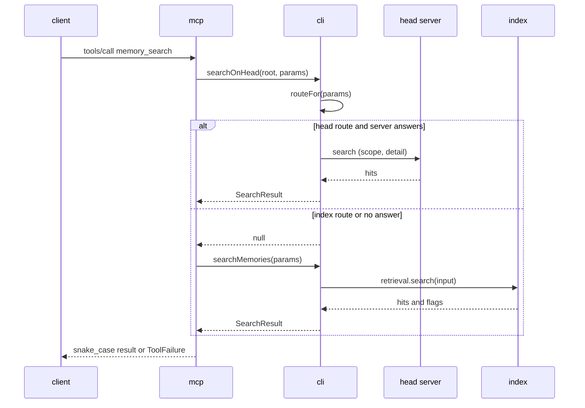

# memhtml · Data flow

> Generated from commit [`3406f7089918`](https://github.com/memhtml/memhtml/tree/3406f7089918528856905902284309cc11fc065d). Line citations refer to that commit.

Data enters memhtml through two binaries: the `memhtml` CLI turns one argv into one JSON envelope on stdout, and the `memhtml-mcp` server turns MCP tool calls on stdio into the same operations. A write travels cli to store to git and then back through index, and a read travels cli or mcp to the index's retrieval service over SQLite. The CLI entry is `apps/cli/src/bin.ts:5`, which runs argv through `run` and writes the envelope to stdout, and the MCP entry is `apps/mcp/src/bin.ts:15`, which launches the stdio server for the process's lifetime. Participant labels use the workspace package names (`cli`, `mcp`, `store`, `index`) plus `git` and `head server` for the external processes.

## Flow 1: Write one memory (`memhtml write`)

A `memhtml write --title ... --claim ... --type ...` call validates its arguments, renders and checks the article, asks the index whether the same bytes already exist, commits the new file under the store's write lock, and then brings the index up to the new commit.

1. The binary calls `run(process.argv.slice(2))` and writes only the returned envelope to stdout, exiting from the write callback `apps/cli/src/bin.ts:5-22`.
2. `run` parses argv with `parseArgv`, reads the store's `v1Doors` mode for record-creating commands, and returns a usage failure at exit 2 when `validate` rejects the call, before any service is built `apps/cli/src/run.ts:1774-1809`.
3. `run` pipes `dispatch` through `layerApp(--repo)`, the tracer and a stderr logger, then runs the program `apps/cli/src/run.ts:2541-2575`. Building `layerApp` opens `index.db` with `state.db` attached `apps/cli/src/api-layer.ts:120-129`.
4. The `write` arm runs `guardV1Door("write")`, calls `ops.writeMemory` with the decoded flags, and names the response `memory.written` `apps/cli/src/run.ts:378-399`.
5. `writeMemory` decodes the parameters with `toWriteInput`, calls `store.writeMemory`, reindexes only when a file was created, and records a `wrote` session link `apps/cli/src/operations.ts:349-358`.
6. The store wraps the write in `exclusive`, which takes the in-process permit and then the cross-process checkout lock `packages/store/src/store.ts:1464-1474`.
7. Inside, the store runs `strictPathRefusal` and `renderChecked`, hashes the HTML, and asks `dedupeLookup`; an existing path returns `deduped: true` with no commit. Otherwise it picks a free path and writes, stages and commits the file under a compensating journal `packages/store/src/store.ts:761-821`. The lookup is the index recorder's `activePathForHash`, wired in at `apps/cli/src/api-layer.ts:196`.
8. `reindex` calls `indexer.update({ embed: true })` `apps/cli/src/operations.ts:272-276`. `update` reprojects when no watermark row exists, otherwise diffs the watermark against HEAD, applies the projection writes, records the new watermark, and embeds the chunks this pass projected `packages/index/src/indexer.ts:808-1002`.

## Flow 2: Ranked search (`memhtml search`)

A `memhtml search "<query>"` call reads only the SQLite index: the retrieval service gates the query vector on coverage, runs one fused statement, hydrates the pool, demotes negation twins, and reorders with MMR.

1. Steps 1 to 3 of Flow 1 run unchanged: `run` parses, validates and provides `layerApp` `apps/cli/src/run.ts:1774-1809`.
2. The `search` arm calls `ops.searchMemories` with the query, the limit and the shared scope, and names the response `memory.hits` `apps/cli/src/run.ts:442-450`.
3. `searchMemories` resolves the `Retrieval` service and calls `retrieval.search` `apps/cli/src/operations.ts:999-1003`.
4. `search` defaults the limit and calls `gatedQueryVector`, which embeds the query only when vector coverage allows `packages/index/src/retrieval.ts:506-510`, `packages/index/src/retrieval.ts:308`.
5. `fuse` runs the reciprocal-rank-fusion statement for a pool of `limit * MMR_POOL_FACTOR` paths `packages/index/src/retrieval.ts:511-516`, `packages/index/src/retrieval.ts:330`.
6. `hydrate` reads the fused paths' rows `packages/index/src/retrieval.ts:517`, `packages/index/src/retrieval.ts:404`.
7. `polarityScored` scores the pool and `applyMmr` cuts it to the limit `packages/index/src/retrieval.ts:530-539`.
8. `snippets` runs over the final paths only, and an empty named scope reports archived matches instead `packages/index/src/retrieval.ts:545-558`.

## Flow 3: MCP `memory_search` tool call

A `tools/call` for `memory_search` on the stdio server asks the head server first and falls back to the same `searchMemories` the CLI arm calls, then renames the result to snake_case for the wire.

1. The `memhtml-mcp` binary launches `layerServer()` over Node stdio for the process's lifetime `apps/mcp/src/bin.ts:15`.
2. `layerServer` merges the toolkit and resources over `ToolHandlers`, `McpServer.layerStdio` with protocol `v2025_06_18`, and the CLI's `layerApp` `apps/mcp/src/server.ts:40-50`.
3. The `memory_search` handler maps the wire parameters to the CLI's search shape, decoding facets with `parseFacetFilters` `apps/mcp/src/handlers.ts:595-608`.
4. It calls `searchOnHead`, and on a `null` answer calls `searchMemories` `apps/mcp/src/handlers.ts:619`.
5. `searchOnHead` asks `routeFor`, which sends the call to the index when `MEMHTML_MCP_HEAD` is `off`, for `include_archived`, `as_of`, a quoted phrase, or a query with no indexable term `apps/cli/src/head-retrieval.ts:68-80`, `apps/cli/src/head-retrieval.ts:128-137`.
6. On the head route, `ask` posts a scoped, detailed `search` request through `askHead` and reshapes the answer into a `SearchResult` `apps/cli/src/head-retrieval.ts:94-118`, `apps/cli/src/head-retrieval.ts:138-165`.
7. With no head answer, `searchMemories` runs Flow 2's retrieval chain `apps/cli/src/operations.ts:999-1003`.
8. The handler renames the result fields to snake_case, and `handled` maps every failure to a `ToolFailure` `apps/mcp/src/handlers.ts:620-640`, `apps/mcp/src/handlers.ts:84`.

## See also

- [processes](../behavior/processes.md): 11 shared source citations
- [REPORT](../REPORT.md): 8 shared source citations
- [components](../diagrams/architecture/components.md): 7 shared source citations
- [sequences](../diagrams/behavioral/sequences.md): 6 shared source citations
- [dependency graph](../diagrams/structural/dependency-graph.md): 6 shared source citations
