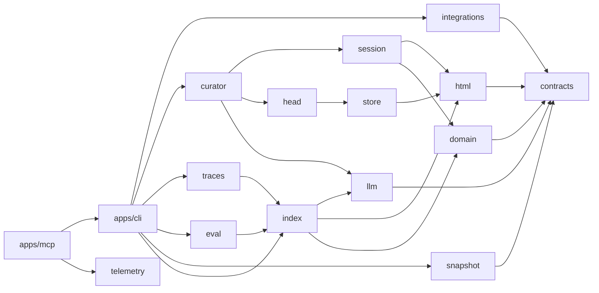

# memhtml · System overview

> Generated from commit [`3406f7089918`](https://github.com/memhtml/memhtml/tree/3406f7089918528856905902284309cc11fc065d). Line citations refer to that commit.

memhtml is a long-term memory store for coding agents: it keeps one fact per semantic HTML5 file in a git repository, projects that tree into a rebuildable SQLite index, and serves search and writes to agents over a CLI and an MCP server (`README.md:5`). Agents and humans call it through the `memhtml` binary (`apps/cli/package.json:21-22`), whose entry point runs one command and writes a single JSON envelope to stdout before exiting (`apps/cli/src/bin.ts:5`, `apps/cli/src/bin.ts:22`), or through the `memhtml-mcp` stdio server (`apps/mcp/package.json:20-21`), which launches an MCP layer for the life of the process (`apps/mcp/src/bin.ts:15`) and pins protocol `v2025_06_18` (`apps/mcp/src/server.ts:44-50`). The CLI surface is the `COMMANDS` table (`apps/cli/src/commands.ts:186`), and the MCP surface is the `Tool.make` toolkit that runs from `memory_write` to `memory_status` (`apps/mcp/src/tools.ts:348`, `apps/mcp/src/tools.ts:1010`). The problem it solves is durable, reviewable agent memory: the git tree is the system of record and the index can be deleted and rebuilt without loss (`README.md:5`). This page was built from the README, the workspace and package manifests, the two bin entry points and the module import graph.

The pieces form a layered pnpm workspace of `apps/*`, `packages/*` and `tests-integration` (`pnpm-workspace.yaml:1-4`). At the bottom, `contracts` holds schemas, enums, errors and path algebra with zero I/O (`packages/contracts/package.json:5`), and the module import graph shows it as the most depended-on module with no outgoing edges. `domain` is pure math for retention, decay, RRF, MMR and merge guards (`packages/domain/package.json:5`), and `html` parses and serializes the memory file format (`packages/html/package.json:5`). `store` is the git-backed file store (`packages/store/package.json:5`), and `index` owns the SQLite schema, migrations, the git-driven indexer and four-arm retrieval (`packages/index/package.json:5`), opening its database through `node:sqlite`'s `DatabaseSync` (`packages/index/src/database.ts:4`). `llm` wraps Bedrock embeddings and structured output (`packages/llm/package.json:5`). `head` holds the corpus as an immutable value per commit and searches it (`packages/head/src/index.ts:1-5`), `session` keeps a session's overlay log and commits it through a temporary git index (`packages/session/src/index.ts:1-4`), and `snapshot` is the columnar cold-start cache (`packages/snapshot/src/index.ts:1`). `curator` runs a bounded model-driven tool loop over a curator session (`packages/curator/package.json:5`), `traces` parses and indexes agent transcripts (`packages/traces/package.json:5`), `eval` generates the fixture corpus and the retrieval discrimination gate (`packages/eval/package.json:5`), `integrations` wires Claude Code, Codex, Cursor and OpenCode to a store (`packages/integrations/package.json:5`), and `telemetry` is an opt-in OTLP exporter (`packages/telemetry/package.json:5`). The CLI depends on every one of these (`apps/cli/package.json:41-54`) and composes them in `layerApp` (`apps/cli/src/api-layer.ts:409`), while the MCP app depends on the CLI package (`apps/mcp/package.json:44`) and provides that same app layer under its server (`apps/mcp/src/server.ts:53`). `apps/docs` is the Astro and Starlight documentation site (`apps/docs/package.json:19`, `apps/docs/package.json:24`), and `tests-integration` exercises the CLI across packages (`tests-integration/package.json:13`).

## Stack

| Layer           | Technology                                     | Source                             |
| --------------- | ---------------------------------------------- | ---------------------------------- |
| Runtime         | Node 24 or newer, ESM                          | `package.json:5-9`                 |
| Runtime pin     | Node `24` through mise                         | `mise.toml:37`                     |
| Package manager | pnpm 11.21.0                                   | `package.json:6`                   |
| Language        | TypeScript 7.0.2                               | `package.json:37`                  |
| Framework       | Effect 4.0.5 and `@effect/platform-node` 4.0.5 | `pnpm-workspace.yaml:64-68`        |
| Storage         | SQLite through `node:sqlite`                   | `packages/index/src/database.ts:4` |
| Model provider  | Bedrock embeddings and structured output       | `packages/llm/package.json:5`      |
| Build           | turbo 2.11.10, tsdown 0.23.1 for the package   | `package.json:35-36`               |
| Lint and format | Biome 2.5.15, dprint for Markdown              | `package.json:32`                  |
| Tests           | vitest 5.0.5 with fast-check                   | `apps/cli/package.json:65-67`      |
| Docs site       | Astro 7 with Starlight                         | `apps/docs/package.json:19-24`     |
| A11y gate       | Playwright 1.64.1 with axe-core                | `apps/docs/package.json:38-45`     |

## Module map

Arrows point from a package to a runtime dependency declared in its `package.json`. Every other package except `telemetry` and the docs app also depends on `contracts` (`packages/curator/package.json:32`, `packages/domain/package.json:33`, `packages/eval/package.json:34`, `packages/head/package.json:26`, `packages/html/package.json:33`, `packages/index/package.json:35`, `packages/integrations/package.json:33`, `packages/llm/package.json:35`, `packages/session/package.json:26`, `packages/snapshot/package.json:26`, `packages/store/package.json:37`, `packages/traces/package.json:33`, `apps/cli/package.json:41`, `apps/mcp/package.json:45`); the diagram draws only a few of those edges to stay readable.

| Edge                                  | Source                                  |
| ------------------------------------- | --------------------------------------- |
| `apps/mcp` to `cli`, `telemetry`      | `apps/mcp/package.json:44-51`           |
| `apps/cli` to every package           | `apps/cli/package.json:41-54`           |
| `curator` to `session`, `head`, `llm` | `packages/curator/package.json:32-37`   |
| `traces` to `index`                   | `packages/traces/package.json:34`       |
| `eval` to `index`                     | `packages/eval/package.json:37`         |
| `head` to `store`                     | `packages/head/package.json:29`         |
| `index` to `domain`, `html`, `llm`    | `packages/index/package.json:36-38`     |
| `session` to `domain`, `html`         | `packages/session/package.json:27-28`   |
| `store` to `html`                     | `packages/store/package.json:38`        |
| `html` to `contracts`                 | `packages/html/package.json:33`         |
| `domain` to `contracts`               | `packages/domain/package.json:33`       |
| `llm` to `contracts`                  | `packages/llm/package.json:35`          |
| `snapshot` to `contracts`             | `packages/snapshot/package.json:26`     |
| `integrations` to `contracts`         | `packages/integrations/package.json:33` |

## See also

- [module map](module-map.md): 21 shared source citations
- [REPORT](../REPORT.md): 12 shared source citations
- [dependency graph](../diagrams/structural/dependency-graph.md): 6 shared source citations
- [processes](../behavior/processes.md): 5 shared source citations
- [components](../diagrams/architecture/components.md): 5 shared source citations
