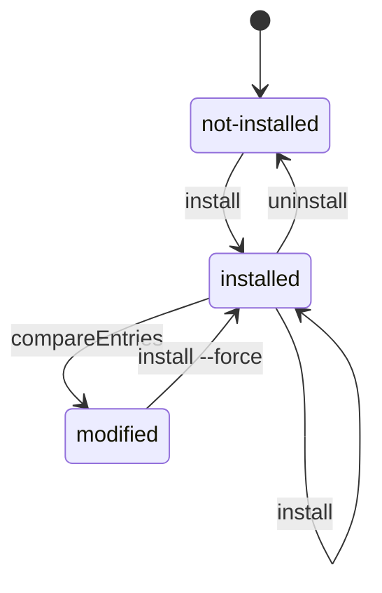
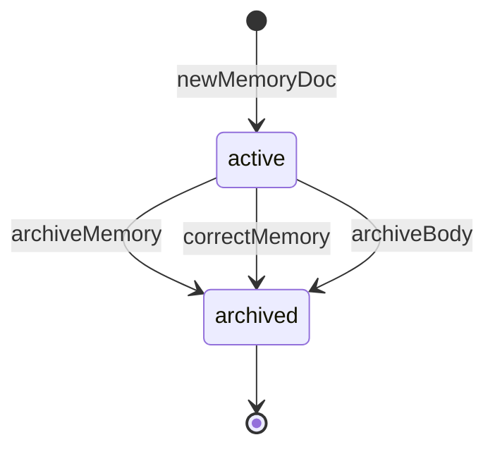
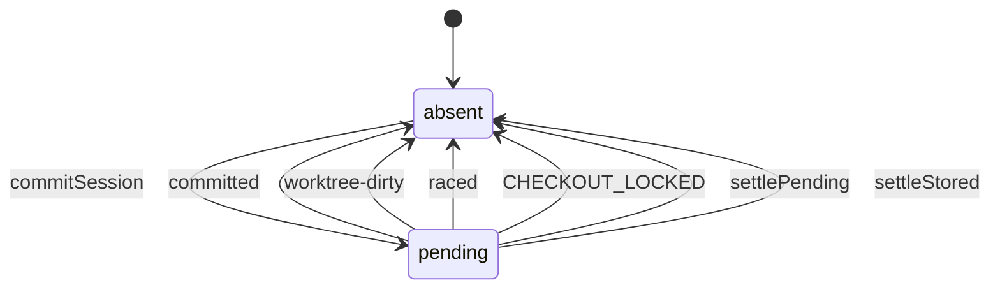
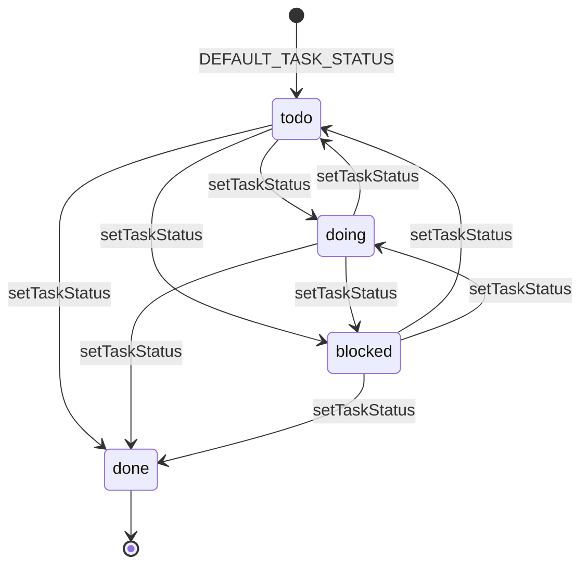

# memhtml · State machines

> Generated from commit [`3406f7089918`](https://github.com/memhtml/memhtml/tree/3406f7089918528856905902284309cc11fc065d). Line citations refer to that commit.

Four entities move through named states: a host integration (`InstallState`), a memory file (`MemoryStatus`), a session log's `pending` commit, and a task (`TaskStatus`). Each section below was built from the type that names the states and the functions that write them, read at HEAD.

## InstallState

`InstallState` describes one host's wiring at one scope, and no field stores it: every reader derives it from the receipt file and a re-hash of the entries the receipt claims. `rowFor` answers `not-installed` when there's no receipt, `modified` when the receipt can't be read, and otherwise whatever `compareEntries` returns (`packages/integrations/src/list.ts:32-63`). `compareEntries` answers `installed` when every entry hashes to its receipt value and `modified` when any one doesn't, a missing entry included (`packages/integrations/src/receipt.ts:166-176`).

- `install` writes the files and then the receipt last (`packages/integrations/src/install.ts:868-887`). A re-run with nothing changed writes nothing, receipt included (`packages/integrations/src/install.ts:842-844`).
- No memhtml code moves a host into `modified`. Someone edits or deletes a claimed entry, and `compareEntries` reports it on the next read.
- Over `modified`, `install` throws `IntegrationModified` unless `options.force` is set, and with it backs up each drifted file before writing (`packages/integrations/src/install.ts:684-699`, `packages/integrations/src/install.ts:850-866`).
- `uninstall` over an absent receipt succeeds with `state: "not-installed"` and changes nothing (`packages/integrations/src/uninstall.ts:103-114`). Over `modified` it throws `IntegrationModified` and has no force override (`packages/integrations/src/uninstall.ts:127-140`).

Defined at: `packages/integrations/src/types.ts:128`

## MemoryStatus

`MemoryStatus` has two values, `active` and `archived`, and moves one way. `newMemoryDoc` hardcodes `status: "active"` on every fresh memory document (`packages/html/src/template.ts:207-214`). Three writers stamp `memhtml-status` as `archived` while moving the file under `archive/`.

- `archiveMemory` calls `stageArchive` with `memhtml-status` `archived` (`packages/store/src/store.ts:1188-1215`).
- `correctMemory` archives the target it supersedes in the same commit as the new file (`packages/store/src/store.ts:1163-1166`).
- A session's `archive` op runs through the `stage` fold, which writes the destination with `archiveBody` (`packages/session/src/commit.ts:181-188`), and `archiveBody` sets the two metas (`packages/session/src/commit.ts:130-131`).
- `supersedeMemories` stamps `archived` through `stageArchive` as well (`packages/store/src/store.ts:1274-1277`).

No function in the cited writers stamps `active` onto an existing file, so the diagram draws no edge back to `active`.

Defined at: `packages/contracts/src/types.ts:69`

## Session pending commit

A session log carries an optional `pending`: the commit `commitSession` built and was about to land when the log was last written, or absent (`packages/session/src/session.ts:51-58`). `commitSession` writes it before anything shared moves and clears it on every outcome of the landing.

- Step 5 saves the log with `pending: commit` (`packages/session/src/commit.ts:617-618`).
- `landOnRef` failing with `CHECKOUT_LOCKED` clears it, since a lock never taken touched nothing (`packages/session/src/commit.ts:631-636`).
- A `worktree-dirty` or `raced` landing clears it, and `raced` is answered as `rebase-needed` (`packages/session/src/commit.ts:638-648`).
- Step 7 saves the log with the new base, no ops and no `pending`, and answers `committed` (`packages/session/src/commit.ts:652-662`).
- A process killed between steps 5 and 7 leaves `pending` in the log. Step 0 of the next `commitSession` calls `settlePending`: a landed commit answers `committed` with `recovered: true`, and one that never landed is cleared before the commit goes on (`packages/session/src/commit.ts:537-562`).
- `appendOps` settles a stored `pending` through `settleStored` before it adds ops (`packages/session/src/session.ts:393-418`, `packages/session/src/session.ts:438`).

Defined at: `packages/session/src/session.ts:58`

## TaskStatus

`TaskStatus` is the closed set `todo`, `doing`, `blocked`, `done`, carried in `memhtml-task-status` beside `MemoryStatus` (`packages/contracts/src/types.ts:82-84`). `newMemoryDoc` stamps `DEFAULT_TASK_STATUS`, which is `todo`, when a task's input names no status (`packages/html/src/template.ts:79`, `packages/html/src/template.ts:233-234`). `memhtml task add` takes an opening status (`apps/cli/src/commands.ts:666`).

`setTaskStatus` is the one transition function, and it has no from-state guard (`apps/cli/src/operations.ts::setTaskStatus`):

- It rejects a non-task memory with `InvalidMemory` (`apps/cli/src/operations.ts:2026-2032`).
- A request for the status the file already has writes nothing and returns `unchanged: true` (`apps/cli/src/operations.ts:2040-2047`).
- It refuses a path under `archive/` through `activeRecordPathViolation` (`apps/cli/src/operations.ts:2058-2069`).
- For `todo`, `doing` and `blocked` it stamps the meta and commits inside `store.exclusive` (`apps/cli/src/operations.ts:2082-2099`).
- For `done` it writes the stamp and then calls `store.archiveMemory`, so finishing a task also drives `MemoryStatus` to `archived` (`apps/cli/src/operations.ts:2110-2111`).

After that move, the archive-path refusal blocks every later `setTaskStatus`, which is why `done` is drawn as terminal. A task opened as `done` through `task add` stays at its live path, and `setTaskStatus` can still move it.

Defined at: `packages/contracts/src/types.ts:84`

## See also

- [impact analysis](../insights/impact-analysis.md): 6 shared source citations
- [module map](../architecture/module-map.md): 5 shared source citations
- [contract map](../insights/contract-map.md): 5 shared source citations
- [dependency graph](../diagrams/structural/dependency-graph.md): 4 shared source citations
- [business logic](../insights/business-logic.md): 4 shared source citations
