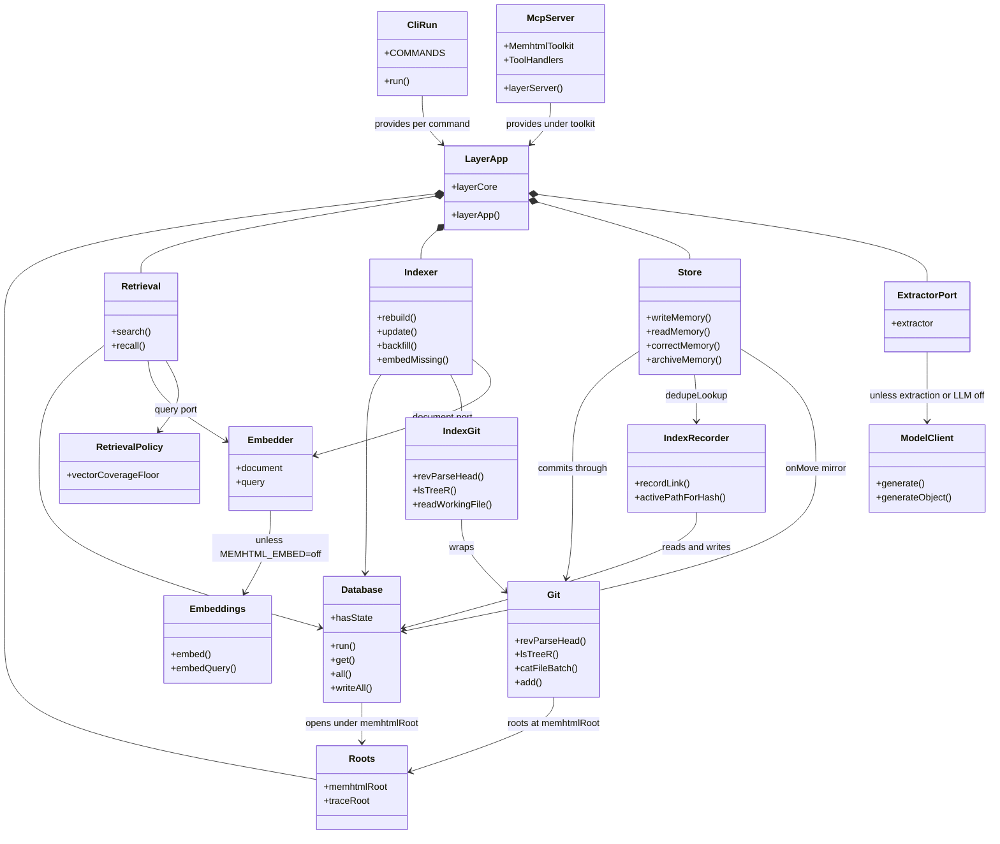

# memhtml · Components

> Generated from commit [`3406f7089918`](https://github.com/memhtml/memhtml/tree/3406f7089918528856905902284309cc11fc065d). Line citations refer to that commit.

The runtime is one service graph assembled by `layerApp` in `apps/cli/src/api-layer.ts:409-419`, and both front ends consume it: the CLI dispatcher provides it per command (`apps/cli/src/run.ts:2560`) and the MCP server provides it under its toolkit (`apps/mcp/src/server.ts:53`). The diagram shows the service tags that graph wires, each taken from its `Context.Service` definition, with every edge read from a `yield*` of one tag inside another's layer in `apps/cli/src/api-layer.ts`.

## Component diagram

| Component       | Definition                                               | Role                                                                                                                                                                                                                           |
| --------------- | -------------------------------------------------------- | ------------------------------------------------------------------------------------------------------------------------------------------------------------------------------------------------------------------------------ |
| CliRun          | `apps/cli/src/run.ts:1767 run`                           | CLI entry: parses argv against `COMMANDS` (`apps/cli/src/commands.ts:186`) and provides `layerApp(str(parsed, "repo"))` (`apps/cli/src/run.ts:2560`).                                                                          |
| McpServer       | `apps/mcp/src/server.ts:40-53 layerServer`               | Merges `McpServer.toolkit(MemhtmlToolkit)` and `Resources`, provides `ToolHandlers` (`apps/mcp/src/handlers.ts:368`), stdio transport, then `layerApp` (`apps/mcp/src/server.ts:53`). Toolkit at `apps/mcp/src/tools.ts:1059`. |
| LayerApp        | `apps/cli/src/api-layer.ts:409-419 layerApp`             | Production composition: `layerCore` (`:396-400`) over roots, embedder, extractor and retrieval policy. `layerAppWith` (`:427-449`) is the same core with test-injected embedder and extractor.                                 |
| Roots           | `apps/cli/src/api-layer.ts:94 Roots`                     | `MEMHTML_ROOT` (or `--repo`) and `MEMHTML_TRACE_ROOT` (`:100-109`).                                                                                                                                                            |
| Database        | `packages/index/src/database.ts:95 DatabaseService`      | `index.db` with `state.db` attached, built by `makeDatabase` (`apps/cli/src/api-layer.ts:119-129`). Shape at `packages/index/src/database.ts:61`.                                                                              |
| Git             | `packages/store/src/git.ts:177 Git`                      | The store's git subprocess wrapper, shape at `:53`; layer at `apps/cli/src/api-layer.ts:132-137`.                                                                                                                              |
| IndexGit        | `packages/index/src/git-port.ts:82 IndexGit`             | The indexer's narrower git port (`:50`), built by `makeGitPort` over `Git` (`apps/cli/src/api-layer.ts:148-167`).                                                                                                              |
| IndexRecorder   | `packages/index/src/traces-persist.ts:162 IndexRecorder` | Session-link writer and dedupe lookup over the database (`apps/cli/src/api-layer.ts:170-177`).                                                                                                                                 |
| Store           | `packages/store/src/store.ts:319 Store`                  | Memory writes, reads, corrections and archives over git (shape `:227`), with `dedupeLookup` and the `onMove` `state.access` mirror attached (`apps/cli/src/api-layer.ts:186-208`).                                             |
| Indexer         | `packages/index/src/indexer.ts:147 Indexer`              | Rebuild, update, backfill and embed-missing over the database, the git port and the document embedder (`apps/cli/src/api-layer.ts:251-271`).                                                                                   |
| Retrieval       | `packages/index/src/retrieval.ts:197 Retrieval`          | `search` and `recall` over the database, the query embedder and the coverage floor (`apps/cli/src/api-layer.ts:320-336`).                                                                                                      |
| Embedder        | `apps/cli/src/api-layer.ts:223 Embedder`                 | Document and query ports, both `undefined` when `MEMHTML_EMBED` is `off` (`:232-244`).                                                                                                                                         |
| Embeddings      | `packages/llm/src/embeddings.ts:27 Embeddings`           | Bedrock embeddings, supplied by `EmbeddingsLive` (`apps/cli/src/api-layer.ts:414`).                                                                                                                                            |
| RetrievalPolicy | `apps/cli/src/api-layer.ts:286 RetrievalPolicy`          | `MEMHTML_VECTOR_COVERAGE_FLOOR`, which dies outside `(0, 1]` (`:294-306`).                                                                                                                                                     |
| ExtractorPort   | `apps/cli/src/api-layer.ts:360 ExtractorPort`            | Write-time entity extractor, absent when `MEMHTML_EXTRACT_ENTITIES` or `MEMHTML_LLM` is `off` (`:362-376`).                                                                                                                    |
| ModelClient     | `packages/llm/src/model-client.ts:71 ModelClient`        | Model invocation (`generate`, `generateObject`, shape `:60`), supplied by `ModelClientLive` (`apps/cli/src/api-layer.ts:415`).                                                                                                 |

## How the pieces relate

- The store is SQL-free by design, so its one dependency on the database arrives as injected functions: `dedupeLookup: recorder.activePathForHash` and an `onMove` that runs `UPDATE state.access` (`apps/cli/src/api-layer.ts:195-206`). The composition root is the only module that knows both halves exist (`:80-83`).
- Two git tags coexist: `memhtml/Git` from `@memhtml/store` (`packages/store/src/git.ts:177`) and `memhtml/IndexGit` from `@memhtml/index` (`packages/index/src/git-port.ts:82`), with different shapes. `apps/cli/src/api-layer.ts:57-59` re-exports both side by side for that reason.
- Network-backed services sit only at the edge of the graph. `layerCore` (`apps/cli/src/api-layer.ts:396-400`) holds no Bedrock dependency, and `layerAppWith` substitutes the embedder and extractor so tests run the production wiring (`:421-449`).
- The MCP server builds the same `layerApp` the CLI does (`apps/mcp/src/server.ts:53`), so a tool and its CLI twin read the same database (`apps/cli/src/api-layer.ts:406-407`).
- The doc comment names the composition `AppLive` (`apps/cli/src/api-layer.ts:62`), but the exported symbol is `layerApp` (`:409`); there's no `AppLive` export in that file.

## See also

- [REPORT](../../REPORT.md): 8 shared source citations
- [module map](../../architecture/module-map.md): 8 shared source citations
- [processes](../../behavior/processes.md): 8 shared source citations
- [data flow](../../architecture/data-flow.md): 7 shared source citations
- [dependency graph](../structural/dependency-graph.md): 7 shared source citations
