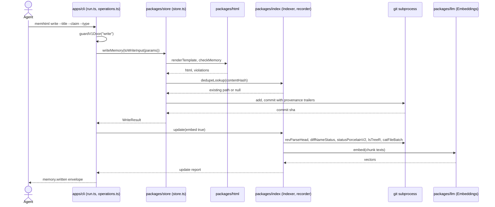
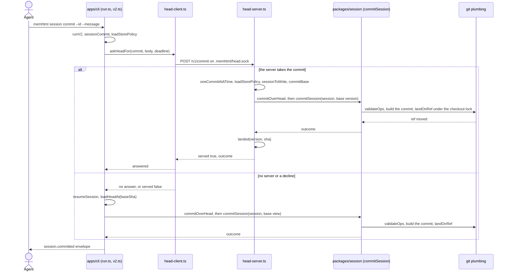
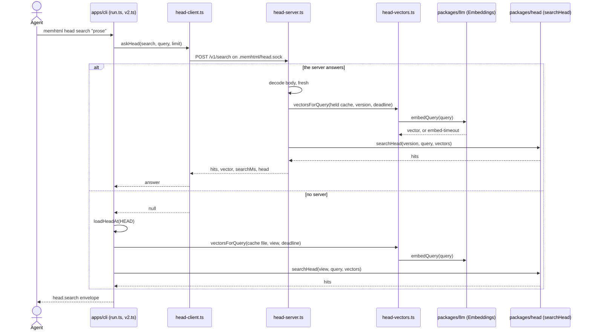

# memhtml · Sequences

> Generated from commit [`3406f7089918`](https://github.com/memhtml/memhtml/tree/3406f7089918528856905902284309cc11fc065d). Line citations refer to that commit.

The three longest cross-module processes are `memhtml write` (the v1 door over the SQLite index), `memhtml session commit` (the v2 commit, through the head server when one runs), and `memhtml head search` (the v2 ranked search over the head).

## memhtml write

The CLI renders, dedupes and commits the record through `packages/store`, then reprojects and embeds it through `packages/index` only when a file was created (`apps/cli/src/operations.ts:349-358`).

| Arrow           | Call site                                                                                                                                                                                                                                                                                                                         |
| --------------- | --------------------------------------------------------------------------------------------------------------------------------------------------------------------------------------------------------------------------------------------------------------------------------------------------------------------------------- |
| `Agent->>Cli`   | `apps/cli/src/bin.ts:5` calls `run(process.argv.slice(2))`; the write arm starts at `apps/cli/src/run.ts:378`                                                                                                                                                                                                                     |
| `Cli->>Cli`     | `apps/cli/src/run.ts:380` `guardV1Door("write")`                                                                                                                                                                                                                                                                                  |
| `Cli->>Store`   | `apps/cli/src/run.ts:381` calls `ops.writeMemory`, which calls `store.writeMemory` at `apps/cli/src/operations.ts:353`                                                                                                                                                                                                            |
| `Store->>Html`  | `packages/store/src/store.ts:696` `renderTemplate`, `packages/store/src/store.ts:718` `checkMemory`; both imported from `@memhtml/html` at `packages/store/src/store.ts:25-29`                                                                                                                                                    |
| `Store->>Index` | `packages/store/src/store.ts:773` calls the injected `dedupeLookup`, which the composition binds to `recorder.activePathForHash` at `apps/cli/src/api-layer.ts:196`; a match returns `deduped: true` with no commit (`packages/store/src/store.ts:774-783`)                                                                       |
| `Store->>Git`   | `packages/store/src/store.ts:807-810` `git.add` then `git.commit`, under the journal from `packages/store/src/store.ts:801`                                                                                                                                                                                                       |
| `Store-->>Cli`  | `packages/store/src/store.ts:814-820`                                                                                                                                                                                                                                                                                             |
| `Cli->>Index`   | `apps/cli/src/operations.ts:355` runs `reindex` only when `result.created`, which calls `indexer.update` at `apps/cli/src/operations.ts:275`                                                                                                                                                                                      |
| `Index->>Git`   | `packages/index/src/indexer.ts:811` `revParseHead`, `packages/index/src/indexer.ts:857-858` `diffNameStatus` and `statusPorcelainV2`, `packages/index/src/indexer.ts:873` `lsTreeR`, `packages/index/src/indexer.ts:880` `catFileBatch`; the port is the store's `Git` wrapped by `makeGitPort` (`apps/cli/src/api-layer.ts:156`) |
| `Index->>Llm`   | `packages/index/src/indexer.ts:1002` `embedMissing`, which calls `embeddings.embed` per slice at `packages/index/src/indexer.ts:577`                                                                                                                                                                                              |
| `Cli-->>Agent`  | `apps/cli/src/run.ts:399` names the response `memory.written`; `apps/cli/src/bin.ts:22` exits from the write callback                                                                                                                                                                                                             |

The projection is written and the watermark recorded before embedding starts (`packages/index/src/indexer.ts:994-995`), and an embedder failure logs an error and keeps the vectors already written (`packages/index/src/indexer.ts:577-582`). After the reindex, `recordLink` writes a `wrote` session link (`apps/cli/src/operations.ts:356`).

## memhtml session commit

`sessionCommit` reads the store policy, asks the head server on its socket, and commits locally through the same `commitOverHead` when no server takes the request (`apps/cli/src/v2.ts::sessionCommit`).

| Arrow                     | Call site                                                                                                                                                                                      |
| ------------------------- | ---------------------------------------------------------------------------------------------------------------------------------------------------------------------------------------------- |
| `Agent->>Cli`             | `apps/cli/src/run.ts:2474` hands a v2 command to `runV2`, which dispatches `session commit` to `sessionCommit` at `apps/cli/src/v2.ts:2192-2193`                                               |
| `Cli->>Cli`, policy       | `apps/cli/src/v2.ts:1327` reads `memhtml.config.json` before the server is asked                                                                                                               |
| `Cli->>Client`            | `apps/cli/src/v2.ts:1331-1337` `askHeadFor` with route `commit`; `apps/cli/src/head-client.ts:148`                                                                                             |
| `Client->>Server`         | the route is `HEAD_ROUTES.commit` (`apps/cli/src/head-protocol.ts:27`), matched at `apps/cli/src/head-server.ts:1510`; the socket is `.memhtml/head.sock` (`apps/cli/src/head-protocol.ts:69`) |
| `Server->>Server`, gate   | `apps/cli/src/head-server.ts:1292` `oneCommitAtATime`, `apps/cli/src/head-server.ts:1296-1299` policy, session and base                                                                        |
| `Server->>Session`        | `apps/cli/src/head-server.ts:1304-1311` `commitOverHead` with `afterCommit: landed`; `commitOverHead` calls `commitSession` at `apps/cli/src/v2.ts:1105`                                       |
| `Session->>Git`           | `packages/session/src/commit.ts:567` `validateOps`, `packages/session/src/commit.ts:589` `markContradictions`, `packages/session/src/commit.ts:621` `landOnRef`                                |
| `Server->>Server`, landed | `apps/cli/src/head-server.ts:1220-1226` advances the held head to the new commit                                                                                                               |
| `Client-->>Cli`, served   | `apps/cli/src/v2.ts:1338-1346` returns with `via: "server"`                                                                                                                                    |
| `else` branch             | `apps/cli/src/v2.ts:1353-1361` `resumeSession`, `loadHeadAt`, `commitOverHead`; the result carries `via: "local"` (`apps/cli/src/v2.ts:1362`)                                                  |
| `Cli-->>Agent`            | `apps/cli/src/v2.ts:2193` names the response `session.committed`                                                                                                                               |

`commitSession` holds the session's lock for the whole call (`packages/session/src/commit.ts:522`) and refuses a log that moved since the caller read it (`packages/session/src/commit.ts:529`). It saves the pending intent before `landOnRef` touches the shared checkout (`packages/session/src/commit.ts:618`). A ref that moved past the validated base returns `rebase-needed` (`packages/session/src/commit.ts:579`). On the local path, `commitOverHead` writes the new commit's snapshot through `snapshotAfterCommit` (`apps/cli/src/v2.ts:1190`).

## memhtml head search

`headSearch` asks the head server first and, with no answer, loads the head itself and runs the same two calls, `vectorsForQuery` then `searchHead` (`apps/cli/src/v2.ts::headSearch`).

| Arrow                   | Call site                                                                                                |
| ----------------------- | -------------------------------------------------------------------------------------------------------- |
| `Agent->>Cli`           | `apps/cli/src/v2.ts:2200-2201` dispatches `head search` to `headSearch`                                  |
| `Cli->>Client`          | `apps/cli/src/v2.ts:1673-1681` `askHead` with route `search`; `apps/cli/src/head-client.ts:226`          |
| `Client->>Server`       | `HEAD_ROUTES.search` (`apps/cli/src/head-protocol.ts:23`), matched at `apps/cli/src/head-server.ts:1423` |
| `Server->>Server`       | `apps/cli/src/head-server.ts:1424-1428` decodes with excess properties refused, then reads `fresh`       |
| `Server->>Vectors`      | `apps/cli/src/head-server.ts:1429-1436`                                                                  |
| `Vectors->>Llm`         | `apps/cli/src/head-vectors.ts:224` `port.embedQuery`                                                     |
| `Server->>Head`         | `apps/cli/src/head-server.ts:1441-1445`; `packages/head/src/search.ts:211`                               |
| `Client-->>Cli`, answer | `apps/cli/src/v2.ts:1682-1691`                                                                           |
| `else` branch           | `apps/cli/src/v2.ts:1694-1704` `loadHeadAt`, `vectorsForQuery`, `searchHead`                             |
| `Cli-->>Agent`          | `apps/cli/src/v2.ts:2201` names the response `head.search`                                               |

`askHead` turns every way of not getting an answer into `null` (`apps/cli/src/head-client.ts:221-229`), and `headSearch` falls back to the local path whenever `answered` is `null` (`apps/cli/src/v2.ts:1682`). A server whose embed misses the deadline counts the `embed-timeout` in its activity stats and still runs `searchHead` (`apps/cli/src/head-server.ts:1437-1441`).

## See also

- [processes](../../behavior/processes.md): 9 shared source citations
- [dependency graph](../structural/dependency-graph.md): 7 shared source citations
- [impact analysis](../../insights/impact-analysis.md): 7 shared source citations
- [data flow](../../architecture/data-flow.md): 6 shared source citations
- [debugging guide](../../insights/debugging-guide.md): 6 shared source citations
