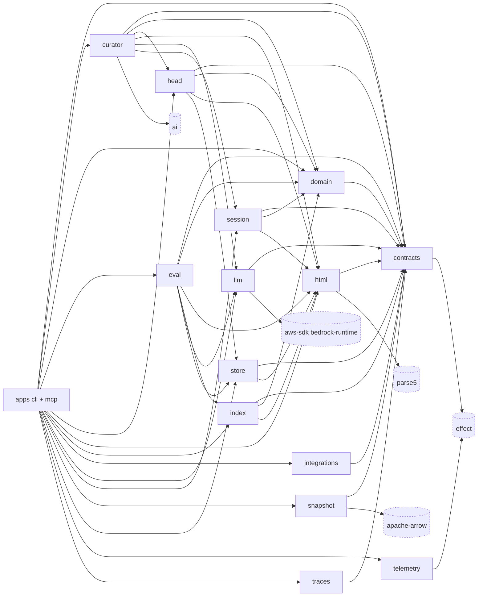

# memhtml · Dependency graph

> Generated from commit [`3406f7089918`](https://github.com/memhtml/memhtml/tree/3406f7089918528856905902284309cc11fc065d). Line citations refer to that commit.

The workspace is a layered DAG with `packages/contracts` at the bottom and the two apps at the top, and every internal edge below was confirmed at an import line. The workspace has 19 modules and 30 module edges with no cycles (module import graph, tests left out). The `apps` node is `apps/cli` plus `apps/mcp`, and the external dependencies come from each package's manifest (`packages/contracts/package.json:60-62`, `packages/telemetry/package.json:26-28`).

Legend: `effect` is declared by every package (`packages/telemetry/package.json`, `packages/contracts/package.json`), so only two edges are drawn. `apps` is `apps/cli` and `apps/mcp`; the `apps/docs` Astro site (`apps/docs/package.json:2`) is not part of the code graph. `tests-integration` depends on the packages (`tests-integration/package.json:13-26`) but is left out of the graph, as the module import graph leaves tests out.

## Internal edges, confirmed at imports

| From                                           | To (first import line)                                                                                                                                                                                                                                                                                                                                                                           |
| ---------------------------------------------- | ------------------------------------------------------------------------------------------------------------------------------------------------------------------------------------------------------------------------------------------------------------------------------------------------------------------------------------------------------------------------------------------------ |
| `apps/cli/src/v2.ts:4`                         | contracts; also `apps/cli/src/run.ts:4` curator, `apps/cli/src/operations.ts:24` domain, `apps/cli/src/head-gate.ts:2` eval, `apps/cli/src/v2.ts:27` head, `:28` html, `apps/cli/src/views.ts:6` index, `:7` llm, `apps/cli/src/run.ts:8` integrations, `apps/cli/src/v2.ts:54` session, `:55` snapshot, `:56` store, `apps/cli/src/run.ts:12` telemetry, `apps/cli/src/operations.ts:48` traces |
| `apps/mcp/src/tools.ts:14`                     | cli; also `:15` contracts, `:17` domain, `apps/mcp/src/resources.ts:3` html, `apps/mcp/src/handlers.ts:35` index, `apps/mcp/src/server.ts:2` telemetry                                                                                                                                                                                                                                           |
| `packages/curator/src/tools.ts:1`              | contracts; also `packages/curator/src/planner/plan.ts:9` domain, `packages/curator/src/planner/similarity.ts:2` head, `packages/curator/src/fake-model.ts:8` html, `packages/curator/src/model.ts:5` llm, `packages/curator/src/tools.ts:2` session                                                                                                                                              |
| `packages/eval/src/harness.ts:5`               | contracts; also `packages/eval/src/controls.ts:5` domain, `packages/eval/src/fixture.ts:5` html, `packages/eval/src/harness.ts:18` index, `:19` llm, `packages/eval/src/fixture.ts:6` store                                                                                                                                                                                                      |
| `packages/head/src/version.ts:1`               | contracts; also `packages/head/src/search.ts:2` domain, `packages/head/src/record.ts:6` html, `packages/head/src/version.ts:4` store                                                                                                                                                                                                                                                             |
| `packages/index/src/vector-coverage.ts:1`      | contracts; also `packages/index/src/traces-persist.ts:2` domain, `packages/index/src/indexer.ts:8` html                                                                                                                                                                                                                                                                                          |
| `packages/session/src/validate.ts:1`           | contracts; also `packages/session/src/commit.ts:13` domain, `packages/session/src/validate.ts:26` html                                                                                                                                                                                                                                                                                           |
| `packages/store/src/store.ts:4`                | contracts; also `:22` html                                                                                                                                                                                                                                                                                                                                                                       |
| `packages/domain/src/index.ts:6`               | contracts                                                                                                                                                                                                                                                                                                                                                                                        |
| `packages/html/src/template.ts:1`              | contracts                                                                                                                                                                                                                                                                                                                                                                                        |
| `packages/integrations/src/render/skill.ts:13` | contracts                                                                                                                                                                                                                                                                                                                                                                                        |
| `packages/llm/src/structured.ts:1`             | contracts                                                                                                                                                                                                                                                                                                                                                                                        |
| `packages/snapshot/src/vectors.ts:24`          | contracts                                                                                                                                                                                                                                                                                                                                                                                        |
| `packages/traces/src/scan.ts:1`                | contracts                                                                                                                                                                                                                                                                                                                                                                                        |

## Manifest edges without an import

`packages/index/package.json` declares `@memhtml/llm` and `packages/traces/package.json` declares `@memhtml/index`, but neither package imports them in `src`. The only mentions are comments (`packages/index/src/index-state.ts:31`, `packages/traces/src/watermark.ts:12`), so those two edges are left out of the graph. `packages/contracts` imports no workspace package, and `packages/telemetry` imports none either: each declares only `effect` as a dependency (`packages/contracts/package.json:60-62`, `packages/telemetry/package.json:26-28`).

## External dependencies not drawn

| Package                                                      | Used by                                                                        |
| ------------------------------------------------------------ | ------------------------------------------------------------------------------ |
| `proper-lockfile`                                            | `packages/store/src/checkout-lock.ts`, `packages/session/src/checkout-lock.ts` |
| `write-file-atomic`                                          | `packages/snapshot/src/snapshot.ts`                                            |
| `highlight.js`                                               | `packages/html/src/detect.ts:45`                                               |
| `jsonc-parser`                                               | `packages/integrations/src/adapters/json.ts`                                   |
| `@ai-sdk/openai-compatible`, `@aws-sdk/credential-providers` | `packages/curator/src/model.ts:2` and `:4`                                     |
| `graphology`                                                 | `packages/curator/src/planner/graph.ts`                                        |
| `zod`                                                        | `packages/curator/src/tools.ts`                                                |
| `just-bash`                                                  | `apps/cli/src/mount.ts`                                                        |
| `ms`                                                         | `apps/cli/src/v2.ts:58`                                                        |
| `@effect/platform-node`                                      | declared in `apps/cli/package.json` and `apps/mcp/package.json`                |

## See also

- [impact analysis](../../insights/impact-analysis.md): 15 shared source citations
- [business logic](../../insights/business-logic.md): 9 shared source citations
- [contract map](../../insights/contract-map.md): 9 shared source citations
- [module map](../../architecture/module-map.md): 7 shared source citations
- [processes](../../behavior/processes.md): 7 shared source citations
