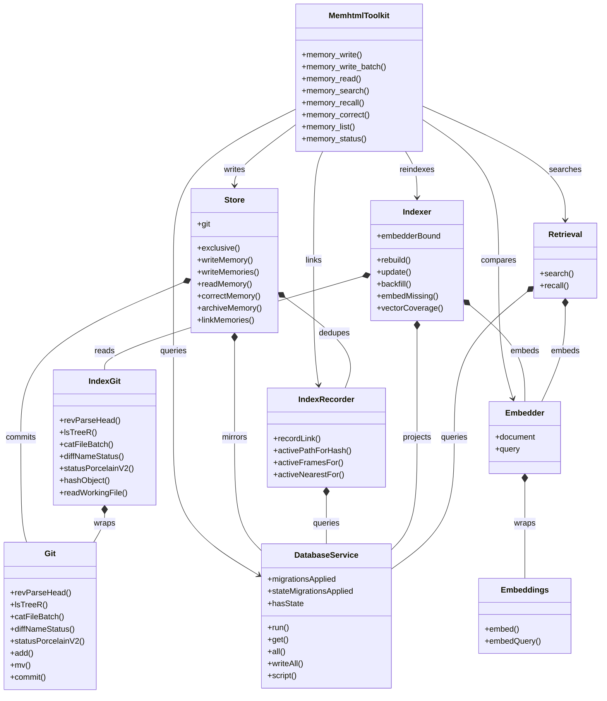

# memhtml-public · Components

Describes the source at 0.16.0 (2026-10-18). Citations are `path:line` into that tree.

The diagram shows the MCP toolkit and the nine Effect services at the center of the app layer, with the edge each service takes on another. The tree defines 13 `Context.Service` tags in all. The nine drawn here come from `packages/store/src/store.ts:318`, `packages/store/src/git.ts:154`, `packages/index/src/indexer.ts:147`, `packages/index/src/retrieval.ts:197`, `packages/index/src/database.ts:95`, `packages/index/src/git-port.ts:82`, `packages/index/src/traces-persist.ts:162`, `packages/llm/src/embeddings.ts:27`, and `apps/cli/src/api-layer.ts:223`.

A service class is a `Context.Service` tag, and its members are the `readonly` fields of the tag's shape interface. `Store` is `Context.Service<StoreShape>` at `packages/store/src/store.ts:318`, over the interface at `packages/store/src/store.ts:226-316`. A member drawn with `()` is a function. A member drawn without them is a value, such as `Store.git` at `packages/store/src/store.ts:228` or `DatabaseShape.hasState` at `packages/index/src/database.ts:92`.

`MemhtmlToolkit` isn't a service. It's a `Toolkit.make` of 15 tool schemas at `apps/mcp/src/tools.ts:1041-1057`, and it takes no dependency itself. The dependencies belong to its handler layer, `MemhtmlToolkit.toLayer` at `apps/mcp/src/handlers.ts:330-334`, which requires `AppServices`, the whole output of `layerApp` (`apps/mcp/src/handlers.ts:53`). Each handler calls an operation imported from `@memhtml/cli` (`apps/mcp/src/handlers.ts:1-30`), and the operation is where the service is taken. So the toolkit's edges below cite `apps/cli/src/operations.ts`.

Three classes are larger than the diagram shows. The `Toolkit.make` has 15 tools and 8 are drawn (`apps/mcp/src/tools.ts:1042-1056`). `StoreShape` has 13 members and 8 are drawn (`packages/store/src/store.ts:226-316`). `GitShape` has 21 members and 8 are drawn (`packages/store/src/git.ts:53-139`). Every other class shows its whole shape.

The layers are composed in one file. `layerCore` stacks the services in dependency order with `Layer.provideMerge` (`apps/cli/src/api-layer.ts:396-400`). `layerApp` adds the roots, the embedder, the extractor port, and the retrieval policy on top (`apps/cli/src/api-layer.ts:409-419`). The CLI runs every v1 command over `layerApp` unless a test injects a layer (`apps/cli/src/run.ts:2417`). The MCP server provides the same `layerApp` under `ToolHandlers` (`apps/mcp/src/server.ts:40-53`), so a tool and its CLI twin read one database and one git root.

The `session`, `head`, and `curate` commands take none of these tags. They resolve the root themselves and call the head, session, snapshot, and curator packages as plain functions, with only the tracer and the stderr logger provided (`apps/cli/src/v2.ts:122-128`, `apps/cli/src/run.ts:2355-2372`). The head server process builds no `layerApp` either. See `docs/design.md` §22.

Four tags sit outside the diagram because they carry configuration or a client rather than behavior of their own. `Roots` holds the two resolved directories (`apps/cli/src/api-layer.ts:87-94`). `RetrievalPolicy` holds the vector coverage floor (`apps/cli/src/api-layer.ts:281-286`). `ExtractorPort` holds one optional entity extractor (`apps/cli/src/api-layer.ts:356-360`). `ModelClient` is the model transport behind it (`packages/llm/src/model-client.ts:71`). Their edges are listed after the diagram.

The tree also has one `Context.Reference`, `CheckoutLockHeld`, the set of checkout locks the current fiber holds. It's what makes `Store.exclusive` and `Git.commit` reentrant on one checkout (`packages/contracts/src/checkout-lock.ts:88-97`).

## Edges

An arrow from `MemhtmlToolkit` is a call from one of its handlers into an operation. A diamond is a layer that takes the other service when it's built.

`MemhtmlToolkit --> Store`: `writeMemory`, `batchWrite`, `readMemory`, `correctMemory`, `linkMemories`, and `archiveMemory` take `Store` at `apps/cli/src/operations.ts:346`, `apps/cli/src/operations.ts:749`, `apps/cli/src/operations.ts:970`, `apps/cli/src/operations.ts:1064`, `apps/cli/src/operations.ts:1102`, and `apps/cli/src/operations.ts:1114`, and `statusReport` takes it at `apps/cli/src/operations.ts:2491`.

`MemhtmlToolkit --> Retrieval`: `searchMemories` and `recallMemories` take `Retrieval` at `apps/cli/src/operations.ts:996` and `apps/cli/src/operations.ts:1013`. The `memory_search` and `memory_recall` handlers ask the head server first and call these two only when the head gives no answer (`apps/mcp/src/handlers.ts:573-581`, `apps/mcp/src/handlers.ts:617-619`).

`MemhtmlToolkit --> Indexer`: every write brings the index up to its commit through `reindex`, which takes `Indexer` at `apps/cli/src/operations.ts:269`.

`MemhtmlToolkit --> DatabaseService`: the read paths take `DatabaseService` directly, in `bumpAccess` (`apps/cli/src/operations.ts:1026`), `reinforceMemories` (`apps/cli/src/operations.ts:1126`), `neighborsOf` (`apps/cli/src/operations.ts:1292`), `resolveMemory` (`apps/cli/src/operations.ts:1541`), `listMemories` (`apps/cli/src/operations.ts:1633`), `searchTraces` (`apps/cli/src/operations.ts:2346`), `traceLinks` (`apps/cli/src/operations.ts:2420-2433`), and `statusReport` (`apps/cli/src/operations.ts:2492`). `readMemory` calls `bumpAccess` after a read (`apps/cli/src/operations.ts:973`).

`MemhtmlToolkit --> IndexRecorder`: `recordLink` takes `IndexRecorder` to write the session link at `apps/cli/src/operations.ts:204`, and the batch assists `detectFrameConflicts` and `detectNearDuplicates` take `IndexRecorder` at `apps/cli/src/operations.ts:545` and `apps/cli/src/operations.ts:663`.

`MemhtmlToolkit --> Embedder`: `detectNearDuplicates` takes `Embedder` for its document port at `apps/cli/src/operations.ts:649` to compare a batch against the store.

The toolkit also takes three tags outside the diagram. `batchWrite` takes `ExtractorPort` at `apps/cli/src/operations.ts:831`, and `statusReport` takes `RetrievalPolicy` at `apps/cli/src/operations.ts:2493`. The `memory_search` and `memory_recall` handlers take `Roots` for the head route (`apps/mcp/src/handlers.ts:580`, `apps/mcp/src/handlers.ts:618`), and `guardV1Door` reads the store policy at the `Roots` directory before a record-creating tool writes (`apps/cli/src/store-config.ts:96-99`, `apps/cli/src/store-config.ts:125-133`).

`Store *-- Git`, `Store *-- IndexRecorder`, `Store *-- DatabaseService`: `layerStore` takes `Git`, `IndexRecorder`, and `DatabaseService` at `apps/cli/src/api-layer.ts:192-194`. The recorder supplies `dedupeLookup`, and the database mirrors `state.access` on a move (`apps/cli/src/api-layer.ts:196-205`).

`IndexRecorder *-- DatabaseService`: `layerRecorder` takes `DatabaseService` at `apps/cli/src/api-layer.ts:174`.

`IndexGit *-- Git`: `layerIndexGit` takes the store's `Git` at `apps/cli/src/api-layer.ts:155` and wraps it with `makeGitPort` at `apps/cli/src/api-layer.ts:156`.

`Indexer *-- DatabaseService`, `Indexer *-- IndexGit`, `Indexer *-- Embedder`: `layerIndexer` takes all three at `apps/cli/src/api-layer.ts:257-259`, and passes `embedder.document` at `apps/cli/src/api-layer.ts:265`.

`Retrieval *-- DatabaseService`, `Retrieval *-- Embedder`: `layerRetrieval` takes both at `apps/cli/src/api-layer.ts:326-327`, and passes `embedder.query` at `apps/cli/src/api-layer.ts:331`. It also takes `RetrievalPolicy` at `apps/cli/src/api-layer.ts:328`.

`Embedder *-- Embeddings`: `layerEmbedder` takes `Embeddings` at `apps/cli/src/api-layer.ts:241` unless `MEMHTML_EMBED` is `off` (`apps/cli/src/api-layer.ts:236-240`).

`ExtractorPort` takes `ModelClient` at `apps/cli/src/api-layer.ts:374`, unless `MEMHTML_EXTRACT_ENTITIES` or `MEMHTML_LLM` is `off` (`apps/cli/src/api-layer.ts:365-373`). `Roots` is read by the database, git, and index git layers at `apps/cli/src/api-layer.ts:123`, `apps/cli/src/api-layer.ts:134`, and `apps/cli/src/api-layer.ts:154`.

## See also

Counts are the distinct existing non-docs source paths cited in inline backticks on both pages, measured against the tree at cf76951.

- [memhtml-public · Module map](../../architecture/module-map.md): 18 shared source citations
- [memhtml-public · Contract map](../../insights/contract-map.md): 17 shared source citations
- [memhtml-public · Impact analysis](../../insights/impact-analysis.md): 17 shared source citations
- [memhtml-public · CLI](../../reference/cli.md): 14 shared source citations
- [memhtml-public · Data flow](../../architecture/data-flow.md): 14 shared source citations
- [memhtml-public · Processes](../../behavior/processes.md): 14 shared source citations
- [memhtml-public · Business logic](../../insights/business-logic.md): 13 shared source citations
- [memhtml-public · Debugging guide](../../insights/debugging-guide.md): 13 shared source citations
- [memhtml-public · Sequences](../../diagrams/behavioral/sequences.md): 13 shared source citations
- [memhtml-public · Dependency graph](../../diagrams/structural/dependency-graph.md): 12 shared source citations
- [memhtml-public · RPC tools](../../reference/rpc-tools.md): 12 shared source citations
- [memhtml-public · Tech debt](../../insights/tech-debt.md): 12 shared source citations
- [memhtml-public · Public API](../../reference/public-api.md): 10 shared source citations
- [memhtml-public · System overview](../../architecture/system-overview.md): 9 shared source citations
- [memhtml-public · State machines](../../behavior/state-machines.md): 8 shared source citations
