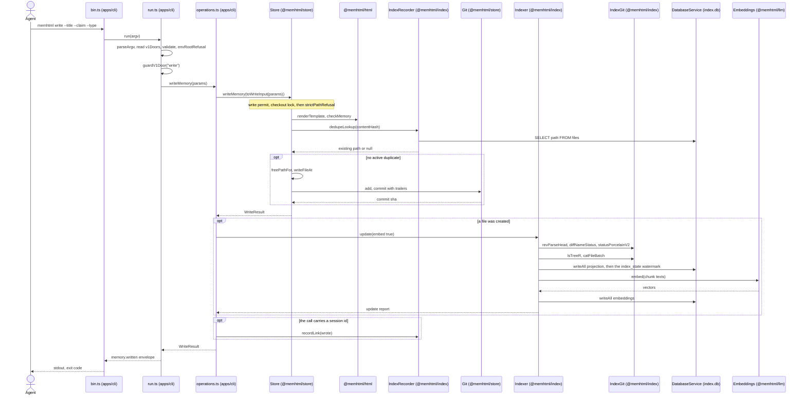
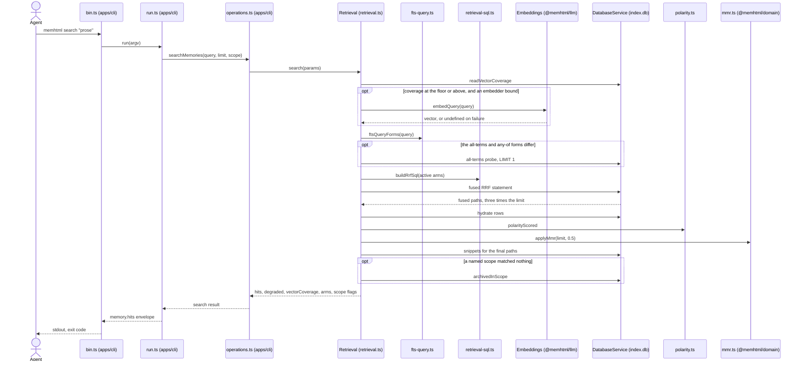
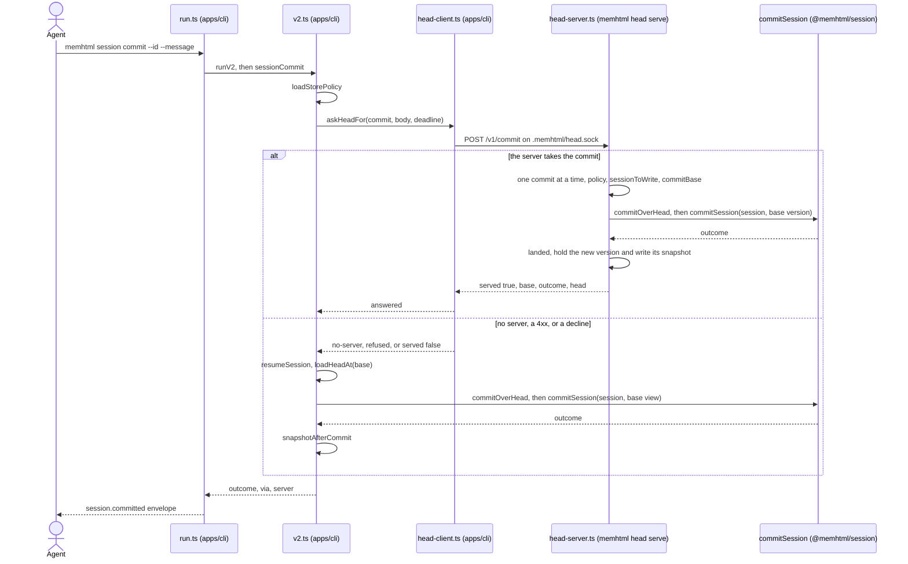
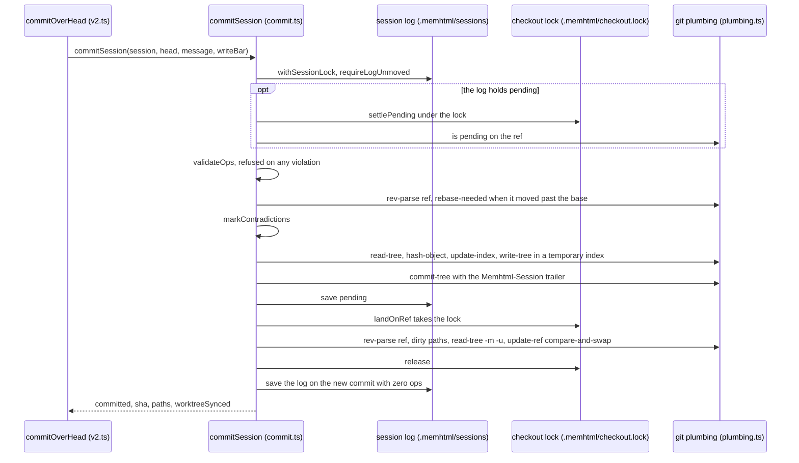
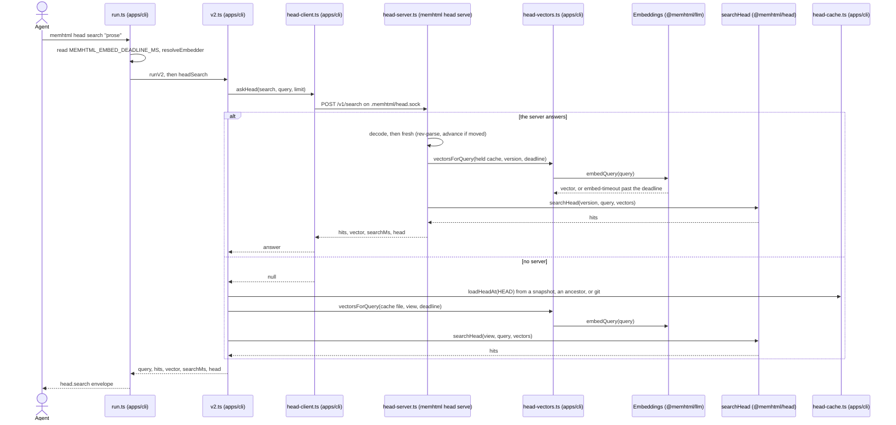
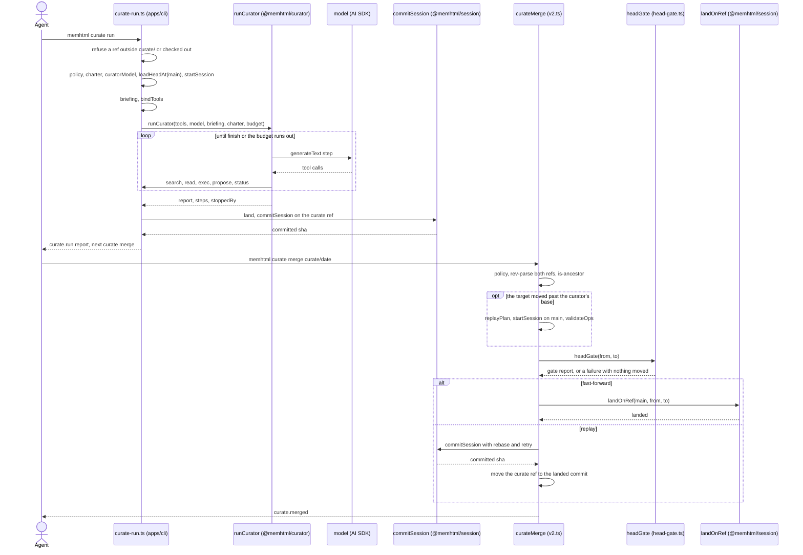

# memhtml-public · Sequences

Describes the source at 0.16.0 (2026-10-18). Citations are `path:line` into that tree.

These diagrams show the call order of six commands. `memhtml write` and `memhtml search` are the v1 doors over the SQLite index. `memhtml session commit`, `memhtml head search`, and `memhtml curate run` followed by `memhtml curate merge` are v2 commands over the head. Each participant is a file, a package, an Effect service tag, or a process defined in this repository, apart from the human or agent at the terminal. Each arrow is a call that the source makes, and the section under each diagram cites it.

Every flow acts on the memhtml root, the separate memory tree that `--repo` or `MEMHTML_ROOT` names (`apps/cli/src/api-layer.ts:96-109`). `DatabaseService` is one connection to that root's `.memhtml/index.db` with `state.db` attached (`apps/cli/src/api-layer.ts:119-129`). `Git` runs `git` subprocesses in that root (`packages/store/src/git.ts:222-231`).

The two v1 commands run their dispatch arm over `layerApp`, the one production composition (`apps/cli/src/run.ts:2414-2431`, `apps/cli/src/api-layer.ts:409-419`). A handler in the MCP server reaches the same operations through the same layer. For example, `memory_write` calls `writeMemory` at `apps/mcp/src/handlers.ts:371`, and `memory_search` asks the head server first and calls `searchMemories` when it gets no answer (`apps/mcp/src/handlers.ts:612`). The MCP door itself is drawn in `architecture/data-flow.md`.

The v2 commands build no `layerApp`. `run` hands them to `runV2`, which calls the session, head, snapshot, and curator packages as plain functions (`apps/cli/src/run.ts:2345-2373`, `apps/cli/src/v2.ts:122-128`).

## memhtml write

### Write call sites

`Agent->>Bin` and `Bin->>Run`: the binary calls `run(process.argv.slice(2))`, and the envelope it returns is the only thing written to stdout (`apps/cli/src/bin.ts:5`).

The first `Run->>Run`: `run` parses argv with `parseArgv` (`apps/cli/src/run.ts:1691`, `apps/cli/src/run.ts:187-264`). Help and the bare manifest answer first (`apps/cli/src/run.ts:1699-1705`). For a record-creating door, `run` reads the store's `v1Doors` mode before it validates (`apps/cli/src/run.ts:1707-1723`). `validate` then refuses a bad call at exit 2 before any service is built (`apps/cli/src/run.ts:1725-1726`). `envRootRefusal` refuses a root taken from the environment when `MEMHTML_REFUSE_ENV_ROOT` is set (`apps/cli/src/run.ts:1944-1945`).

The second `Run->>Run` and `Run->>Ops`: the `write` dispatch arm runs `guardV1Door`, calls `ops.writeMemory`, and names the response type `memory.written` (`apps/cli/src/run.ts:364-386`). The guard reads the policy at the layer's root and refuses with `V1DoorClosed` when the mode closes the door (`apps/cli/src/store-config.ts:120-133`).

`Ops->>Store`: `writeMemory` decodes the parameters with `toWriteInput` and calls `store.writeMemory` (`apps/cli/src/operations.ts:344-353`). The decode checks the type against the operator vocabulary and checks a task's status and due date before any file is rendered (`apps/cli/src/operations.ts:299-336`).

The note on `Store`: the store's `writeMemory` runs inside `exclusive`, which takes one in-process permit and then the cross-process checkout lock (`packages/store/src/store.ts:1418-1422`, `packages/store/src/store.ts:1429`). A waiter for the lock retries for up to 15 s (`packages/contracts/src/checkout-lock.ts:47-54`). Its first gate is `strictPathRefusal` (`packages/store/src/store.ts:724`, `packages/store/src/store.ts:707-720`).

`Store->>Html`: `renderFor` calls `renderTemplate` (`packages/store/src/store.ts:657`), and `renderChecked` fails with `InvalidMemory` on any `checkMemory` violation before the file is written (`packages/store/src/store.ts:676-683`). Both functions are imported from `@memhtml/html` (`packages/store/src/store.ts:22-31`).

`Store->>Recorder` and `Recorder->>Db`: the store hashes the rendered bytes and calls its injected `dedupeLookup` (`packages/store/src/store.ts:728-734`). The composition injects the recorder's `activePathForHash` (`apps/cli/src/api-layer.ts:196`), which is one query for a live, non-archived, non-task row with that hash (`packages/index/src/traces-persist.ts:196-203`). A match returns `deduped: true` with no file and no commit (`packages/store/src/store.ts:735-744`).

`Store->>Store`: `freePathFor` picks a free path (`packages/store/src/store.ts:746-754`), and `writeFileAt` writes the file with `node:fs` (`packages/store/src/store.ts:767`, `packages/store/src/store.ts:475-481`).

`Store->>Git` and `Git-->>Store`: the store calls `git.add` and `git.commit` with provenance trailers (`packages/store/src/store.ts:768-771`). The `add` member of `Git` runs `git add` (`packages/store/src/git.ts:396-399`). Its `commit` member takes the checkout lock again, which the fiber already holds, then runs `git commit` and `git rev-parse HEAD` for the sha (`packages/store/src/git.ts:403-422`). The write, the stage, and the commit run under a journal that compensates a failure (`makeJournal`, `packages/store/src/store.ts:762-773`).

`Store-->>Ops`: the result carries the path, `created`, `deduped`, the commit sha, and the content hash (`packages/store/src/store.ts:775-781`).

`Ops->>Indexer`: only a created file triggers `reindex` (`apps/cli/src/operations.ts:350`), which calls `indexer.update({ embed: true })` (`apps/cli/src/operations.ts:267-271`).

`Indexer->>IndexGit`: `update` reads HEAD at `packages/index/src/indexer.ts:811`, diffs the watermark against it with `diffNameStatus` at `packages/index/src/indexer.ts:857`, and reads uncommitted changes with `statusPorcelainV2` at `packages/index/src/indexer.ts:858`. It reads the changed blobs with `lsTreeR` at `packages/index/src/indexer.ts:873` and `catFileBatch` at `packages/index/src/indexer.ts:880`. `IndexGit` is the store's `Git` wrapped by `makeGitPort` (`apps/cli/src/api-layer.ts:155-156`).

`Indexer->>Db`, first arrow: `applyProjectionWrites` sends the projection through `db.writeAll` in batches (`packages/index/src/indexer.ts:994`, `packages/index/src/indexer.ts:284`). Then `writeState` (`packages/index/src/indexer.ts:995`, `packages/index/src/indexer.ts:439-441`) records the new watermark in `index_state`.

`Indexer->>Emb` and `Emb-->>Indexer`: `embedMissing` runs over the chunks this pass projected (`packages/index/src/indexer.ts:1002`) and calls `embeddings.embed` one slice at a time (`packages/index/src/indexer.ts:577`). The port is the embedder's document half (`apps/cli/src/api-layer.ts:265`). The Bedrock port's `embed` (`packages/llm/src/embeddings.ts:136-141`) sends each batch of texts to Bedrock through `embedChunk`, which calls `invokeJson` (`packages/llm/src/embeddings.ts:111-116`).

`Indexer->>Db`, second arrow: each slice's vectors are written through `applyWrites` (`packages/index/src/indexer.ts:606`), the same batched `writeAll`. When a slice comes back as a `Failure`, the pass ends and keeps every vector already written, so an embedder outage doesn't fail the write (`packages/index/src/indexer.ts:585`).

`Ops->>Recorder`: `recordLink` writes a `wrote` session link when the call carries a session id, and logs a failure instead of raising it (`apps/cli/src/operations.ts:351`, `apps/cli/src/operations.ts:201-218`).

`Run-->>Bin` and `Bin-->>Agent`: a success becomes an envelope at exit 0. A typed failure goes through `failureFor` at exit 1, and a closed door raised inside the layer exits 2 (`apps/cli/src/run.ts:2414-2422`, `apps/cli/src/errors.ts:277-279`). The codes are `EXIT_OK`, `EXIT_USAGE`, and `EXIT_RUNTIME` (`apps/cli/src/envelope.ts:166-168`). The binary calls `process.exit` from the write callback, so a slow pipe reader still gets the whole envelope (`apps/cli/src/bin.ts:22`).

The diagram leaves out the indexer's two early exits. With no watermark row from `readState`, `update` reprojects the whole tree (`packages/index/src/indexer.ts:812`, `packages/index/src/indexer.ts:821-822`). With a watermark a rebuild left empty, it fails with `IndexStale` (`packages/index/src/indexer.ts:842-846`). The batch door, `memhtml apply`, calls `ops.batchWrite` instead (`apps/cli/src/run.ts:394-405`), and `architecture/data-flow.md` covers the rest of the write steps.

## memhtml search

### Search call sites

`Agent->>Bin` through `Run->>Ops`: the binary and `run` behave as in the write flow. The `search` arm calls `ops.searchMemories` with the query, the limit, and the shared scope, and names the response type `memory.hits` (`apps/cli/src/run.ts:428-436`). The scope comes from one helper that `search` and `recall` share (`apps/cli/src/run.ts:302-313`).

`Ops->>Retrieval`: `searchMemories` takes `Retrieval` and delegates (`apps/cli/src/operations.ts:994-998`). It records no access bump, so a ranked hit doesn't feed back into salience (`apps/cli/src/operations.ts:982-993`).

`Retrieval->>Db`, coverage: `search` first calls `gatedQueryVector` (`packages/index/src/retrieval.ts:509`), which calls `readVectorCoverage` (`packages/index/src/retrieval.ts:310`, `packages/index/src/vector-coverage.ts:99-125`). Below the floor, `VECTOR_COVERAGE_FLOOR` or 0.95 by default, the query is never embedded (`packages/index/src/retrieval.ts:311-318`, `packages/index/src/vector-coverage.ts:43`). The floor comes from `RetrievalPolicy` (`apps/cli/src/api-layer.ts:328`).

`Retrieval->>Emb` and `Emb-->>Retrieval`: `queryVector` returns `undefined` when no embedder is bound. Otherwise it calls `embedQuery`, logs a failure, and turns it into `undefined` (`packages/index/src/retrieval.ts:319`, `packages/index/src/retrieval.ts:266-280`). `embedQuery` embeds one text with the `search_query` input type (`packages/llm/src/embeddings.ts:142-144`).

`Retrieval->>Fts`: `fuse` never matches the caller's prose. It asks `ftsQueryForms` for an all-terms form and an any-of form (`packages/index/src/retrieval.ts:354`, `packages/index/src/fts-query.ts:99`).

`Retrieval->>Db`, probe: when the two forms differ, `holdsEveryTerm` runs one `LIMIT 1` statement from `buildFtsProbeSql` to decide which form to bind (`packages/index/src/retrieval.ts:355-358`, `packages/index/src/retrieval.ts:283-296`, `packages/index/src/retrieval-sql.ts:149`).

`Retrieval->>Sql`: `buildRrfSql` folds the arms that can fire into one statement (`packages/index/src/retrieval.ts:359-364`, `packages/index/src/retrieval-sql.ts:307-311`). The registry holds four arms, lexical, vector, recency, and salience (`packages/index/src/retrieval-sql.ts:268`). In `activeArms`, an arm leaves the fold when it lacks a query vector, the state plane, or query terms (`packages/index/src/retrieval-sql.ts:288-295`). With no arm left, the `sql` is `undefined` and `fuse` returns no paths (`packages/index/src/retrieval.ts:365`).

`Retrieval->>Db`, fused statement: one `db.all` returns the fused paths (`packages/index/src/retrieval.ts:374`). The pool is `MMR_POOL_FACTOR` times the limit, and `DEFAULT_SEARCH_LIMIT` is 10 (`packages/index/src/retrieval.ts:514`, `packages/index/src/retrieval.ts:47`, `packages/index/src/retrieval.ts:53`).

`Retrieval->>Db`, hydrate: one statement reads each fused path's row, entities, superseding edge, and first chunk vector (`packages/index/src/retrieval.ts:517`, `packages/index/src/retrieval.ts:404-429`).

`Retrieval->>Polarity`: `polarityScored` gives each candidate a score from its fused rank and demotes a negation-flipped twin (`packages/index/src/retrieval.ts:530-533`, `packages/index/src/polarity.ts:78`).

`Retrieval->>Mmr`: `applyMmr` reorders the pool down to the limit with `MMR_LAMBDA` of 0.5 (`packages/index/src/retrieval.ts:539`, `packages/domain/src/mmr.ts:36`, `packages/domain/src/ranking.ts:18`).

`Retrieval->>Db`, snippets: `snippets` runs over the final paths only and keeps each file's best chunk from one `buildSnippetSql` statement (`packages/index/src/retrieval.ts:545-548`, `packages/index/src/retrieval.ts:441-461`, `packages/index/src/retrieval-sql.ts:343`).

`Retrieval->>Db`, archived: when a named scope left nothing, `archivedInScope` counts the archived rows in the same scope (`packages/index/src/retrieval.ts:549-558`, `packages/index/src/retrieval.ts:474-498`).

`Retrieval-->>Ops` through `Bin-->>Agent`: the result carries the hits and the response flags (`packages/index/src/retrieval.ts:560-597`). `degraded` is true whenever the search ran without a query vector, for any of the three reasons above (`packages/index/src/retrieval.ts:585`). The envelope and exit follow the write flow.

The diagram folds the SQL each arm contributes into the one `fused RRF statement` message. The arm bodies live in `packages/index/src/retrieval-sql.ts`, and `recall` follows the same path up to fusion (`packages/index/src/retrieval.ts:600-604`).

## memhtml session commit

The first diagram shows who runs the commit. The second shows what `commitSession` does once one of them runs it. See `docs/design.md` §17 and §22.

### Session commit call sites

`Agent->>Run` and `Run->>V2`: `run` takes the v2 branch for `session commit` and hands it to `runV2` (`apps/cli/src/run.ts:2345-2373`), which calls `sessionCommit` (`apps/cli/src/v2.ts:1927-1928`).

`V2->>V2`, policy: `sessionCommit` reads `memhtml.config.json` before it asks the server, so a malformed file fails with `ERR_STORE_CONFIG` on either path (`apps/cli/src/v2.ts:1114-1116`).

`V2->>Client` and `Client->>Server`: `askHeadFor` posts `{ id, message, dropRefused }` to the commit route and waits up to `MEMHTML_COMMIT_DEADLINE_MS`, 60000 by default (`apps/cli/src/v2.ts:1117-1126`, `apps/cli/src/head-protocol.ts:373-376`). The client dials the store's socket, and a failure before the connection completes means no server (`apps/cli/src/head-client.ts:21-25`, `apps/cli/src/head-client.ts:147-219`).

The first `Server->>Server`: the server runs one commit or rebase at a time and declines `busy` after a 20 s wait (`apps/cli/src/head-server.ts:1232-1241`, `apps/cli/src/head-protocol.ts:384`). `serveCommit` reads the policy per request, declines a session on another ref or one whose log doesn't read, and builds the version at the session's base from what it holds (`apps/cli/src/head-server.ts:1263-1276`, `apps/cli/src/head-server.ts:1243-1261`, `apps/cli/src/head-server.ts:1145-1171`).

`Server->>Commit`: the server runs `commitOverHead` with an `afterCommit` hook (`apps/cli/src/head-server.ts:1277-1284`). `commitOverHead` calls `commitSession`, repeats it with the refused ops dropped under `--drop-refused`, and writes the new commit's snapshot on `committed` (`apps/cli/src/v2.ts:944-996`).

The second `Server->>Server`: `landed` builds the version at the new commit from the base over the commit's diff, holds it when the ref is still there, writes its snapshot, and starts the vector fill (`apps/cli/src/head-server.ts:1198-1230`).

`Server-->>Client` and `Client-->>V2`: a served answer comes back with `via: "server"` (`apps/cli/src/v2.ts:1127-1135`).

The `else` branch: no server, a 4xx, or a decline sends the commit to the local path (`apps/cli/src/v2.ts:1047-1077`, `apps/cli/src/v2.ts:1136-1139`). A 5xx or a lost answer fails with `ERR_STORAGE` instead, because the ref may already have moved. Locally, `sessionCommit` resumes the session, loads the head at its base, and runs the same `commitOverHead` (`apps/cli/src/v2.ts:1141-1150`).

`Caller->>Commit` and `Commit->>Log`: `commitSession` holds the session's lock for the whole call and refuses a log that changed since the caller read it (`packages/session/src/commit.ts:451-458`).

The `opt` block: a `pending` commit an earlier call left is settled first. It answers `committed` with `recovered: true` when that commit landed, and otherwise it undoes the checkout and goes on (`packages/session/src/commit.ts:465-491`, `packages/session/src/commit.ts:335-383`).

`Commit->>Commit`, validate, and the first `Commit->>Git`: the ops are judged against the write bar, and the ref must still be at the validated version (`packages/session/src/commit.ts:493-508`).

`Commit->>Commit`, contradictions, and the temporary index: frame-key contradictions are marked, then the blobs, the tree, and the commit are built through an index file of the call's own under the OS temp directory (`packages/session/src/commit.ts:510-534`, `packages/session/src/commit.ts:223-247`). The commit message carries the `Memhtml-Session` trailer (`packages/session/src/commit.ts:62-80`).

`Commit->>Log`, pending: the intent is saved before anything shared is touched (`packages/session/src/commit.ts:536-537`).

`Commit->>Lock` through `Commit->>Lock`, release: `landOnRef` runs under the checkout lock and is uninterruptible once it holds it. The ref must still name the base, a checked-out ref with a dirty path answers `worktree-dirty`, `read-tree -m -u` moves the checkout, and `update-ref` swaps the ref. A lost swap rolls the checkout back (`packages/session/src/commit.ts:284-333`, `packages/session/src/commit.ts:539-567`).

`Commit->>Log`, final save, and `Commit-->>Caller`: the log is saved on the new commit with zero ops, and the outcome names the commit, its paths, and whether the checkout followed (`packages/session/src/commit.ts:569-580`).

## memhtml head search

### Head search call sites

`Run->>Run`: `head search` reads `MEMHTML_EMBED_DEADLINE_MS` and binds an embedder, one of four v2 commands that do (`apps/cli/src/run.ts:2161-2167`, `apps/cli/src/run.ts:1231-1241`, `apps/cli/src/run.ts:2271-2278`).

`Run->>V2`: `runV2` calls `headSearch` and names the response type `head.search` (`apps/cli/src/v2.ts:1935-1936`).

`V2->>Client` and `Client->>Server`: `headSearch` posts the query and limit, plus the deadline when one is set, unless `--no-server` is given (`apps/cli/src/v2.ts:1407-1421`). `askHead` answers `null` for every way of not getting an answer, so a server can make a call faster and never makes it fail (`apps/cli/src/head-client.ts:14-19`, `apps/cli/src/head-client.ts:221-229`).

The first `Server->>Server`: the server decodes the body with excess properties refused, then `fresh` reads the ref and advances the held version when the ref moved (`apps/cli/src/head-server.ts:1363-1368`, `apps/cli/src/head-server.ts:958-969`).

`Server->>Vectors` and `Vectors->>Emb`: `vectorsForQuery` embeds the query against the held vector cache within the deadline, 450 ms by default. Past it the search answers on the lexical arm with `embed-timeout` (`apps/cli/src/head-server.ts:1369-1377`, `apps/cli/src/head-vectors.ts:206-266`, `apps/cli/src/head-protocol.ts:123`).

`Server->>Search`: `searchHead` runs a BM25 lexical arm and, given vectors, a vector arm, fused by RRF, with the request's scope as a predicate when it names one (`apps/cli/src/head-server.ts:1378-1385`, `packages/head/src/search.ts:211-234`).

`Server-->>Client`: the answer carries the hits, the vector arm's report, the search time, and the head it searched (`apps/cli/src/head-server.ts:1406-1414`). `headSearch` returns the answer (`apps/cli/src/v2.ts:1422-1432`), and `servedStats` marks its head as the server's (`apps/cli/src/v2.ts:201-210`).

The `else` branch: `headSearch` loads the head at `HEAD` and runs the same two calls over the vector cache file (`apps/cli/src/v2.ts:1434-1447`). `loadVersion` tries the commit's own snapshot, then an ancestor's snapshot advanced by delta, then git (`apps/cli/src/head-cache.ts:177-224`).

## memhtml curate run, then curate merge

### Curate call sites

`CurateRun->>CurateRun`, refusals: the ref must sit under `refs/heads/curate/` and must not be the branch `HEAD` names, checked before a model is built or a session opens (`apps/cli/src/curate-run.ts:548-561`). See `docs/design.md` §23.

`CurateRun->>CurateRun`, setup: the run reads the policy once, renders the charter, builds the model from the `--model` spec, loads the head at `main`'s tip, and starts the session on the curate ref (`apps/cli/src/curate-run.ts:565-599`). It builds the briefing over the starting view and binds the tools to the head, the session overlay, and the write bar (`apps/cli/src/curate-run.ts:601-613`).

`CurateRun->>Curator` and the loop: `runCurator` (`apps/cli/src/curate-run.ts:615-625`, `packages/curator/src/loop.ts:102`) runs a `generateText` tool loop (`packages/curator/src/loop.ts:214`) with the tools `search`, `read`, `exec`, `propose`, `status`, and `finish` (`packages/curator/src/loop.ts:145-196`). The model is Bedrock through `@ai-sdk/amazon-bedrock`, an OpenAI-compatible proxy, or a scripted fake (`packages/curator/src/model.ts:13-23`). A run the model stopped fails as `ERR_MODEL_UNAVAILABLE` and leaves its ops in the session for `--resume` (`apps/cli/src/curate-run.ts:627-634`).

`CurateRun->>Commit`: `land` calls `commitSession` under the `curate` scope and retries `rebase-needed` up to 8 times with the base moved to the ref's tip (`apps/cli/src/curate-run.ts:663-669`, `apps/cli/src/curate-run.ts:470-520`, `apps/cli/src/curate-run.ts:100`). The run then writes the new commit's snapshot so `curate merge` loads both tips from snapshots (`apps/cli/src/curate-run.ts:670-671`).

`Merge->>Merge`: `curateMerge` reads the policy, resolves both refs, and asks whether the curate ref descends from the target (`apps/cli/src/v2.ts:1635-1656`). When it doesn't, the curator's log is rebuilt from the trees, a fresh session starts on the target at its tip with those ops, and `validateOps` judges them, so a collision refuses before the gate runs (`apps/cli/src/v2.ts:1663-1688`).

`Merge->>Gate`: the head gate loads the versions at both tips and scores the same probes at each with `gateHeads`, with no network call. A failing gate fails the merge with nothing moved. `--skip-gate` is a logged override (`apps/cli/src/v2.ts:1690-1699`, `apps/cli/src/head-gate.ts:93-109`).

`Merge->>Land`: a fast-forward lands through `landOnRef` under the checkout lock, the same section a session commit lands with, and writes the snapshot for the new tip (`apps/cli/src/v2.ts:1732-1753`).

`Merge->>Commit`, replay: `landReplay` calls `commitSession` with the subject `(replayed onto <short sha>)` through a loop bounded at `MERGE_ATTEMPTS`, then moves the curate ref to the landed commit with a compare-and-swap (`apps/cli/src/v2.ts:1771-1810`, `apps/cli/src/v2.ts:1535`).

## See also

Counts are the distinct existing non-docs source paths cited in inline backticks on both pages, measured against the tree at cf76951.

- [memhtml-public · Processes](../../behavior/processes.md): 31 shared source citations
- [memhtml-public · CLI](../../reference/cli.md): 29 shared source citations
- [memhtml-public · Data flow](../../architecture/data-flow.md): 28 shared source citations
- [memhtml-public · Impact analysis](../../insights/impact-analysis.md): 27 shared source citations
- [memhtml-public · Contract map](../../insights/contract-map.md): 25 shared source citations
- [memhtml-public · Module map](../../architecture/module-map.md): 25 shared source citations
- [memhtml-public · Business logic](../../insights/business-logic.md): 22 shared source citations
- [memhtml-public · Debugging guide](../../insights/debugging-guide.md): 21 shared source citations
- [memhtml-public · RPC tools](../../reference/rpc-tools.md): 17 shared source citations
- [memhtml-public · Tech debt](../../insights/tech-debt.md): 17 shared source citations
- [memhtml-public · Components](../../diagrams/architecture/components.md): 13 shared source citations
- [memhtml-public · Dependency graph](../../diagrams/structural/dependency-graph.md): 13 shared source citations
- [memhtml-public · Public API](../../reference/public-api.md): 13 shared source citations
- [memhtml-public · State machines](../../behavior/state-machines.md): 10 shared source citations
- [memhtml-public · System overview](../../architecture/system-overview.md): 10 shared source citations
