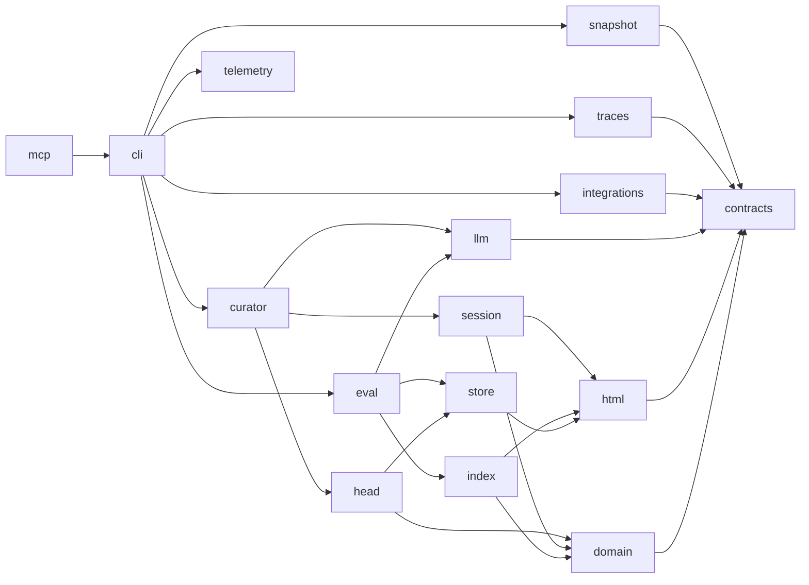
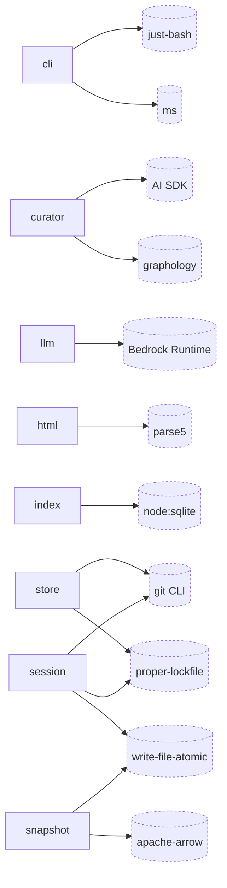

# memhtml-public · Dependency graph

Describes the source at 0.16.0 (2026-10-18). Citations are `path:line` into that tree.

This repository holds the software that manages a memhtml root. It stores no memories itself. The root is a separate directory located by `MEMHTML_ROOT` (`apps/cli/src/config.ts:107-112`). The software reaches into that root through three external nodes. The git CLI owns the system of record, and both `store` and `session` spawn it (`packages/store/src/git.ts:222-231`, `packages/session/src/plumbing.ts:1-14`). `node:sqlite` owns the rebuildable v1 projection at `.memhtml/index.db` (`packages/index/src/database.ts:4`, `packages/index/src/index.ts:1-6`). `apache-arrow` writes the head's snapshots and vector caches under `.memhtml/snapshots` and `.memhtml/vectors` (`packages/snapshot/src/snapshot.ts:41-42`, `packages/snapshot/src/snapshot.ts:177`, `packages/snapshot/src/vectors.ts:68`).

The page has two diagrams. The first shows the 16 workspace packages and the internal edges between them. The second shows the 8 packages that carry a drawn external dependency and the 11 external nodes they reach, 19 nodes in all. Each diagram stays inside a 20-node budget. `effect` is declared by every package, so it's in the external table only.

## Internal graph

Internal edges are the transitive reduction of the direct-import graph. An edge is left out when the same relation already holds along a longer path through other packages, so a missing arrow between two internal nodes means the relation is implied by a path.

An internal edge P → Q exists when a file under P's `src/` imports `@memhtml/<q>` or one of its subpaths. `@memhtml/contracts/errors` and the other `contracts` subpaths account for 102 of the 144 `contracts` sites. No internal import is dynamic. The reduction dropped 24 of the 50 direct internal edges and kept 26. Fourteen of the other fifteen packages import `contracts` directly, and `cli` imports all fourteen libraries, so the unreduced graph is close to dense and hard to read.

The graph has two sinks. `contracts` imports nothing internal by design, and `telemetry` imports only `effect` and its subpaths (`packages/telemetry/src/index.ts:1-2`), which is also why `telemetry` is the one package that doesn't import `contracts`. `mcp` is the only source. The graph is acyclic, so it has exactly one transitive reduction.

Three examples show what the reduction left out. `cli --> contracts` has 50 import sites in `apps/cli/src`, such as `apps/cli/src/api-layer.ts:3`, and the relation still holds through `cli --> snapshot --> contracts` (`packages/snapshot/src/snapshot.ts:25`). `mcp --> index` (`apps/mcp/src/handlers.ts:33`) still holds through `mcp --> cli --> eval --> index`. `head --> html` has 2 sites in `packages/head/src` (`packages/head/src/record.ts:6`, `packages/head/src/overlay.ts:5`), and it still holds through `head --> store --> html` (`packages/store/src/store.ts:21-31`).

## External graph

This diagram draws only the external edges. The internal edges are in the first diagram.

## Internal nodes

Each description is the `description` field of the package's own manifest. Every manifest names the package on line 2 and marks it `"private": true` on line 4. Twelve describe it on line 5. `head`, `session`, `snapshot`, and `telemetry` have no `description` field, so their rows quote the module comment of the package's entry point.

| Node           | Manifest                               | Description                                                                                                                                                                                                                                                                                                                                                     |
| -------------- | -------------------------------------- | --------------------------------------------------------------------------------------------------------------------------------------------------------------------------------------------------------------------------------------------------------------------------------------------------------------------------------------------------------------- |
| `cli`          | `apps/cli/package.json:2`              | The `memhtml` binary (`apps/cli/package.json:5`). Publishes the `memhtml` bin at `apps/cli/package.json:21-23`.                                                                                                                                                                                                                                                 |
| `mcp`          | `apps/mcp/package.json:2`              | The `memhtml-mcp` stdio server (`apps/mcp/package.json:5`). Publishes the `memhtml-mcp` bin at `apps/mcp/package.json:20-22`.                                                                                                                                                                                                                                   |
| `contracts`    | `packages/contracts/package.json:2`    | Schemas, enums, errors, and path algebra. Zero I/O (`packages/contracts/package.json:5`).                                                                                                                                                                                                                                                                       |
| `curator`      | `packages/curator/package.json:2`      | The curator memhtml itself owns: a bounded model-driven tool loop over a curator session, its charter, its budget, and its model factory (`packages/curator/package.json:5`). Imported only by `cli`, at four sites (`apps/cli/src/run.ts:2`, `apps/cli/src/config.ts:4`, `apps/cli/src/curate-run.ts:28`, `apps/cli/src/curate-collapse.ts:26`).               |
| `domain`       | `packages/domain/package.json:2`       | Pure math: retention, decay, RRF, MMR, merge guards (`packages/domain/package.json:5`).                                                                                                                                                                                                                                                                         |
| `eval`         | `packages/eval/package.json:2`         | Fixture corpus generator and the refusable retrieval discrimination gate (`packages/eval/package.json:5`).                                                                                                                                                                                                                                                      |
| `head`         | `packages/head/package.json:2`         | No `description` field. The module comment calls it the corpus as a value, one immutable version per commit, searched by RRF over a lexical arm and, given vectors, a vector arm (`packages/head/src/index.ts:1-6`).                                                                                                                                            |
| `html`         | `packages/html/package.json:2`         | Parse and serialize the memory file format (`packages/html/package.json:5`).                                                                                                                                                                                                                                                                                    |
| `index`        | `packages/index/package.json:2`        | SQLite schema, migrations, the git-driven indexer, and four-arm retrieval (`packages/index/package.json:5`).                                                                                                                                                                                                                                                    |
| `integrations` | `packages/integrations/package.json:2` | Wire a coding agent (Claude Code, Codex, Cursor, OpenCode) to a memhtml store: MCP entry, hooks, instruction block, skill, receipt (`packages/integrations/package.json:5`). Imported only by `cli`, at four sites (`apps/cli/src/run.ts:6`, `apps/cli/src/commands.ts:5`, `apps/cli/src/hook.ts:12`, `apps/cli/src/integrations.ts:26`).                       |
| `llm`          | `packages/llm/package.json:2`          | Bedrock embeddings and structured output (`packages/llm/package.json:5`).                                                                                                                                                                                                                                                                                       |
| `session`      | `packages/session/package.json:2`      | No `description` field. The module comment calls it a session's overlay log and the mechanical commit path that lands it on a ref through a temporary git index (`packages/session/src/index.ts:1-4`).                                                                                                                                                          |
| `snapshot`     | `packages/snapshot/package.json:2`     | No `description` field. The module comment calls it the columnar cold-start cache (`packages/snapshot/src/index.ts:1`).                                                                                                                                                                                                                                         |
| `store`        | `packages/store/package.json:2`        | Git-backed file store: read, write, move, commit, status (`packages/store/package.json:5`).                                                                                                                                                                                                                                                                     |
| `telemetry`    | `packages/telemetry/package.json:2`    | No `description` field. The module comment describes it as the opt-in OTLP trace exporter, gated on `OTEL_EXPORTER_OTLP_ENDPOINT` (`packages/telemetry/src/index.ts:5`). The CLI imports it at `apps/cli/src/run.ts:10` and the MCP server at `apps/mcp/src/server.ts:2`. The `mcp` edge is dropped by the reduction because `mcp --> cli --> telemetry` holds. |
| `traces`       | `packages/traces/package.json:2`       | Streaming JSONL parser and trace indexer (`packages/traces/package.json:5`).                                                                                                                                                                                                                                                                                    |

`mcp --> cli` is the most important internal edge. The MCP server imports the CLI's operations instead of reimplementing them, at five sites. The server takes `layerApp` (`apps/mcp/src/server.ts:1`). The resources take `readMemory` and `Store` (`apps/mcp/src/resources.ts:1`). The failure mapper takes `codeFor` and `messageFor` (`apps/mcp/src/failure.ts:1`). The handlers take the operations, the head-first search and recall, and `guardV1Door` (`apps/mcp/src/handlers.ts:1-30`). The tool definitions take the service tags and the neighbor and resolve constants (`apps/mcp/src/tools.ts:1-14`). A tool call and a CLI invocation therefore resolve through the same code and produce the same error codes. The CLI also publishes a machine-readable description of itself. `apps/cli/src/commands.ts:187` registers a `manifest` command, and `apps/cli/src/commands.ts:176-183` states that one table drives parsing, the manifest, and the generated doc, so that description can't drift from behavior.

## External nodes

| Node                | Version pin                                                                                                                                                                                                                                    | Source module         | Import sites                                                                                                                                                                                                                                                                                                                                                                                                                                                                                                          |
| ------------------- | ---------------------------------------------------------------------------------------------------------------------------------------------------------------------------------------------------------------------------------------------- | --------------------- | --------------------------------------------------------------------------------------------------------------------------------------------------------------------------------------------------------------------------------------------------------------------------------------------------------------------------------------------------------------------------------------------------------------------------------------------------------------------------------------------------------------------- |
| `effect`            | `4.0.5` (`pnpm-workspace.yaml:61`)                                                                                                                                                                                                             | all 16                | 109 sites in 98 files across `apps/*/src` and `packages/*/src`, 33 of them in `apps/cli/src`. Declared by all 16 packages and the integration harness, always as `catalog:`. The MCP protocol comes from `effect/ai` (`apps/mcp/src/server.ts:4`), the head server's HTTP router and client from `effect/http` (`apps/cli/src/head-server.ts:39`, `apps/cli/src/head-client.ts:6`), and the OTLP exporter from `effect/observability` (`packages/telemetry/src/index.ts:30`), so none of them adds a node of its own. |
| `Bedrock Runtime`   | `@aws-sdk/client-bedrock-runtime` `3.1153.0` (`packages/llm/package.json:33`)                                                                                                                                                                  | `llm`                 | `packages/llm/src/client.ts:1` takes `BedrockRuntimeClient` and `InvokeModelCommand`, and `packages/llm/src/proxy.ts:1` takes the command type.                                                                                                                                                                                                                                                                                                                                                                       |
| `AI SDK`            | `ai` `7.0.146` (`packages/curator/package.json:38`); `@ai-sdk/amazon-bedrock` `5.0.120`, `@ai-sdk/openai-compatible` `3.0.74`, `@ai-sdk/provider` `4.0.31`, `@aws-sdk/credential-providers` `3.1153.0` (`packages/curator/package.json:28-31`) | `curator`             | `packages/curator/src/model.ts:1-6` builds the model, `packages/curator/src/loop.ts:2` runs `generateText`, and `packages/curator/src/fake-model.ts:6` and `packages/curator/src/fake-model.ts:9` build the scripted test model.                                                                                                                                                                                                                                                                                      |
| `graphology`        | `graphology` `0.26.0`, `graphology-communities-louvain` `2.0.2`, `graphology-metrics` `2.4.2` (`packages/curator/package.json:40-42`)                                                                                                          | `curator`             | `packages/curator/src/planner/graph.ts:1-3`, the collapse planner's similarity graph, communities, and PageRank.                                                                                                                                                                                                                                                                                                                                                                                                      |
| `just-bash`         | `3.4.2` (`apps/cli/package.json:56`)                                                                                                                                                                                                           | `cli`                 | `apps/cli/src/exec.ts:347` loads it by dynamic `import`. `apps/cli/src/mount.ts:10-11` imports it statically, and `exec.ts` loads `mount.js` by dynamic `import` too (`apps/cli/src/exec.ts:351`). The sandbox worker loads it at `apps/cli/guest/sandbox-runner.mjs:44`.                                                                                                                                                                                                                                             |
| `ms`                | `2.1.3` (`apps/cli/package.json:57`)                                                                                                                                                                                                           | `cli`                 | `apps/cli/src/v2.ts:49`, which parses and prints `session prune` durations (`apps/cli/src/v2.ts:1311`, `apps/cli/src/v2.ts:1344`).                                                                                                                                                                                                                                                                                                                                                                                    |
| `parse5`            | `8.0.1` (`packages/html/package.json:36`)                                                                                                                                                                                                      | `html`                | `packages/html/src/tree.ts:1-2`, `packages/html/src/markup.ts:1`.                                                                                                                                                                                                                                                                                                                                                                                                                                                     |
| `node:sqlite`       | Node builtin, `node >=24` (`package.json:7-9`)                                                                                                                                                                                                 | `index`               | `packages/index/src/database.ts:4` imports `DatabaseSync`.                                                                                                                                                                                                                                                                                                                                                                                                                                                            |
| `git CLI`           | External binary                                                                                                                                                                                                                                | `store`, `session`    | `packages/store/src/git.ts:1` imports `node:child_process`, and `packages/store/src/git.ts:222-231` spawns `git` through `execFile`. `packages/session/src/plumbing.ts:1` imports it too, because a session sets its own `GIT_INDEX_FILE` per call (`packages/session/src/plumbing.ts:7-14`).                                                                                                                                                                                                                         |
| `proper-lockfile`   | `4.1.2` (`packages/store/package.json:40`, `packages/session/package.json:30`)                                                                                                                                                                 | `store`, `session`    | `packages/store/src/checkout-lock.ts:12` and `packages/session/src/checkout-lock.ts:12` for the checkout lock, `packages/session/src/session.ts:6` for the per-session lock.                                                                                                                                                                                                                                                                                                                                          |
| `write-file-atomic` | `8.0.0` (`packages/session/package.json:31`, `packages/snapshot/package.json:29`)                                                                                                                                                              | `session`, `snapshot` | `packages/session/src/session.ts:7`, `packages/session/src/exclude.ts:6`, `packages/snapshot/src/snapshot.ts:44`, `packages/snapshot/src/vectors.ts:41`.                                                                                                                                                                                                                                                                                                                                                              |
| `apache-arrow`      | `21.2.0` (`packages/snapshot/package.json:27`)                                                                                                                                                                                                 | `snapshot`            | `packages/snapshot/src/snapshot.ts:41-42`, `packages/snapshot/src/vectors.ts:38-39`.                                                                                                                                                                                                                                                                                                                                                                                                                                  |

The curator's model stack is its own `AI SDK` node. It reaches Bedrock through `@ai-sdk/amazon-bedrock`, or an OpenAI-compatible proxy through `@ai-sdk/openai-compatible` (`packages/curator/src/model.ts:13-23`). `llm` calls InvokeModel with the AWS SDK instead (`packages/llm/src/client.ts:1`). The five AI SDK libraries keep their separate pins in the table above. `zod`, which the tool loop uses for tool schemas, is in the overflow.

`just-bash` loads on the exec paths only, and the reason is measured. `apps/cli/src/exec.ts:339-345` gives a 6 MB bundle across 20 chunks that costs about 160 ms to load, so both `just-bash` and `./mount.js` arrive by dynamic import and stay off the graph of every `memhtml read`.

Four declared workspace dependencies produce no runtime edge and so aren't drawn.

- `packages/traces/package.json:34` declares `@memhtml/index` as a runtime dependency, and no file under `packages/traces/src` or `packages/traces/tests` imports it. The dependency runs the other way. `packages/index/src/traces-persist.ts:11-13` explains it. The trace scanner lives in `@memhtml/traces`, which depends on `@memhtml/index`, so `traces-persist.ts` declares the shapes it consumes structurally instead of importing them, and the arrow stays pointed one way.
- `packages/index/package.json:38` declares `@memhtml/llm` as a runtime dependency, and `packages/index/src` never imports it. `packages/index/src/indexer.ts:27` declares the embedder structurally as `@memhtml/llm`'s `EmbeddingsShape`. The imports are in tests only (`packages/index/tests/harness.ts:7`, `packages/index/tests/indexer.test.ts:2`, `packages/index/tests/retrieval.test.ts:1`, `packages/index/tests/vector-coverage.test.ts:1`), which take `EMBED_DIM` and `EMBED_WATERMARK`.
- `packages/index/package.json:44` declares `@memhtml/store` under `devDependencies`, and its only imports are in tests (`packages/index/tests/git-adapter.test.ts:5-6`). `packages/index/src/git-port.ts:7-8` gives the reason. The git port is declared rather than imported so the indexer depends on a shape and not on the store.
- `apps/mcp/package.json:49`, `apps/mcp/package.json:50`, and `apps/mcp/package.json:52` declare `@memhtml/llm`, `@memhtml/store`, and `@memhtml/traces`, and nothing under `apps/mcp/src` imports any of them. The server reaches all three through `cli`, and its tests import `@memhtml/store` for fixtures (`apps/mcp/tests/failure.test.ts:15`).

Four declared external dependencies have no import site either.

- `@aws/bedrock-token-generator` `1.1.0` (`packages/llm/package.json:34`). No file under `packages/llm/src` imports it.
- `@effect/platform-node-shared` `4.0.5` (`apps/cli/package.json:40`, `apps/mcp/package.json:43`). It's `@effect/platform-node`'s own dependency, pinned in the catalog so the published manifest carries the whole Effect set (`pnpm-workspace.yaml:55-59`).
- `graphology-types` `0.24.8` (`packages/curator/package.json:43`). It's the type package that `graphology` 0.26.0 names as a peer dependency.
- `node-html-parser` `9.0.5` (`apps/cli/package.json:58`). The host never loads it. `exec.ts` resolves its path with `createRequire` and reads it as text for the sandbox (`apps/cli/src/exec.ts:144-152`).

## Legend (overflow)

Seventeen nodes were measured and left out of the external diagram. Edge counts are static and dynamic import sites across `apps/cli/src`, `apps/mcp/src`, and `packages/*/src`, with `apps/docs` excluded.

| Elided node                           | Edge count | Why elided                                                                                                                                                                                                                                                                                                                                                                                                                                                                                             |
| ------------------------------------- | ---------- | ------------------------------------------------------------------------------------------------------------------------------------------------------------------------------------------------------------------------------------------------------------------------------------------------------------------------------------------------------------------------------------------------------------------------------------------------------------------------------------------------------ |
| `node:path`                           | 47         | Node builtin used by nearly every module, so drawing it would add edges everywhere and tell the reader nothing new.                                                                                                                                                                                                                                                                                                                                                                                    |
| `node:fs/promises`                    | 43         | Same.                                                                                                                                                                                                                                                                                                                                                                                                                                                                                                  |
| `node:os`                             | 9          | Same.                                                                                                                                                                                                                                                                                                                                                                                                                                                                                                  |
| `node:crypto`                         | 8          | Same.                                                                                                                                                                                                                                                                                                                                                                                                                                                                                                  |
| `node:child_process`                  | 6          | Same. Two of the six are the `git CLI` edges already drawn (`packages/store/src/git.ts:1`, `packages/session/src/plumbing.ts:1`). The others spawn processes from `apps/cli/src/serve.ts:1`, `apps/cli/src/integrations.ts:1`, `apps/cli/src/mount.ts:1`, and `packages/integrations/src/doctor.ts:18`. A seventh textual match, `packages/integrations/src/render/plugin.ts:56`, is a string literal inside a rendered plugin.                                                                        |
| `node:url`                            | 6          | Same.                                                                                                                                                                                                                                                                                                                                                                                                                                                                                                  |
| `node:fs`                             | 5          | Same.                                                                                                                                                                                                                                                                                                                                                                                                                                                                                                  |
| `node:http`, `node:net`, `node:https` | 5          | The head server's Unix socket transport, in `apps/cli/src/head-server.ts:2-3` and `apps/cli/src/head-client.ts:1-3`.                                                                                                                                                                                                                                                                                                                                                                                   |
| `node:module`                         | 2          | `apps/cli/src/exec.ts:2` and `packages/html/src/detect.ts:43` use `createRequire` to resolve a path or load a CommonJS module lazily.                                                                                                                                                                                                                                                                                                                                                                  |
| `node:worker_threads`                 | 1          | `apps/cli/src/exec-pool.ts:2`, the head server's pool of sandbox workers.                                                                                                                                                                                                                                                                                                                                                                                                                              |
| `node:path/posix`, `node:util`        | 2          | `apps/cli/src/mount.ts:8-9`. Guest paths follow POSIX rules on every host.                                                                                                                                                                                                                                                                                                                                                                                                                             |
| `@effect/platform-node`               | 4          | `4.0.5` (`pnpm-workspace.yaml:62`), declared as `catalog:` in both app manifests (`apps/cli/package.json:39`, `apps/mcp/package.json:42`). `apps/mcp/src/bin.ts:2` takes `NodeRuntime` and `NodeStdio`, which is what makes the server a stdio process. The CLI loads the Node HTTP client and server by dynamic `import` for the head server (`apps/cli/src/head-client.ts:165`, `apps/cli/src/head-server.ts:1391`, `apps/cli/src/head-server.ts:1554`). It rides the same catalog line as `effect`. |
| `highlight.js`                        | 1          | `11.11.2` (`packages/html/package.json:35`). Type-only at `packages/html/src/detect.ts:45` and lazily required at `packages/html/src/detect.ts:61`, so it's never on the load-time graph.                                                                                                                                                                                                                                                                                                              |
| `zod`                                 | 2          | `4.6.7` (`packages/curator/package.json:44`). `packages/curator/src/loop.ts:4` and `packages/curator/src/tools.ts:3`, where the curator's tool loop declares its tool input schemas.                                                                                                                                                                                                                                                                                                                   |
| `jsonc-parser`                        | 1          | `3.3.1` (`packages/integrations/package.json:35`). One site, `packages/integrations/src/adapters/json.ts:37`, the JSONC adapter for agent config files.                                                                                                                                                                                                                                                                                                                                                |
| `@memhtml/docs`                       | n/a        | The Astro documentation site (`apps/docs/package.json:2`), out of scope for this page.                                                                                                                                                                                                                                                                                                                                                                                                                 |
| `@memhtml/integration`                | 14         | The cross-package integration test harness (`tests-integration/package.json:6`). It declares 14 of the 16 workspace packages (`tests-integration/package.json:13-26`), all but `integrations` and `telemetry`, and ships no runtime code, so drawing it would add 14 edges that describe the test tier rather than the system.                                                                                                                                                                         |

## See also

Counts are the distinct existing non-docs source paths cited in inline backticks on both pages, measured against the tree at cf76951.

- [memhtml-public · Module map](../../architecture/module-map.md): 55 shared source citations
- [memhtml-public · Contract map](../../insights/contract-map.md): 38 shared source citations
- [memhtml-public · Impact analysis](../../insights/impact-analysis.md): 36 shared source citations
- [memhtml-public · System overview](../../architecture/system-overview.md): 32 shared source citations
- [memhtml-public · CLI](../../reference/cli.md): 31 shared source citations
- [memhtml-public · Processes](../../behavior/processes.md): 31 shared source citations
- [memhtml-public · Tech debt](../../insights/tech-debt.md): 25 shared source citations
- [memhtml-public · Debugging guide](../../insights/debugging-guide.md): 23 shared source citations
- [memhtml-public · Business logic](../../insights/business-logic.md): 22 shared source citations
- [memhtml-public · Public API](../../reference/public-api.md): 18 shared source citations
- [memhtml-public · RPC tools](../../reference/rpc-tools.md): 18 shared source citations
- [memhtml-public · State machines](../../behavior/state-machines.md): 18 shared source citations
- [memhtml-public · Data flow](../../architecture/data-flow.md): 17 shared source citations
- [memhtml-public · Sequences](../../diagrams/behavioral/sequences.md): 13 shared source citations
- [memhtml-public · Components](../../diagrams/architecture/components.md): 12 shared source citations
